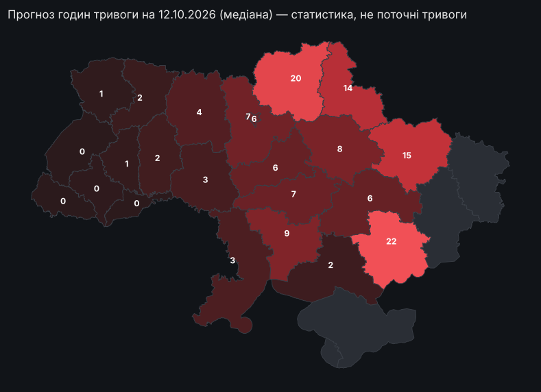

# Air raid alerts: a regime change in Kyiv and an honest forecast

*Short English version. The full project is in Ukrainian: [README.md](README.md),
details in [REPORT.md](REPORT.md).*

Test task, stage 2, KSE Agentic AI School 2026 (October 2026). Author: Toros-Manuk
Petrychenko, 2nd-year Applied Mathematics, KSE. The project analyses air-raid alert time
series and makes a next-day forecast without leakage, in Python. It was built together with
AI agents.

> **Question.** Did the air-raid alert regime in Kyiv change in autumn 2026, and how do you
> honestly forecast daily alert hours when the regime changes?
>
> **Short answer.**
> - **Yes.** Kyiv's regime changed abruptly on **27 Aug 2026**, 10 days before the alert
>   rules changed. Alert hours per day went from **1.7 to 8.1**, mostly through many more
>   separate alerts, which looks like frequent attacks by small groups of drones.
> - **Regional.** The break is strongest in Kyiv and around it.
> - **Hard to forecast.** The honest forecast is a wide interval. For Kyiv the model is only
>   slightly better than "same as yesterday".
>
> **Why this question.** The exact moment of the next alert cannot be predicted. So we look
> at the regime and at alert hours per day, with an uncertainty interval.

**Next-day forecast and map** — [interactive map of Ukraine →](https://torosyasia.github.io/air-alerts-forecast/). It shows a forecast
for every oblast centre, the change after 27 Aug and alert hours over 30 days. These are
statistics and a forecast, not live alerts.

[](https://torosyasia.github.io/air-alerts-forecast/)

<!-- FORECAST_EN:START -->
**Forecast for 12 Oct 2026** (00:00–24:00 Kyiv time), issued as of 00:00 from data up to 2026-10-12 10:46 UTC.

| City | Median, h | 80% interval, h | Alert at 00:00 | Yesterday, h | Test MAE, h | Test coverage |
|---|---|---|---|---|---|---|
| Kyiv | **6.2** | 2.2 – 11.0 | no | 5.4 | 4.22 | 71% |
| Kharkiv | **15.3** | 6.8 – 21.6 | yes | 14.7 | 2.44 | 100% |
| Dnipro | **6.0** | 2.0 – 11.6 | yes | 8.4 | 2.29 | 79% |

**How far to trust it.** For Kyiv the model is only slightly better than the best simple baseline (4.2 vs 4.3 h mean error), so read the interval, not the point. This is a statistical forecast, not a threat warning.
<!-- FORECAST_EN:END -->

| Key numbers (data snapshot 12 Oct 2026, last full day 11 Oct) | |
|---|---|
| Kyiv alert hours per day: 60 days before → after 27 Aug | **1.70 → 8.09** |
| Separate alerts per day | 2.1 → 7.3 (about 80% of the rise in hours) |
| Alert hours per day right after the break (27 Aug – 5 Sep, before the reform) | Kyiv 1.7 → 9.4, Bila Tserkva 1.1 → 6.7, Cherkasy 2.4 → 10.0, and the jump holds; the west grew from a tiny base, mostly after 6 Sep; Kharkiv 18.5 → 17.6 |
| Kyiv since 6 Sep: yellow (drone) level | 7.1 of 7.7 alert hours per day (~92%) |
| October vs September (11 days) | significantly more alerts only in Dnipro and Rivne, out of 23 cities; no wider wave detected |
| Forecast, 23 cities: shared model vs best simple baseline | mean error 2.14 vs 2.31 h; interval score 10.75 vs 10.50; coverage 0.82 |
| Kyiv: model vs "same as yesterday" | 4.22 vs 4.29 h |

**The model in two steps.**
- **v1:** separate models for 3 cities. For Kyiv it was no better than "same as yesterday",
  and its median was too low by 2.5 h on average, with only 32 days of the new regime.
- **v2:** one shared model for 23 cities with a per-city base level, trained on 626 new-regime
  city-days. Its main gain is honest intervals: coverage 0.82 against 0.71 for separate
  models, at almost the same mean error (2.14 vs 2.10 h).
- **Kyiv.** v2 is slightly better than the best simple baseline: 4.22 vs 4.29 h. That is a
  noise-sized gap on 14 days.

A global model makes sense here: there are many series, each with little history of the new
regime. By mean error it beats the best simple baseline in 11 of 23 cities, mostly in the
centre and the rear (Dnipro 2.29 vs 2.92 h). It loses on the front (Chernihiv 3.28 vs 2.07 h),
where "same as yesterday" is almost perfect.

**Why it matters.**
- **For the city.** Under resolution No 1092, at the yellow level businesses may keep working
  if they have a shelter, and the Kyiv metro runs fully. So in Kyiv these rules now cover
  ~92% of alert time.
- **For forecasting.** Models trained on one city's history break exactly at a regime
  change. A shared model over many cities gave more honest intervals. The next step is
  detecting the change fast.
- **For data.** The open dataset of the official channel silently stopped after 7 Sep, and
  the channel had an outage on 29 Aug – 2 Sep. Volunteer data missed long alerts. We built a
  checked series from three cross-validated sources.

**How it was done: a human + AI agents.**
- **Who did what.** Toros set the question and the rules, approved every checkpoint and
  merged every PR. Claude Code wrote the code and the analysis.
- **Rules set in advance:** no synthetic data, a strict leakage definition, a decision log,
  one commit per step.
- **Four independent checker agents** reviewed the repository without seeing the process:
  - a **reviewer** checked ~170 numbers;
  - a **reproducer** ran everything from a clean clone; results are bit-identical;
  - a **devil's advocate** refuted the claim "the break is Kyiv-only";
  - a **leak hunter** found a real, small leak, which was fixed test-first.

  Details: [agents/](agents/README.md); the human–AI chat log goes to [ai_log/](ai_log/).

**Run it** (Python 3.13):
```bash
python -m venv .venv && .venv/bin/pip install -r requirements.txt
.venv/bin/python run_all.py            # reproduce the pinned snapshot (~12 min); --latest for fresh data
.venv/bin/python -m pytest             # tests on real data
```
Step by step: [REPORT §10](REPORT.md#10-як-відтворити). Every result file: [results/README.md](results/README.md).
