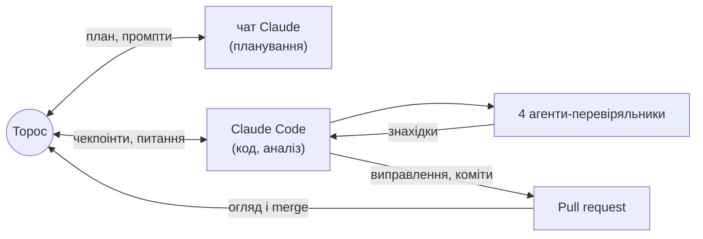

# Повітряні тривоги: злам режиму в Києві і чесний прогноз

**English version:** [README.en.md](README.en.md)

Це тестове завдання 2 етапу KSE Agentic AI School 2026 (жовтень 2026). Виконав
Торос-Манук Петриченко, 2 курс прикладної математики KSE.
- **Що зроблено:** аналіз часових рядів повітряних тривог і прогноз годин тривоги на
  наступну добу без leakage, на Python.
- **Як:** разом з AI-агентами — як саме, описано в розділі
  [«Як це зроблено: людина + AI-агенти»](#як-це-зроблено-людина--ai-агенти).

> **Питання.** Чи змінився восени 2026 року режим повітряних тривог у Києві, і як чесно
> прогнозувати добові години тривоги, коли режим змінюється?
>
> **Коротка відповідь.**
> - **Так, змінився.** Різко, **27.08.2026**, за 10 днів до зміни правил оголошення
>   тривог 06.09. Годин тривоги на добу стало вчетверо більше: **1.7 → 8.0**.
> - **Це не лише Київ.** Того ж дня зросли тривоги в сусідніх областях, а не по всій
>   країні.
> - **Схоже на тактику.** Тривог стало значно більше, і вони часті — це схоже на часті
>   атаки малими групами дронів.
> - **Прогнозувати такий режим важко.** Чесний прогноз — це широкий інтервал. Для Києва
>   модель не краща за простий прогноз «як учора».
>
> **Чому саме таке питання.** Точний момент наступної тривоги передбачити неможливо.
> Тому ми дивимось на режим і на кількість годин тривоги за добу, з інтервалом
> невизначеності.

**Одним поглядом**

| | |
|---|---|
| **Дані** | 16.03.2022 – 09.10.2026. Три джерела офіційних тривог: KMDA (data.gov.ua), канал @air_alert_ua, alerts.in.ua. Звірені між собою на днях, де перекриваються; пропуски не заповнювались |
| **Міста** | **Київ** — головне місто: злам і прогноз. **Харків, Дніпро** — прогноз і контроль. **Львів** — лише описово. Плюс області довкола Києва для перевірки, чи злам регіональний |
| **Що зроблено** | Ціль — години тривоги за добу. Пошук точки зламу (байєсівська модель). Механізм: більше тривог чи довші. Прогноз на наступну добу о 00:00 з 80% інтервалом. Чесна оцінка на днях, яких модель не бачила, проти 5 простих прогнозів |
| **Перевірка** | 57 тестів на реальних даних, зокрема на leakage. 4 незалежні AI-агенти-перевіряльники: рецензент, відтворювач, адвокат диявола, мисливець за витоками |

**Зміст**
1. [Що ми з'ясували](#що-ми-зясували)
2. [Навіщо це](#навіщо-це)
3. [Прогноз на наступну добу](#прогноз-на-наступну-добу)
4. [Як це зроблено: людина + AI-агенти](#як-це-зроблено-людина--ai-агенти)
5. [Як запустити](#як-запустити)
6. [Що далі](#що-далі)
7. [Дані, файли і структура](#дані-файли-і-структура)

## Що ми з'ясували
Числа — для зафіксованого знімка даних 10.10.2026. Докази, статистичні тести й
перевірки на стійкість — у [REPORT.md](REPORT.md#4-висновки-з-доказами).


1. **Злам різкий і стався до реформи.** Режим змінився за один день, 27.08, за 10 днів до
   нових правил оголошення тривог (06.09). Годин тривоги на добу: **1.7 → 8.0**. Ту саму дату
   дають і незалежні дані офіційного каналу.
2. **Тривог стало більше, а не довших.** Окремих тривог на добу: **2.1 → 7.2**; типова
   тривалість 27 → 37 хв. Близько 80% зростання годин дала кількість.
3. **Злам регіональний.** Того ж 27.08 різко зросли тривоги в Київській, Черкаській і
   Вінницькій областях (годин ≈ ×3.5), а в Чернігівській і Полтавській — ні
   ([графік](figures/README.md#9-чи-змінився-2708-лише-київ)).
4. **Це дрони, і вони йдуть хвилями.**
   - Після реформи **~92%** київських годин тривоги — жовтий рівень, «Дронова небезпека».
   - Рівень змінюється хвилями на тиждень-два, а в межах доби тривоги йдуть пачками. Це
     схоже на часті атаки малими групами дронів (дронів ми не бачимо, лише тривоги).
5. **Прогнозувати такий режим важко.**
   - Для Києва модель не краща за «як учора»: помилка 4.8 проти 4.3 год. Її медіана
     занижена: факт був вищим у 10 з 14 днів.
   - Для трьох міст разом модель трохи краща, але в межах шуму
     ([по містах](REPORT.md#6-прогноз-результати-по-містах)).

## Навіщо це
- **Для міста.**
  - З 06.09 Київ у середньому **7.6 год на добу під тривогою**, з них **7.0 год — жовтий
    рівень**, лише 0.6 год — червоний.
  - За [постановою КМУ № 1092](https://jurliga.ligazakon.net/news/246063_povtryan-trivogi-podlyat-na-dva-rvn-yak-zmozhe-pratsyuvati-bznes)
    за жовтого рівня бізнес може працювати, якщо є укриття, а метро працює повноцінно. За
    червоного — [зупинка й укриття](https://news.dtkt.ua/society/economics/114347-robota-biznesu-pri-zovtomu-rivni-trivogi-ta-novi-pravila-dlia-transportu-postanova-kmu-1092-dije-z-4-veresnia).
  - Тож у Києві правила жовтого рівня стосуються ~92% часу тривог.
- **Для прогнозування.** Модель, навчена на історії, ламається саме на зміні режиму. Тому
  важливо швидко помічати зміну і чесно показувати широкий інтервал.
- **Для даних.**
  - Відкритий датасет офіційного каналу мовчки перестав поповнюватись після 07.09.
  - Канал мав збій 29.08–02.09.
  - Волонтерські дані губили довгі тривоги.

  Ми зібрали перевірений ряд із трьох звірених джерел
  ([REPORT §2](REPORT.md#2-дані-та-їх-перевірка)).

## Прогноз на наступну добу
Блок оновлює `run_all.py`.

<!-- FORECAST:START -->
**Прогноз на 12.10.2026** (доба 00:00–24:00 за Києвом), зроблений станом на 12.10 00:00 з даних до 2026-10-12 10:46 UTC. Модель — квантильна регресія на всій історії: серед варіантів у неї найменший interval score на валідації.

| Місто | Медіана, год | 80% інтервал, год | Тривога о 00:00 | Учора, год | Середнє за 7 днів, год | MAE моделі на тесті | Покриття на тесті |
|---|---|---|---|---|---|---|---|
| Київ | **4.9** | 0.0 – 11.4 | ні | 5.4 | 8.0 | 4.30 | 79% |
| Харків | **15.5** | 9.6 – 20.1 | так | 14.7 | 15.3 | 2.38 | 86% |
| Дніпро | **6.4** | 3.5 – 9.9 | так | 8.4 | 6.7 | 2.36 | 79% |

**Наскільки цьому вірити.** На тесті 80% інтервал накрив факт у 79%–86% днів, а медіана помилялась у середньому на 2.4–4.3 год. Для Києва модель не краща за найкращий простий прогноз (4.3 проти 4.3 год), а її медіана занижена: у середньому факт вищий на 2.5 год (вищий у 9 з 14 днів). Тож для Києва дивіться на інтервал, а не на точну цифру; це статистика, а не попередження про загрозу. Файл: [`results/forecast_next_day.csv`](results/forecast_next_day.csv).
<!-- FORECAST:END -->

## Як це зроблено: людина + AI-агенти
- **Ролі.** Торос поставив питання і правила, з окремим чатом Claude готував план і
  найважчі промпти, погоджував кожен чекпоінт і мерджив PR. Claude Code писав код,
  рахував і комітив.
- **Правила наперед:** жодних вигаданих даних, точне означення leakage, чекпоінти,
  [DECISIONS.md](DECISIONS.md), окремий коміт на крок.
- **Чотири незалежні агенти-перевіряльники** бачили лише репозиторій, а не процес:

| Агент | Що робив | Що знайшов |
|---|---|---|
| [Рецензент](agents/reviewer.md) | звірив ~170 чисел із файлами | подвійне округлення в коді, неточну дату, 10 висновків сильніших за докази |
| [Відтворювач](agents/reproducer.md) | запуск із чистого клону | закріплений запуск відтворюється бітово; `--latest` ламав тест і плодив дублі знімка |
| [Адвокат диявола](agents/devils_advocate.md) | альтернативні пояснення кожного висновку, перевірені кодом | **спростував «злам лише київський»**: сусідні області теж зросли 27.08; «усі години доби» — наслідок кількості; розкид між днями — хвилі, а не пачки |
| [Мисливець за витоками](agents/leak_hunter.md) | шукав будь-який шлях із майбутнього в прогноз | **справжній витік:** день перемикання Києва з KMDA на alerts.in.ua брався з майбутнього (з останнього запису KMDA). Спершу тест, що падає, потім виправлення; на опубліковані числа не вплинуло |

**Де людина змінила результат:**
- KMDA як основне київське джерело;
- волонтерські дані — «перевірено чи здогадка?» → відкинуто;
- дата реформи — 06.09, а не 10.09;
- накладання жовтих і червоних тривог;
- уточнена гіпотеза;
- покриття 0.43 → конформні інтервали;
- події закомічено до аналізу;
- тест на маскування.

**Де Claude виправив сам себе:**
- CV пауз між тривогами;
- збій каналу;
- «пропуск» 6–7.09, який виявився справжньою тишею.



Повна історія — у [agents/README.md](agents/README.md). Повний журнал розмов буде в
`ai_log/` (додамо в понеділок).

## Як запустити
```bash
python -m venv .venv && .venv/bin/pip install -r requirements.txt   # Python 3.13
.venv/bin/python run_all.py            # відтворити знімок (~6 хв); --latest — найсвіжіші дані
.venv/bin/python -m pytest             # тести на реальних даних (~2 хв)
```
Покроково — що робить кожен крок, що перезаписується і що комітити після `--latest` — у
[REPORT §10](REPORT.md#10-як-відтворити).

## Що далі
- **Карта:** інтерактивна карта областей із прогнозом (окремий PR).
- **Поширення тривог:** чи передує тривога в сусідніх областях київській і на скільки
  хвилин.
- **Модель, що швидко помічає зміну режиму** і більше важить свіжі дні.

Решта ідей, а також методи, які розглядали, але не застосували (процес Хокса, HMM, глибокі
моделі), і чому — у [REPORT §9](REPORT.md#9-що-лишилося-на-потім).

## Дані, файли і структура
Київ — офіційна статистика KMDA ([data.gov.ua](https://data.gov.ua/dataset/83eda433-b4d9-47ac-89a0-5868dd4d5ce6)).
Харків, Дніпро, Львів — офіційний канал @air_alert_ua ([датасет Vadimkin](https://github.com/Vadimkin/ukrainian-air-raid-sirens-dataset))
до 07.09, далі — архів alerts.in.ua ([JustJimer](https://github.com/JustJimer/ukraine-air-alert-stats)).

<!-- DATA:START -->
| Джерело | Версія у `data/raw/MANIFEST.json` | Останній запис у даних |
|---|---|---|
| KMDA, data.gov.ua (Київ) | знімок 2026-10-12 | 2026-10-12 05:46 (за Києвом) |
| Офіційний канал @air_alert_ua (датасет Vadimkin) | коміт `7ccd436` | 2026-09-07 05:28 UTC (канал далі не публікує) |
| alerts.in.ua (архів JustJimer) | коміт `c5b3bd0` | 2026-10-12 10:46 UTC |

Остання повна доба в аналізі: **11.10.2026**.
<!-- DATA:END -->

| Що | Де |
|---|---|
| Усі деталі: дані, метод, висновки з доказами, результати по містах, факти, обмеження | [REPORT.md](REPORT.md) |
| Кожен графік: питання, осі, висновок, обмеження | [figures/README.md](figures/README.md) |
| Терміни простими словами з формулами | [docs/GLOSSARY.md](docs/GLOSSARY.md) |
| Чому зроблено саме так | [DECISIONS.md](DECISIONS.md) |
| Як працювали AI-агенти | [agents/](agents/README.md) |
| Таблиці результатів | [results/](results/), [reports/](reports/) |

```
├── README.md                коротко: відповідь, головне, прогноз, як зроблено
├── README.en.md             коротка англійська версія
├── REPORT.md                усі деталі й докази
├── DECISIONS.md             рішення з обґрунтуванням (D-01 … D-21) і журнал виправлень
├── run_all.py               одна команда: дані → ціль → ознаки → оцінка → моделі → аналіз → графіки → README/REPORT
├── requirements.txt         фіксовані версії
├── airalerts/               код: джерела, ціль, ознаки о 00:00, baselines, моделі, злам, події, графіки
├── tests/                   тести на реальних даних: ціль, leakage, оцінка, моделі, режими, вихідні файли
├── agents/                  чотири агенти-перевіряльники: роль, промпт, знахідки, коміти
├── docs/GLOSSARY.md         глосарій
├── data/raw/                MANIFEST.json (коміти й sha256 джерел) + знімок KMDA
├── data/events/             події з посиланнями (закомічено до аналізу)
├── results/                 малі CSV: ціль по днях, метрики, прогноз, злами, факти
├── reports/                 згенеровані звіти з таблицями
└── figures/                 графіки + README з поясненням кожного
```
