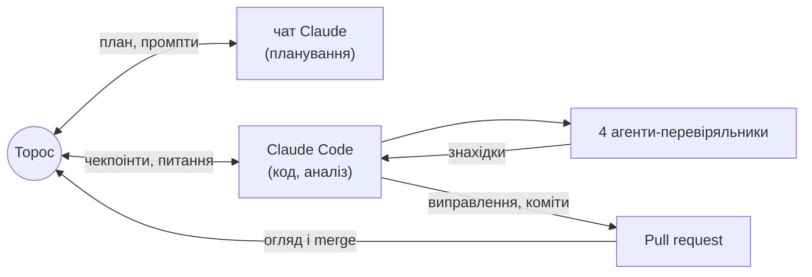

# Повітряні тривоги: злам режиму в Києві і чесний прогноз

**Так, режим змінився.** У Києві режим повітряних тривог змінився різко **27.08.2026**, за
10 днів до зміни правил оголошення тривог (06.09). Годин тривоги на добу стало вчетверо
більше: **1.7 → 8.0**.


## Головне
Числа нижче — для зафіксованого знімка даних 10.10.2026; деталі й докази — у [REPORT.md](REPORT.md).

1. **Злам різкий і стався до реформи.** Байєсівська модель з однією точкою зламу
   називає найімовірнішим днем 27.08 (імовірність 0.71). Імовірність, що злам стався до
   06.09, — 1.00. Тож зростання дала не зміна правил оголошення.
2. **Тривог стало більше, а не лише довших.**
   - Кількість: 2.1 → 7.2 тривоги на добу (×3.5).
   - Медіанна тривалість: 27 → 37 хв.
   - ~80% зростання годин дала кількість.
   - Тривоги йдуть пачками в межах доби.
   - Після реформи 87–92% годин — жовтий рівень, а він у KMDA означає рівно «Дронова
     небезпека».

   Це узгоджується з тактикою частих атак малими групами дронів, про яку пише
   [Texty](https://texty.org.ua/articles/118339/shaxed-za-shaxedom-yak-reaktyvni-drony-zupynyayut-kyyiv/).
   Але ми бачимо тривоги, а не дрони.
3. **Злам регіональний: Київ і області довкола, а не вся країна.** Того ж 27.08 різко
   зросли тривоги в Київській (годин ×3.5), Черкаській (×3.4) і Вінницькій (×3.6)
   областях. У Чернігівській і Полтавській тривог не побільшало. Харків і Дніпро без
   чіткого зламу, але як контроль вони слабкі: Харків і так під тривогою 77% часу. Спершу
   ми писали «злам лише київський», і агент
   [«адвокат диявола»](agents/devils_advocate.md) це спростував
   ([fig9](figures/README.md#9-чи-змінився-2708-лише-київ)).
4. **Чесний прогноз у новому режимі — широкий інтервал.** Рівень у Києві йде хвилями на
   тиждень-два, а модель бачить хвилю, лише коли та вже почалась. Модель (квантильна
   регресія) **для Києва не краща за простий прогноз «як учора»**:
   - середня помилка 4.8 проти 4.3 год;
   - на знімку 11.10 вона програє вже за всіма метриками;
   - її медіана занижена: факт був вищим у 10 з 14 тестових днів, бо модель навчилась
     здебільшого на старому, спокійнішому режимі.

   На трьох містах разом модель трохи краща за найкращий простий прогноз, але ця перевага
   в межах шуму: 95% bootstrap-інтервал різниці містить 0. Цінність проєкту — у знайденому
   зламі, механізмі й чесній оцінці, а не в перемозі моделі.

## Прогноз на наступну добу
Блок оновлює `run_all.py`.

<!-- FORECAST:START -->
**Прогноз на 10.10.2026** (доба 00:00–24:00 за Києвом), зроблений станом на 10.10 00:00 з даних до 2026-10-10 09:50 UTC. Модель — квантильна регресія на всій історії: серед варіантів у неї найменший interval score на валідації.

| Місто | Медіана, год | 80% інтервал, год | Тривога о 00:00 | Учора, год | Середнє за 7 днів, год | MAE моделі на тесті | Покриття на тесті |
|---|---|---|---|---|---|---|---|
| Київ | **4.4** | 0.0 – 11.9 | ні | 11.9 | 6.3 | 4.82 | 79% |
| Харків | **13.1** | 7.9 – 17.6 | так | 7.1 | 16.4 | 2.69 | 86% |
| Дніпро | **5.4** | 2.3 – 8.0 | ні | 9.2 | 5.0 | 2.28 | 79% |

**Наскільки цьому вірити.** На тесті 80% інтервал накрив факт у 79%–86% днів, а середня помилка медіани — 2.3–4.8 год. Для Києва це 4.8 год, а в найкращого простого прогнозу (baseline) — 4.3 год, тобто модель там не краща за простий прогноз. До того ж київська медіана занижена: на тесті факт був вищим за неї в 10 з 14 днів, бо модель навчена здебільшого на старому, спокійнішому режимі. Київський прогноз — орієнтир рівня, а не точна цифра: інтервал широкий, бо рівень у Києві йде хвилями на тиждень-два, а тривоги в межах доби — пачками. Це статистика, а не попередження про загрозу. Файл: [`results/forecast_next_day.csv`](results/forecast_next_day.csv).
<!-- FORECAST:END -->

## Як це зроблено: людина + AI-агенти
Проєкт зробили разом людина й AI.
- **Ролі.**
  - Торос (автор) з окремим чатом Claude готував план і найважчі промпти.
  - Claude Code писав код, рахував і комітив.
  - Торос погоджував кожен чекпоінт і мерджив PR.
- **Правила наперед:**
  - жодних вигаданих чи домальованих даних;
  - точне означення leakage;
  - чекпоінти;
  - [DECISIONS.md](DECISIONS.md) з кожним рішенням;
  - окремий коміт на кожен крок.
- **Чотири незалежні агенти-перевіряльники.** Жоден не бачив процесу, тільки репозиторій.

| Агент | Що робив | Що знайшов |
|---|---|---|
| [Рецензент](agents/reviewer.md) | звірив ~170 чисел із файлами | подвійне округлення в коді, неточну дату, 10 висновків сильніших за докази |
| [Відтворювач](agents/reproducer.md) | запуск із чистого клону | закріплений запуск відтворюється бітово; `--latest` ламав тест і плодив дублі знімка |
| [Адвокат диявола](agents/devils_advocate.md) | альтернативні пояснення кожного висновку, перевірені кодом | **спростував «злам лише київський»**: сусідні області теж зросли 27.08; «усі години доби» — наслідок кількості; розкид між днями — хвилі, а не пачки |
| [Мисливець за витоками](agents/leak_hunter.md) | шукав будь-який шлях із майбутнього в прогноз | див. файл агента |

**Де втручання людини змінило результат:**
- KMDA як основне київське джерело;
- перевірка, «перевірено чи здогадка», про волонтерські дані — їх відкинули;
- дата реформи 06.09, а не 10.09;
- накладання жовтих і червоних тривог рахується один раз;
- уточнена гіпотеза про механізм;
- покриття 0.43 → конформні інтервали;
- список подій закомічено до аналізу;
- дірка в перевірці контрольних міст → тест на маскування.

**Де Claude виправив сам себе:** CV пауз між тривогами, збій офіційного каналу, «пропуск» у
Києві 6–7.09, який виявився справжньою тишею.



Повна історія — у [agents/README.md](agents/README.md). Повний журнал розмов буде в
`ai_log/` (додамо в понеділок).

## Дані
- **Київ:** офіційна статистика KMDA ([data.gov.ua](https://data.gov.ua/dataset/83eda433-b4d9-47ac-89a0-5868dd4d5ce6)),
  єдиний ряд по обидва боки реформи.
- **Харків, Дніпро, Львів:** офіційний канал @air_alert_ua
  ([датасет Vadimkin](https://github.com/Vadimkin/ukrainian-air-raid-sirens-dataset)) до
  07.09, далі — архів alerts.in.ua ([JustJimer](https://github.com/JustJimer/ukraine-air-alert-stats)).

Пропуски не заповнювались. Склейку джерел перевірено на днях, де вони перекриваються
([REPORT §2](REPORT.md#2-дані-та-їх-перевірка)).

<!-- DATA:START -->
| Джерело | Версія у `data/raw/MANIFEST.json` | Останній запис у даних |
|---|---|---|
| KMDA, data.gov.ua (Київ) | знімок 2026-10-10 | 2026-10-04 23:32 (за Києвом) |
| Офіційний канал @air_alert_ua (датасет Vadimkin) | коміт `7ccd436` | 2026-09-07 05:28 UTC (канал далі не публікує) |
| alerts.in.ua (архів JustJimer) | коміт `3b0e7f1` | 2026-10-10 09:50 UTC |

Остання повна доба в аналізі: **09.10.2026**.
<!-- DATA:END -->

## Як запустити
Python 3.13 (перевірено на 3.13.16); усі версії залежностей зафіксовано в [`requirements.txt`](requirements.txt).
```bash
python -m venv .venv && .venv/bin/pip install -r requirements.txt
.venv/bin/python run_all.py            # відтворити знімок (~6 хв); --latest — найсвіжіші дані
.venv/bin/python -m pytest             # тести на реальних даних
```
Що робить `--latest` і що після нього комітити — у [REPORT §10](REPORT.md#10-як-відтворити).

## Де що
| Що | Де |
|---|---|
| Усі деталі: дані, метод, висновки з доказами, результати по містах, факти, обмеження | [REPORT.md](REPORT.md) |
| Кожен графік: питання, осі, висновок, обмеження | [figures/README.md](figures/README.md) |
| Терміни простими словами з формулами | [docs/GLOSSARY.md](docs/GLOSSARY.md) |
| Чому зроблено саме так | [DECISIONS.md](DECISIONS.md) |
| Як працювали AI-агенти | [agents/](agents/README.md) |
| Таблиці результатів | [results/](results/), [reports/](reports/) |

```
├── README.md                коротко: відповідь, головне, прогноз, як зроблено
├── REPORT.md                усі деталі й докази
├── DECISIONS.md             рішення з обґрунтуванням (D-01 … D-21) і журнал виправлень
├── run_all.py               одна команда: дані → ціль → ознаки → оцінка → моделі → аналіз → графіки → README/REPORT
├── requirements.txt         фіксовані версії
├── airalerts/               код: джерела, ціль, ознаки о 00:00, baselines, моделі, злам, події, графіки
├── tests/                   тести на реальних даних: ціль, leakage, оцінка, моделі, режими, вихідні файли
├── agents/                  чотири агенти-перевіряльники: роль, промпт, знахідки, коміти
├── docs/GLOSSARY.md         глосарій
├── data/raw/                MANIFEST.json (коміти й sha256 джерел) + знімок KMDA
├── data/events/             події з посиланнями (закомічено до аналізу)
├── results/                 малі CSV: ціль по днях, метрики, прогноз, злами, факти
├── reports/                 згенеровані звіти з таблицями
└── figures/                 графіки + README з поясненням кожного
```
