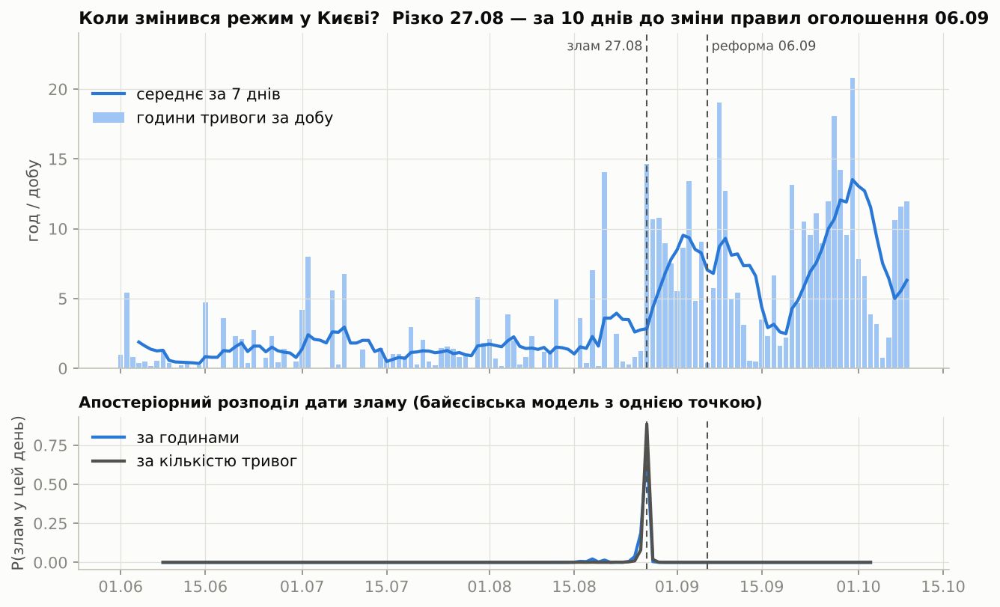
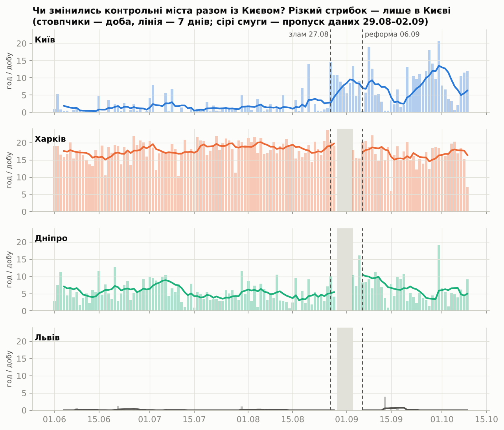
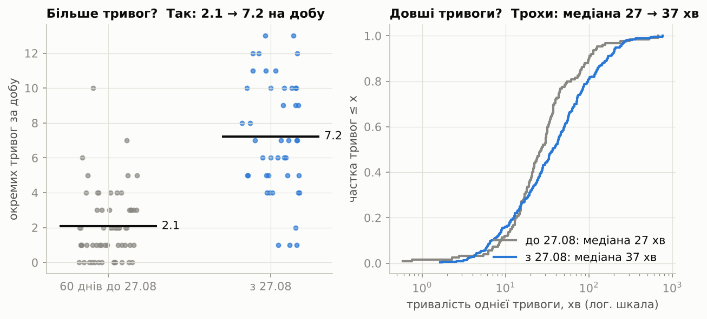
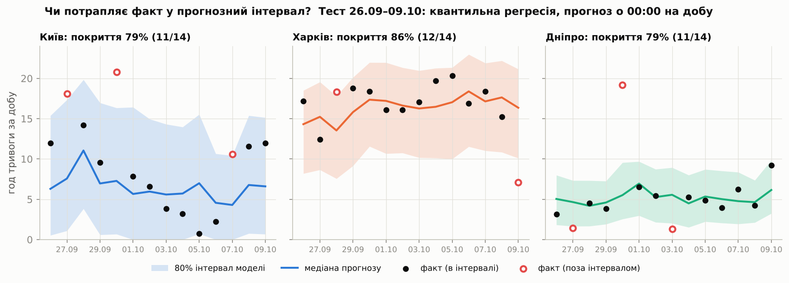
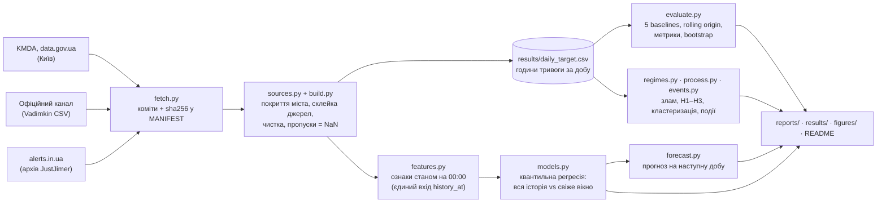

# Повітряні тривоги: злам режиму в Києві і чесний прогноз

**Питання.** Чи змінився режим повітряних тривог у Києві восени 2026 року — і як чесно
прогнозувати добові години тривоги, коли режим змінюється?

**Коротко** (знімок даних 10.10.2026, остання повна доба 09.10).
- У Києві режим змінився **різко 27.08.2026**, за 10 днів до зміни правил оголошення
  тривог (06.09). Головне — тривог стало **більше** (2.1 → 7.2 на добу) і вони
  стали частими **в усі години доби**. Тривалість кожної зросла лише помірно.
- **Різкий і стійкий злам — лише в Києві** (локальна, київська зміна). У Харкові й
  Дніпрі чіткого зламу немає, хоча через пропуск даних 29.08–02.09 короткого сплеску там
  виключити не можна. Харків помірно змінився: тривог +21%, але коротші, і годин менше.
- **Прогноз «на завтра».** Квантильна регресія на тесті краща за найкращий baseline за
  MAE і за interval score, а покриття 80% інтервалу — 0.81. Але перевага в межах шуму:
  bootstrap-інтервали різниць містять 0. Для Києва інтервали широкі, бо тривоги
  кластеризуються.

Прогноз для Києва, Харкова і Дніпра; Львів — лише в описовому порівнянні.

## Зміст
- [Прогноз на наступну добу](#прогноз-на-наступну-добу)
- [Головні висновки](#головні-висновки)
- [Ключові графіки](#ключові-графіки)
- [Цікаві факти з даних](#цікаві-факти-з-даних)
- [Дані](#дані)
- [Метод](#метод)
- [Результати прогнозу](#результати-прогнозу)
- [Обмеження](#обмеження)
- [Як запустити](#як-запустити)
- [Структура репозиторію](#структура-репозиторію)

## Прогноз на наступну добу
Цей блок і блок дат даних нижче перегенеровує `run_all.py`. Режим `--latest` спершу
завантажує найсвіжіші дані.

<!-- FORECAST:START -->
**Прогноз на 10.10.2026** (доба 00:00–24:00 за Києвом), зроблений станом на 10.10 00:00 з даних до 2026-10-10 09:50 UTC. Модель — `qr_full__with_midnight` (найменший interval score на валідації серед варіантів квантильної регресії).

| Місто | Медіана, год | 80% інтервал, год | Тривога о 00:00 | Учора, год | Середнє за 7 днів, год | MAE моделі на тесті | Покриття на тесті |
|---|---|---|---|---|---|---|---|
| Київ | **4.4** | 0.0 – 11.9 | ні | 11.9 | 6.3 | 4.82 | 79% |
| Харків | **13.1** | 7.9 – 17.6 | так | 7.1 | 16.4 | 2.69 | 86% |
| Дніпро | **5.4** | 2.3 – 8.0 | ні | 9.2 | 5.0 | 2.28 | 79% |

Інтервал широкий, бо київські дні мінливі й кластеризуються (розширення 1). Це статистичний прогноз, а не попередження про загрозу. Файл: [`results/forecast_next_day.csv`](results/forecast_next_day.csv).
<!-- FORECAST:END -->

## Головні висновки
| Твердження | Доказ |
|---|---|
| У Києві є злам режиму, і стався він **27.08.2026** — до зміни правил 06.09 | Байєсівська модель з однією точкою зламу: найімовірніший день 27.08 (P = 0.71 за годинами, 0.89 за кількістю); 95% HPD-набір — 18.08 і 25–27.08 (години), 26–27.08 (кількість); P(злам до 06.09) = 1.000 ([fig1](figures/README.md#1-коли-змінився-режим-у-києві)) |
| Зросла насамперед **кількість** тривог | 60 днів до 27.08 проти після: 2.08 → 7.23 тривоги на добу (×3.5), години 1.70 → 8.04 (×4.7); ~80% зростання дала кількість, ~20% — тривалість ([fig3](figures/README.md#3-більше-тривог-чи-довші-тривоги)) |
| Тривоги стали частими **в усі години доби** | Днів із тривогами у ≥ 3 з 4 шестигодинних блоків: 17% → 84% (значною мірою наслідок того, що тривог більше); частка нічних годин 47% → 23%. Але розподіл стартів по блоках доби значуще не змінився (χ², p = 0.13): і до зламу 64% стартів були вдень ([fig4](figures/README.md#4-як-змінився-добовий-ритм-києва), [fig5](figures/README.md#5-нічні-чи-денні-тривоги--по-містах)) |
| Після реформи переважають **дронові** тривоги | Жовтих годин 91.6%, червоних 8.3%; у KMDA 168 з 170 дронових записів — «Дронова небезпека», лише 2 — «Масована дронова загроза» |
| Злам **локальний (київський)**: різкий і стійкий лише в Києві | Харків: чіткого зламу немає (log10 BF 0.9 / −1.3), але помірні зміни є — тривог +21% (p = 0.003), вони коротші, годин 18.5 → 16.7 (p = 0.002). Дніпро: дані за «без зламу» (log10 BF −1.6 / −1.7). Львів: формальний злам 18.09 (log10 BF 5.0), але це падіння 0.10 → 0 год/добу ([fig2](figures/README.md#2-чи-змінились-контрольні-міста-разом-із-києвом)) |
| Київські тривоги **кластеризуються**, тому прогноз важкий | Дисперсія/середнє денної кількості 1.51 (p = 0.018), CV пауз між тривогами 1.50; для незалежних подій обидва = 1. Частину надмірної дисперсії може давати й зміна інтенсивності в межах періоду ([fig7](figures/README.md#7-чому-київ-важко-прогнозувати-пуассон-чи-кластеризація)) |
| Надлишку тривог навколо свят, переговорів і ударів по РФ **не виявлено** | Перестановковий тест із локальними плацебо: жодне p < 0.05 з 15; Київ +0.13 год/добу (95% смуга плацебо −0.26…+0.50). Смуги широкі — менші ефекти тест не побачив би ([fig8](figures/README.md#8-чи-більше-тривог-навколо-свят-переговорів-і-ударів)) |

Новини описують ту саму тактику. За
[Texty, 24.09](https://texty.org.ua/articles/118339/shaxed-za-shaxedom-yak-reaktyvni-drony-zupynyayut-kyyiv/),
з середини серпня атакують реактивні «шахеди», «поодинокі дрони і невеликі групи, розтягнуті
в часі». [Телеграф](https://news.telegraf.com.ua/ukr/ukraina/5948850-chetvertye-sutki-vzryvov-kak-shakhedy-letyat-na-kiev-i-skolko-uzhe-bylo-trevog-infografika)
називає 13, 12, 10 і 11 тривог 27–30.08 — рівно стільки ж епізодів і в наших даних.

> **Застереження до «злам лише в Києві».** Для Харкова і Дніпра немає даних за 29.08–02.09
> (збій офіційного каналу, [D-06a](DECISIONS.md)) — це перший тиждень після київського
> зламу.
> - **Що тримається.** Стрибка київського масштабу там немає: якщо вирізати ті самі
>   5 днів із київського ряду, метод однаково знаходить 27.08 (log10 BF = 12.4).
> - **Що не тримається.** Ми не можемо виключити короткого сплеску (≤ 5 днів) саме в ці
>   дні. Помірного зростання в Дніпрі (≈ +25–35%, p = 0.10) теж не можемо виключити.

**Як читати байєсівські числа.**
- **Апостеріорний розподіл дати зламу** — для кожного дня ймовірність, що новий режим
  почався саме тоді.
- **log10 BF** — у скільки разів (10^x) дані ймовірніші за моделі «є один злам», ніж за
  моделі «зламу немає». Понад 2 — рішучий доказ; близько 0 — не розрізнити; менше 0 — за
  «без зламу».
- Київське значення 14 буквально не читаємо. Модель вважає дні незалежними, а вони
  кластеризуються, тож впевненість роздута. Правильне прочитання — «доказ величезний і
  стійкий».

## Ключові графіки
Тут чотири графіки, які несуть головну думку. Усі вісім — з поясненням осей,
висновком і обмеженнями — у [figures/README.md](figures/README.md).

**1. Коли змінився режим у Києві?** Різко 27.08, за 10 днів до реформи. Унизу — розподіл
ймовірності дати зламу.


**2. Чи змінились контрольні міста?** Різкий стійкий стрибок — лише в Києві. Сірим
позначено пропуск даних.


**3. Більше тривог чи довші?** Насамперед більше.


**4. Чи потрапляє факт у прогнозний інтервал?** Тест 26.09–09.10: Київ 11/14, Харків 12/14, Дніпро 11/14.


Інші графіки: [добовий ритм Києва](figures/README.md#4-як-змінився-добовий-ритм-києва) ·
[ніч і день по містах](figures/README.md#5-нічні-чи-денні-тривоги--по-містах) ·
[Пуассон чи кластеризація](figures/README.md#7-чому-київ-важко-прогнозувати-пуассон-чи-кластеризація) ·
[тривоги навколо подій](figures/README.md#8-чи-більше-тривог-навколо-свят-переговорів-і-ударів).

## Цікаві факти з даних
Факти пораховано після всіх чисток: дублі об'єднано, дні збою каналу пропущено,
домальовані кінці тривог викинуто. «Тривога» тут — це епізод: накладені записи
області, району й міста рахуються один раз. Таблицю перегенеровує `run_all.py`; деталі —
[`results/city_facts.csv`](results/city_facts.csv).

<!-- FACTS:START -->
| | Київ | Харків | Дніпро | Львів |
|---|---|---|---|---|
| Тривог (епізодів) з 16.03.2022 | 2 520 | 9 551 | 7 566 | 842 |
| Годин під тривогою | 2 893 | 14 759 | 7 764 | 902 |
| Частка часу під тривогою, усього | 7% | 37% | 19% | 2% |
| … у 2022 (з 16.03) | 7% | 19% | 13% | 4% |
| … у 2023 | 5% | 15% | 14% | 3% |
| … у 2024 | 6% | 45% | 22% | 2% |
| … у 2025 | 8% | 44% | 25% | 2% |
| … у 2026 (до останньої доби) | 10% | 65% | 24% | 1% |
| Днів без жодної тривоги | 29% | <1% | 1% | 64% |
| Медіанна тривалість тривоги | 37 хв | 45 хв | 34 хв | 43 хв |
| Найдовша тривога | 12.7 год (29.09.2026) | 50.5 год (23.07.2024) | 15.1 год (31.05.2025) | 6.1 год (07.02.2026) |
| Найдовша тиша | 15.5 доби (з 02.10.2023) | 2.3 доби (з 20.11.2022) | 3.2 доби (з 08.05.2026) | 28.6 доби (з 29.09.2023) |
| Рекордна доба за годинами | 20.8 год (30.09.2026) | 24.0 год (08.07.2024) | 19.2 год (26.01.2026) | 6.8 год (10.02.2023) |
| Рекордна доба за кількістю тривог | 13 (27.08.2026) | 18 (08.05.2026) | 15 (10.08.2026) | 6 (24.08.2022) |
| Найнапруженіший місяць | 2026-09 (8.1 год/добу) | 2024-07 (20.6 год/добу) | 2025-03 (10.1 год/добу) | 2022-03 (2.0 год/добу) |
<!-- FACTS:END -->

Застереження до порівняння років:
- У другій половині 2025 року тривоги в цих областях перейшли з обласного на районний
  рівень: Харківська — із серпня, Дніпропетровська — поступово з травня по грудень,
  Львівська — у вересні–листопаді (видно з офіційного CSV; про перехід пише й
  [README датасету](https://github.com/Vadimkin/ukrainian-air-raid-sirens-dataset/tree/main/datasets)). Частина «годин під тривогою» до 2026
  року — це тривоги, оголошені через загрозу в іншій частині області.
- «Найдовша тиша» не враховує періоди, що зачіпають пропуск даних 29.08–02.09.2026.
  Через це Львів, де в серпні–вересні 2026 тиша тривала до ~36 днів, показує іншу дату.

## Дані
<!-- DATA:START -->
| Джерело | Версія у `data/raw/MANIFEST.json` | Останній запис у даних |
|---|---|---|
| KMDA, data.gov.ua (Київ) | знімок 2026-10-10 | 2026-10-04 23:32 (за Києвом) |
| Офіційний канал @air_alert_ua (датасет Vadimkin) | коміт `7ccd436` | 2026-09-07 05:28 UTC (канал далі не публікує) |
| alerts.in.ua (архів JustJimer) | коміт `3b0e7f1` | 2026-10-10 09:50 UTC |

Остання повна доба в аналізі: **09.10.2026**.
<!-- DATA:END -->

- **[KMDA на data.gov.ua](https://data.gov.ua/dataset/83eda433-b4d9-47ac-89a0-5868dd4d5ce6)**
  — офіційна статистика тривог саме м. Київ, із рівнем і причиною загрози після 06.09.
  Це єдиний ряд по обидва боки реформи. Він збігається з офіційним каналом (кореляція
  денних годин 0.996) і з alerts.in.ua (MAE 0.014 год).
- **[Vadimkin/ukrainian-air-raid-sirens-dataset](https://github.com/Vadimkin/ukrainian-air-raid-sirens-dataset)**
  — парсинг офіційного Telegram-каналу @air_alert_ua. Історія Харкова, Дніпра і Львова до
  06.09.2026. Публічна стрічка каналу закінчилась 07.09 і мала збій 29.08–02.09.
- **[JustJimer/ukraine-air-alert-stats](https://github.com/JustJimer/ukraine-air-alert-stats)**
  — щоденний архів API alerts.in.ua з рівнями жовтий/червоний. Харків, Дніпро і Львів
  з 07.09; Київ з 04.10 (останню, можливо неповну, добу KMDA теж беремо звідси).
- **Відкинуто:** волонтерський датасет eTryvoga. З 2024 він губить довгі тривоги
  (див. [D-03](DECISIONS.md)).
- **Ціль:** години доби D (00:00–24:00 за Києвом), коли місто покрите хоча б однією
  повітряною тривогою — оголошеною на область, район міста або саме місто. Інтервали
  об'єднуються, а не сумуються.
- **Чистка, склейка, пропуски й перевірки на перекриттях:**
  [reports/data_quality.md](reports/data_quality.md), [DECISIONS.md](DECISIONS.md)
  D-02…D-08. Таблиця цілі по днях: [`results/daily_target.csv`](results/daily_target.csv).
- **Події для аналізу:** [data/events/](data/events/) — список закомічено до аналізу.

## Метод

- **Без leakage.** Прогноз на добу D робиться о 00:00 за Києвом. Ознаки бачать історію
  лише через `features.history_at`:
  - вона відкидає все, що почалось о 00:00 або пізніше;
  - тривогу, що йде о півночі, обрізає на 00:00 — тобто відомий лише факт, що вона йде,
    і її тривалість до 00:00.

  Перевіряється тестами: майбутнє змінюється чотирма способами, а ознаки лишаються
  бітово однаковими; навмисно зсунута на 03:00 відсічка ловиться.
- **Оцінка.**
  - Rolling origin: кожен день прогнозується тільки з минулого, без перемішування.
  - Валідація 08.09–25.09, тест — останні 14 днів (26.09–09.10).
  - Метрики оголошено заздалегідь ([D-11](DECISIONS.md), [D-17](DECISIONS.md)): MAE,
    покриття 80% інтервалу з інтервалом Вілсона, ширина інтервалу, interval score
    (ширина + штраф ×10 за промах), pinball loss.
  - Модель «краща», якщо її MAE і interval score нижчі за найкращий з 5 baselines, а
    покриття близьке до 80%. Невизначеність різниці — блоковий bootstrap.
- **Модель.** Лінійна квантильна регресія (окремо для квантилів 10/50/90%) на лагах,
  середніх, кількості епізодів, ознаці «тривога о 00:00» та годинах за останні 6 год.
  Вся історія проти свіжого вікна. Вікно (84 дні) і саму модель обрано на валідації.
  CQR-калібровку додано лише там, де покриття погане ([D-18](DECISIONS.md)).
  Застереження щодо чистоти вибору:
  - 84 дні — край сітки кандидатів;
  - поріг для CQR зафіксовано після перегляду валідації, а тест рахувався в тому самому
    прогоні;
  - спосіб будувати інтервали baselines змінено, коли їхню тестову таблицю вже було
    видно (рішення ухвалено за валідацією, [D-17a](DECISIONS.md)).
- **Режими.**
  - Байєсівська модель з однією точкою зламу (`regimes.py`).
  - Порівняння «до/після»: кількість, тривалість, розподіл по добі.
  - Пуассон чи кластеризація: індекс дисперсії, паузи між тривогами (`process.py`).
  - Тривоги навколо подій: перестановковий тест із локальними плацебо (`events.py`).

## Результати прогнозу
Таблиці нижче перегенеровує `run_all.py` з `results/metrics_validation_test.csv`. Модель для
прогнозу щоразу обирається на валідації (найменший interval score).

<!-- RESULTS:START -->
Тест **26.09–09.10.2026** (останні 14 повних діб), прогноз о 00:00 на добу, 3 міста разом:

| Метод | MAE, год | Покриття 80% (95% CI) | Ширина, год | Interval score |
|---|---|---|---|---|
| найкращий baseline за MAE (`climatology28`) | 3.55 | 0.86 (0.72–0.93) | 12.08 | 17.16 |
| найкращий baseline за IS (`median7`) | 3.69 | 0.86 (0.72–0.93) | 10.49 | 15.94 |
| **модель, обрана на валідації** (`qr_full__with_midnight`) | 3.27 | 0.81 (0.67–0.90) | 10.58 | 15.19 |
| свіже вікно + CQR (`qr_fresh84__with_midnight+cqr`) | 3.19 | 0.88 (0.75–0.95) | 12.93 | 17.75 |

| Місто | Модель: MAE / IS / покриття | Найкращий baseline: MAE / IS | Модель краща за |
|---|---|---|---|
| Київ | 4.82 / 18.38 / 0.79 | 4.30 (`yesterday`) / 18.60 (`median7`) | interval score |
| Харків | 2.69 / 13.39 / 0.86 | 2.26 (`climatology28`) / 11.80 (`climatology28`) | жодною метрикою |
| Дніпро | 2.28 / 13.80 / 0.79 | 2.56 (`median7`) / 17.09 (`climatology28`) | MAE, interval score |

Різниця «модель − найкращий baseline» (блоковий bootstrap, 95% CI): MAE -0.28 [-0.67, +0.14] (CI містить 0), interval score -0.75 [-3.67, +2.98] (CI містить 0).
<!-- RESULTS:END -->

Висновки для знімка даних 10.10.2026 (тест 26.09–09.10):
- **Чесний вердикт.** На трьох містах разом модель проходить заздалегідь оголошений
  критерій. Те, що оцінюємо саме разом, уточнено вже після: критерій D-11 цього не
  визначав, а по містах він виконується лише для Дніпра. Але 95% bootstrap-інтервали
  різниць містять 0: MAE −0.28 [−0.67, +0.14], interval score −0.75 [−3.67, +2.98]. Тож
  на 14 днях перевага **статистично не доведена**.
- **Свіже вікно** не дає стабільної переваги: на валідації гірше за всю історію.
- **Ознака «тривога о 00:00 і скільки триває»** не покращує MAE, лише трохи звужує
  інтервали: interval score −0.76 [−1.42, −0.34] на тесті, −0.44 [−1.27, +0.10] на
  валідації (там CI містить 0).
- **Межі інтервалів baselines** будуються за конформними рангами, а не вибірковими
  квантилями 10/90%. З 28 точок вибіркові квантилі покривають у середньому лише 74.5%
  ([D-17a](DECISIONS.md)).
- Повні таблиці: [reports/baselines.md](reports/baselines.md),
  [reports/models.md](reports/models.md),
  [`results/metrics_validation_test.csv`](results/metrics_validation_test.csv).

## Обмеження
- **Тривоги ≠ дрони.** «Малі групи дронів» — висновок із патерну (багато коротких
  тривог по всій добі) і з новин, а не з даних про кількість дронів.
- **Малий тест.** 14 днів на місто: 95% інтервал для покриття ±~21 п.п. Довгий бектест
  2025–2026 — інший режим (~1–2 год/добу в Києві), тож його калібровка на осінь не
  переноситься. Він лише в додатку ([reports/baselines.md](reports/baselines.md)).
- **Пропуск 29.08–02.09** у Харкові, Дніпрі й Львові — збій джерела. Не заповнювали, див.
  застереження вище.
- **Дніпро до 06.09.** В офіційному CSV могли бути пропущені тривоги, оголошені лише для
  громади міста. Після 06.09 вони не додавали годин понад районні.
- **«м. Київ» після реформи** тлумачимо як тривогу на все місто. Це спирається на джерела,
  але прямого офіційного документа немає.
- **Тести для статистики.** Манн–Вітні і байєсівська модель вважають дні незалежними,
  тож p-значення і фактори Байєса оптимістичні. Київські ефекти настільки великі, що
  висновок не змінюється.
- **Кластеризація.** Індекс дисперсії > 1 дає не лише «пачковість» тривог, а й зміна
  інтенсивності в межах періоду (наприклад, тихий тиждень 01–06.10). Ці два ефекти не
  розділено.
- **Тривоги навколо подій.** Подій мало (6–18 у групі), список ударів 2026 року — з пошуку
  новин, а не повний.
- **Числа в тексті** описують зафіксований знімок даних 10.10.2026. Після `--latest`
  автоматично оновлюються results/, reports/, figures/ і чотири блоки README: прогноз,
  дати даних, факти, таблиці результатів. Текст висновків і `figures/README.md`
  лишаються для знімка 10.10.2026, доки їх не переглянути вручну.

## Як запустити
Python 3.13 (перевірено на 3.13.16). Усі залежності, включно з транзитивними, мають
фіксовані версії у [`requirements.txt`](requirements.txt).

```bash
python -m venv .venv && .venv/bin/pip install -r requirements.txt
.venv/bin/python run_all.py            # відтворити зафіксований знімок (~5–6 хв; перший раз качає ~45 МБ)
.venv/bin/python run_all.py --latest   # найсвіжіші дані: перезакріпити MANIFEST і перебудувати все
.venv/bin/python -m pytest             # 40+ тестів на реальних даних (~1.5 хв)
```

- **`run_all.py`** — бере версії джерел із
  [`data/raw/MANIFEST.json`](data/raw/MANIFEST.json): точні коміти й sha256, плюс
  закомічений знімок KMDA. Тому числа збігаються з README.
- **`run_all.py --latest`:**
  - визначає поточні коміти джерел (`git ls-remote`) і завантажує KMDA з data.gov.ua як
    новий датований знімок;
  - переписує MANIFEST і перебудовує ціль, моделі, звіти, графіки й блоки README;
  - прогноз робить на першу добу після останньої повної доби в даних. Архів alerts.in.ua
    оновлюється раз на добу (~03:07 UTC, буває із затримкою), тож удень це зазвичай
    сьогоднішня доба.
  - Якщо котресь джерело недоступне, лишається попередня закріплена версія, а в лог
    пишеться попередження. Якщо файл KMDA на сайті не змінився, новий знімок не
    створюється.
  - Щоб оновлений стан став відтворюваним, закомітьте:
    ```bash
    git add data/raw/MANIFEST.json data/raw/kmda_airalerts_*.json results reports figures README.md
    ```
    Новий знімок KMDA обов'язково, бо інакше закріплений запуск на іншій машині зупиниться.
  - Тести працюють на будь-якому знімку: вони перевіряють властивості, а не конкретні
    числа.

## Структура репозиторію
```
├── run_all.py               одна команда: дані → ціль → ознаки → оцінка → моделі → аналіз → графіки → README
├── requirements.txt         фіксовані версії
├── DECISIONS.md             усі рішення з обґрунтуванням (D-01 … D-21) і журнал виправлень
├── airalerts/               код
│   ├── config.py            часовий пояс, міста і правило покриття, точки склейки, збій каналу
│   ├── fetch.py             закріплені знімки (MANIFEST) або --latest
│   ├── sources.py           читання трьох джерел в одну схему записів
│   ├── intervals.py         об'єднання інтервалів, години по добах (з переходами годинника)
│   ├── build.py             склейка джерел, чистка, ціль по добах, звіт якості
│   ├── features.py          ознаки станом на 00:00 (history_at — єдиний вхід)
│   ├── evaluate.py          baselines, rolling origin, метрики, bootstrap
│   ├── models.py            квантильна регресія, свіже вікно, CQR, абляція
│   ├── forecast.py          прогноз на наступну добу + блоки README
│   ├── regimes.py           байєсівська точка зламу, H1–H3
│   ├── process.py           Пуассон чи кластеризація
│   ├── events.py            тривоги навколо подій (перестановковий тест)
│   ├── stats.py             цікаві факти по містах
│   ├── figures.py           усі графіки
│   └── readme.py            перезапис автоблоків README
├── tests/                   тести на реальних даних: ціль, leakage, оцінка, моделі, режими, вихідні файли
├── data/
│   ├── raw/                 MANIFEST.json + знімок KMDA (великі CSV качаються скриптом)
│   ├── events/              список подій із джерелами (закомічено до аналізу)
│   └── processed/           проміжні таблиці (у .gitignore, перегенеровуються)
├── results/                 малі таблиці результатів (видно на GitHub без запуску)
├── reports/                 згенеровані звіти з таблицями
└── figures/                 графіки + README з поясненням кожного
```

| Що шукаєте | Де |
|---|---|
| Ціль по днях для всіх міст | [`results/daily_target.csv`](results/daily_target.csv) |
| Прогноз на наступну добу | [`results/forecast_next_day.csv`](results/forecast_next_day.csv) |
| Цікаві факти по містах | [`results/city_facts.csv`](results/city_facts.csv), [reports/facts.md](reports/facts.md) |
| Метрики всіх методів (валідація і тест) | [`results/metrics_validation_test.csv`](results/metrics_validation_test.csv), [reports/models.md](reports/models.md) |
| Точка зламу по містах | [`results/changepoints.csv`](results/changepoints.csv), [reports/regimes.md](reports/regimes.md) |
| Пуассон чи кластеризація | [`results/process_poisson_vs_clustering.csv`](results/process_poisson_vs_clustering.csv), [reports/process.md](reports/process.md) |
| Тривоги навколо подій | [`results/events_effects.csv`](results/events_effects.csv), [reports/events.md](reports/events.md) |
| Якість даних, склейка, пропуски | [reports/data_quality.md](reports/data_quality.md) |
| Чому зроблено саме так | [DECISIONS.md](DECISIONS.md) |
