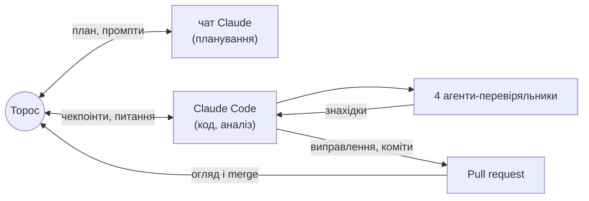

# Повітряні тривоги восени 2026: що змінилось, де, і чи можна це прогнозувати

**English version:** [README.en.md](README.en.md)

Тестове завдання 2 етапу KSE Agentic AI School 2026 (жовтень 2026). Виконав Торос-Манук
Петриченко, 2 курс прикладної математики KSE, разом з AI-агентами
([як саме](#як-це-зроблено-людина--ai-агенти)). Python, аналіз часових рядів, прогноз без
leakage.

Почали з питання, чи змінився режим тривог у Києві. Злам виявився регіональним, тож ми
розширили аналіз на всі обласні центри, зробили спільну модель прогнозу і карту.

> **Питання.** Що змінилось у режимі повітряних тривог восени 2026 року, де саме, і чи можна
> чесно прогнозувати добові години тривоги, коли режим змінюється?
>
> **Коротка відповідь.**
> - **Режим.**
>   - У Києві — різкий злам 27.08.2026, за 10 днів до нових правил оголошення тривог.
>     Годин тривоги на добу стало **1.7 → 8.1**, насамперед через більшу кількість окремих
>     тривог.
>   - Злам регіональний: найсильніший і стійкий у Києві, Київській (Біла Церква) і
>     Черкаській (Черкаси) областях. На сході зростання немає.
>   - З 06.09 ~92% годин тривоги в Києві — жовтий рівень, тобто дрони.
> - **Прогноз.** Одна спільна модель на 23 обласні центри.
>   - Інтервали чесні: покриття 0.82 при номінальних 0.80.
>   - Середня помилка 2.14 год проти 2.31 у найкращого простого прогнозу.
>   - На фронті — у Чернігівській, Сумській, Харківській областях — модель гірша за
>     «як учора».
> - **Довіра.**
>   - Три джерела офіційних тривог звірені між собою.
>   - 64 тести на реальних даних, зокрема на leakage.
>   - 4 незалежні AI-агенти перевірили числа, відтворюваність, висновки й витоки.
>
> **Чому таке питання.** Точний момент наступної тривоги передбачити неможливо, тому ми
> дивимось на режим і на години тривоги за добу, з інтервалом невизначеності.

**Зміст**
1. [Прогноз на наступну добу і карта](#прогноз-на-наступну-добу-і-карта)
2. [Що ми з'ясували](#що-ми-зясували)
3. [Модель: від v1 до v2](#модель-від-v1-до-v2)
4. [Обмеження](#обмеження)
5. [Навіщо це](#навіщо-це)
6. [Як це зроблено: людина + AI-агенти](#як-це-зроблено-людина--ai-агенти)
7. [Як запустити](#як-запустити)
8. [Що далі](#що-далі)
9. [Дані, файли і структура](#дані-файли-і-структура)

## Прогноз на наступну добу і карта
### [Інтерактивна карта всієї України →](https://torosyasia.github.io/air-alerts-forecast/)
На карті — прогноз для кожного обласного центру, зміна після 27.08 і години за 30 днів. Це
статистика і прогноз, а не поточні тривоги.

[](https://torosyasia.github.io/air-alerts-forecast/)

Блок нижче оновлює `run_all.py`. Прогноз для всіх 23 міст —
[`results/forecast_next_day_all.csv`](results/forecast_next_day_all.csv).

<!-- FORECAST:START -->
**Прогноз на 12.10.2026** (доба 00:00–24:00 за Києвом), зроблений станом на 12.10 00:00 з даних до 2026-10-12 10:46 UTC. Модель — спільна квантильна регресія для всіх обласних центрів (обрана на валідації; прогноз для кожного центру — [на карті](https://torosyasia.github.io/air-alerts-forecast/) і в [`results/forecast_next_day_all.csv`](results/forecast_next_day_all.csv)).

| Місто | Медіана, год | 80% інтервал, год | Тривога о 00:00 | Учора, год | Середнє за 7 днів, год | MAE моделі на тесті | Покриття на тесті |
|---|---|---|---|---|---|---|---|
| Київ | **6.2** | 2.2 – 11.0 | ні | 5.4 | 8.0 | 4.22 | 71% |
| Харків | **15.3** | 6.8 – 21.6 | так | 14.7 | 15.3 | 2.44 | 100% |
| Дніпро | **6.0** | 2.0 – 11.6 | так | 8.4 | 6.7 | 2.29 | 79% |

**Наскільки цьому вірити.** На тесті 80% інтервал накрив факт у 71%–100% днів, а медіана помилялась у середньому на 2.3–4.2 год. Для Києва модель трохи краща за найкращий простий прогноз (4.2 проти 4.3 год); факт у середньому вищий за медіану на 1.1 год, хоча вищий лише в 7 з 14 днів (кілька дуже важких днів тягнуть середнє вгору). Тож для Києва дивіться на інтервал, а не на точну цифру; це статистика, а не попередження про загрозу. Файл: [`results/forecast_next_day.csv`](results/forecast_next_day.csv).
<!-- FORECAST:END -->

## Що ми з'ясували
Знімок 12.10.2026. Докази, статистичні тести й перевірки на стійкість — у
[REPORT.md](REPORT.md#4-висновки-з-доказами).


1. **Злам різкий і стався до реформи.** Режим у Києві змінився за один день, 27.08, за
   10 днів до нових правил оголошення тривог (06.09). Годин тривоги на добу: **1.70 → 8.09**
   (60 днів до 27.08 проти 27.08–11.10). Ту саму дату дають і незалежні дані офіційного
   каналу.
2. **Тривог стало більше, а не довших.**
   - Окремих тривог на добу: **2.1 → 7.3**; типова тривалість: 27 → 38 хв.
   - ~80% зростання годин дала кількість.
   - Те, що тривоги тепер в усі години доби, — наслідок їхньої кількості, а не нового
     добового ритму.
3. **Злам регіональний: найсильніший і стійкий у Києві й довкола.** Години тривоги на добу в
   області — рахуємо за обласним центром ([карта, шар «Зміна після 27.08»](https://torosyasia.github.io/air-alerts-forecast/)):

   | Область (центр) | 60 днів до 27.08 | 27.08–05.09 (до реформи) | 06.09–11.10 |
   |---|---|---|---|
   | м. Київ | 1.7 | **9.4** | **7.7** |
   | Київська (Біла Церква) | 1.1 | **6.7** | **8.3** |
   | Черкаська (Черкаси) | 2.4 | **10.0** | **8.4** |
   | Житомирська (Житомир) | 1.1 | 1.9 | 5.0 |
   | Вінницька (Вінниця) | 0.7 | 2.0 | 3.0 |
   | Дніпропетровська (Дніпро) | 5.3 | 9.6 | 6.3 |
   | Полтавська (Полтава) | 8.1 | 14.0 | 10.6 |
   | Рівненська (Рівне) | 0.2 | 0.6 | 2.5 |
   | Харківська (Харків) | 18.5 | 17.6 | 16.4 |

   - **Київ, Київська і Черкаська області.** Стрибок одразу після 27.08, і він тримається.
   - **Житомирська і Вінницька.** Зростання менше і здебільшого після 06.09.
   - **Дніпропетровська і Полтавська.** У перші дні стрибнули, потім повернулись ближче до
     попереднього рівня.
   - **Захід.** Тривог побільшало від дуже малої бази і переважно після 06.09.
   - **Схід.** Харківська, Сумська, Запорізька — без зростання або вже насичено. На півдні
     виняток — Миколаївська область (Миколаїв, 6.0 → 9.5).
   - **Чернігівська (Чернігів)** зросла найбільше (7.8 → 17.8), але поступово і з тривогами,
     довшими за 24 год.
4. **Це дрони, і вони йдуть хвилями.**
   - З 06.09 Київ у середньому 7.7 год на добу під тривогою, з них **7.1 год — жовтий
     рівень** («Дронова небезпека»).
   - Рівень змінюється хвилями на тиждень-два, а в межах доби тривоги йдуть пачками.
   - Дронів ми не бачимо, лише тривоги.
5. **Жовтень: ширшої хвилі не виявлено** (за 11 днів жовтня).
   - Значуще більше тривог, ніж у вересні, лише в 2 з 23: Дніпропетровська область (Дніпро,
     7.4 → 9.3 на добу) і Рівненська (Рівне). У Києві тривог 6.3 → 8.0, але p = 0.07.
   - Формальний «злам» Львова 18.09, який був на знімку 10.10, після нових даних зник.
6. **Прогноз: де модель працює, а де ні.**
   - **Разом.** Спільна модель на 23 міста помиляється в середньому на 2.14 год, найкращий
     простий прогноз — на 2.31. За interval score простий прогноз трохи кращий (10.50 проти
     10.75). Покриття 80% інтервалу — 0.82.
   - **Краща за середньою помилкою** — в 11 з 23 міст, здебільшого в центрі й тилу:
     Дніпропетровська (2.29 проти 2.92 год), Полтавська, Черкаська, Житомирська області,
     Київ (4.22 проти 4.29).
   - **Гірша** — на фронті: Чернігівська (3.28 проти 2.07), Сумська, Харківська,
     Запорізька, Херсонська, а також Миколаївська і Вінницька області. Там, де тривога
     стоїть майже постійно, «як учора» майже ідеальний.

## Модель: від v1 до v2
- **v1 — окремі моделі для трьох міст.** Для Києва вона не краща за «як учора», а медіана
  занижена на 2.5 год: даних нового режиму було лише 32 дні.
- **v2 — одна спільна модель на 23 міста.** Тут 626 місто-днів нового режиму. Головне
  покращення — чесні інтервали: покриття 0.82 проти 0.71. Точність майже та сама.

Деталі й таблиця — у [REPORT §6](REPORT.md#6-прогноз-від-v1-до-v2-результати-по-містах).

## Обмеження
- **Тест — лише 14 днів.** Для Києва різниця з «як учора» (4.22 проти 4.29 год) у межах
  шуму.
- **Поза Києвом з 07.09 інше джерело** (alerts.in.ua замість офіційного каналу), і це
  збігається в часі з реформою 06.09. Частина змін після 06.09 може бути різницею джерел.
- **Ми бачимо тривоги, а не атаки.** «Малі групи дронів» — висновок із патерну тривог і з
  новин.
- **Фактор Байєса завищений:** модель вважає дні незалежними, а вони корелюють. Дата зламу
  від цього стійка, а величина доказу — ні.

## Навіщо це
- **Для міста.**
  - З 06.09 Київ у середньому 7.7 год на добу під тривогою; з них **7.1 год жовтого
    рівня** і лише 0.6 год червоного.
  - За [постановою КМУ № 1092](https://jurliga.ligazakon.net/news/246063_povtryan-trivogi-podlyat-na-dva-rvn-yak-zmozhe-pratsyuvati-bznes)
    за жовтого рівня бізнес може працювати, якщо є укриття, а метро працює повноцінно. За
    червоного — [зупинка й укриття](https://news.dtkt.ua/society/economics/114347-robota-biznesu-pri-zovtomu-rivni-trivogi-ta-novi-pravila-dlia-transportu-postanova-kmu-1092-dije-z-4-veresnia).
  - Тож у Києві правила жовтого рівня стосуються ~92% часу тривог.
- **Для прогнозування.** Модель, навчена на історії одного міста, ламається саме на зміні
  режиму: медіана v1 для Києва була занижена в середньому на 2.5 год. Спільна модель на
  багатьох містах дала чесніші інтервали. Далі варто вчитись швидко помічати зміну режиму.
- **Для даних.**
  - Відкритий датасет офіційного каналу мовчки перестав поповнюватись після 07.09.
  - Канал мав збій 29.08–02.09.
  - Волонтерські дані губили довгі тривоги.

  Ми зібрали перевірений ряд із трьох звірених джерел
  ([REPORT §2](REPORT.md#2-дані-та-їх-перевірка)).

## Як це зроблено: людина + AI-агенти
- **Ролі.** Торос поставив питання і правила, з окремим чатом Claude готував план і
  найважчі промпти, погоджував кожен чекпоінт і мерджив PR. Claude Code писав код,
  рахував і комітив.
- **Правила наперед:** жодних вигаданих даних, точне означення leakage, чекпоінти,
  [DECISIONS.md](DECISIONS.md), окремий коміт на крок.
- **Чотири незалежні агенти-перевіряльники** бачили лише репозиторій, а не процес:

| Агент | Що робив | Що знайшов |
|---|---|---|
| [Рецензент](agents/reviewer.md) | звірив ~170 чисел із файлами | подвійне округлення в коді, неточну дату, 10 висновків сильніших за докази |
| [Відтворювач](agents/reproducer.md) | запуск із чистого клону | закріплений запуск відтворюється бітово; `--latest` ламав тест і плодив дублі знімка |
| [Адвокат диявола](agents/devils_advocate.md) | альтернативні пояснення кожного висновку, перевірені кодом | **спростував «злам лише київський»**: сусідні області теж зросли 27.08; «усі години доби» — наслідок кількості; розкид між днями — хвилі, а не пачки (перевірки перезапущено на даних 12.10) |
| [Мисливець за витоками](agents/leak_hunter.md) | шукав будь-який шлях із майбутнього в прогноз | **справжній витік:** день перемикання Києва з KMDA на alerts.in.ua брався з майбутнього (з останнього запису KMDA). Спершу тест, що падає, потім виправлення; на опубліковані числа не вплинуло |

**Де людина змінила результат** (що я спитав → що змінилось):
- «Перевір склейку за даними KMDA» → KMDA стало основним джерелом Києва, єдиним рядом по обидва боки реформи.
- «Перевірено чи здогадка?» про волонтерські дані → порівняння подія за подією; джерело відкинуто.
- «06.09 чи 10.09?» → дату реформи 06.09 підтверджено новинами й даними.
- «Чи не накладаються жовті й червоні?» → накладання рахується один раз, як червоне.
- «Механізм — часті атаки малими групами дронів» → гіпотези H1–H3 і їхні перевірки.
- «Чому покриття 0.43?» → межі простих прогнозів за конформними рангами.
- «Події — з новин і закомітити до аналізу» → список зафіксовано окремим комітом до тесту.
- «Дірка після 27.08 — чи тримається висновок?» → тест на маскування.
- «Медіана для Києва 4.4, хоча вчора 11.9?» → пояснено заниження, автоблок показує середній зсув.
- «Одна модель на всі міста, щоб було більше даних нового режиму» → v2, для Києва вперше краща.
- «Київська область показує сам Київ» → місто-представник Біла Церква з власним прогнозом.
- «На карті 1.69 → 8.82, у README 1.70 → 8.09» → однакове вікно скрізь, обласна міра підписана окремо.
- «Волинь ×5.2 світиться яскравіше за Київ» → шар фарбується за приростом годин, а не за кратністю.
- «У README 4.9, на карті 6.2» → одна головна модель скрізь.

**Де Claude виправив сам себе:**
- CV пауз між тривогами;
- збій каналу;
- «пропуск» 6–7.09, який виявився справжньою тишею.



Повна історія — у [agents/README.md](agents/README.md). Журнал розмов людини з AI — у
[`ai_log/`](ai_log/).

## Як запустити
```bash
python -m venv .venv && .venv/bin/pip install -r requirements.txt   # Python 3.13
.venv/bin/python run_all.py            # відтворити знімок (~12 хв); --latest — найсвіжіші дані
.venv/bin/python -m pytest             # тести на реальних даних (~3 хв)
```
Покроково — у [REPORT §10](REPORT.md#10-як-відтворити). Опис кожного файлу результатів — у
[results/README.md](results/README.md).

## Що далі
- **Поширення тривог:** чи передує тривога в сусідніх областях київській і на скільки
  хвилин.
- **Модель, що швидко помічає зміну режиму** і окремо працює з фронтовими містами, де
  найкраще «як учора».
- **Звірка зі звітами Повітряних сил** про кількість дронів.

Решта ідей і методи, які розглядали, але не застосували (процес Хокса, HMM, глибокі
моделі), — у [REPORT §9](REPORT.md#9-що-лишилося-на-потім).

## Дані, файли і структура
Київ — офіційна статистика KMDA ([data.gov.ua](https://data.gov.ua/dataset/83eda433-b4d9-47ac-89a0-5868dd4d5ce6)).
Харків, Дніпро, Львів — офіційний канал @air_alert_ua ([датасет Vadimkin](https://github.com/Vadimkin/ukrainian-air-raid-sirens-dataset))
до 07.09, далі — архів alerts.in.ua ([JustJimer](https://github.com/JustJimer/ukraine-air-alert-stats)).

<!-- DATA:START -->
| Джерело | Версія у `data/raw/MANIFEST.json` | Останній запис у даних |
|---|---|---|
| KMDA, data.gov.ua (Київ) | знімок 2026-10-12 | 2026-10-12 05:46 (за Києвом) |
| Офіційний канал @air_alert_ua (датасет Vadimkin) | коміт `7ccd436` | 2026-09-07 05:28 UTC (канал далі не публікує) |
| alerts.in.ua (архів JustJimer) | коміт `c5b3bd0` | 2026-10-12 10:46 UTC |

Остання повна доба в аналізі: **11.10.2026**.
<!-- DATA:END -->

| Що | Де |
|---|---|
| Усі деталі: дані, метод, висновки з доказами, результати по містах, факти, обмеження | [REPORT.md](REPORT.md) |
| Кожен графік: питання, осі, висновок, обмеження | [figures/README.md](figures/README.md) |
| Терміни простими словами з формулами | [docs/GLOSSARY.md](docs/GLOSSARY.md) |
| Чому зроблено саме так | [DECISIONS.md](DECISIONS.md) |
| Як працювали AI-агенти | [agents/](agents/README.md) |
| Таблиці результатів | [results/](results/), [reports/](reports/) |

```
├── README.md                коротко: відповідь, головне, прогноз, як зроблено
├── README.en.md             коротка англійська версія
├── REPORT.md                усі деталі й докази
├── DECISIONS.md             рішення з обґрунтуванням (D-01 … D-23) і журнал виправлень
├── run_all.py               одна команда: дані → ціль → ознаки → оцінка → моделі → аналіз → графіки → README/REPORT
├── requirements.txt         фіксовані версії
├── airalerts/               код: джерела, ціль, ознаки о 00:00, baselines, моделі, злам, події, графіки
├── tests/                   тести на реальних даних: ціль, leakage, оцінка, моделі, режими, вихідні файли
├── agents/                  чотири агенти-перевіряльники: роль, промпт, знахідки, коміти
├── docs/GLOSSARY.md         глосарій
├── data/raw/                MANIFEST.json (коміти й sha256 джерел) + знімок KMDA
├── data/events/             події з посиланнями (закомічено до аналізу)
├── results/                 малі CSV: ціль по днях, метрики, прогноз, злами, факти
├── reports/                 згенеровані звіти з таблицями
└── figures/                 графіки + README з поясненням кожного
```
