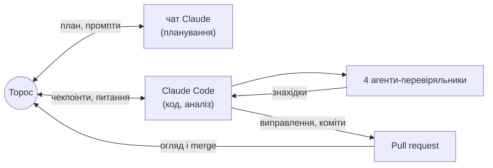

# Повітряні тривоги: злам режиму в Києві і чесний прогноз

Це тестове завдання 2 етапу KSE Agentic AI School 2026 (жовтень 2026). Виконав
Торос-Манук Петриченко, 2 курс прикладної математики KSE.
- **Що зроблено:** аналіз часових рядів повітряних тривог і прогноз годин тривоги на
  наступну добу без leakage, на Python.
- **Як:** разом з AI-агентами — як саме, описано в розділі
  [«Як це зроблено: людина + AI-агенти»](#як-це-зроблено-людина--ai-агенти).

> **Питання.** Чи змінився восени 2026 року режим повітряних тривог у Києві, і як чесно
> прогнозувати добові години тривоги, коли режим змінюється?
>
> **Коротка відповідь.**
> - **Так, змінився.** Різко, **27.08.2026**, за 10 днів до зміни правил оголошення
>   тривог 06.09. Годин тривоги на добу стало вчетверо більше: **1.7 → 8.0**.
> - **Це не лише Київ.** Того ж дня зросли тривоги в сусідніх областях, а не по всій
>   країні.
> - **Схоже на тактику.** Тривог стало значно більше, і вони часті — це схоже на часті
>   атаки малими групами дронів.
> - **Прогнозувати такий режим важко.** Чесний прогноз — це широкий інтервал. Для Києва
>   модель не краща за простий прогноз «як учора».
>
> **Чому саме таке питання.** Точний момент наступної тривоги передбачити неможливо.
> Тому ми дивимось на режим і на кількість годин тривоги за добу, з інтервалом
> невизначеності.

**Одним поглядом**

| | |
|---|---|
| **Дані** | 16.03.2022 – 09.10.2026. Три джерела офіційних тривог: KMDA (data.gov.ua), канал @air_alert_ua, alerts.in.ua. Звірені між собою на днях, де перекриваються; пропуски не заповнювались |
| **Міста** | **Київ** — головне місто: злам і прогноз. **Харків, Дніпро** — прогноз і контроль. **Львів** — лише описово. Плюс області довкола Києва для перевірки, чи злам регіональний |
| **Що зроблено** | Ціль — години тривоги за добу. Пошук точки зламу (байєсівська модель). Механізм: більше тривог чи довші. Прогноз на наступну добу о 00:00 з 80% інтервалом. Чесна оцінка на днях, яких модель не бачила, проти 5 простих прогнозів |
| **Перевірка** | 57 тестів на реальних даних, зокрема на leakage. 4 незалежні AI-агенти-перевіряльники: рецензент, відтворювач, адвокат диявола, мисливець за витоками |

**Зміст**
1. [Що ми з'ясували](#що-ми-зясували)
2. [Навіщо це](#навіщо-це)
3. [Прогноз на наступну добу](#прогноз-на-наступну-добу)
4. [Як це зроблено: людина + AI-агенти](#як-це-зроблено-людина--ai-агенти)
5. [Як запустити](#як-запустити)
6. [Що далі і що свідомо не робили](#що-далі-і-що-свідомо-не-робили)
7. [Дані, файли і структура](#дані-файли-і-структура)

## Що ми з'ясували
Числа — для зафіксованого знімка даних 10.10.2026. Докази, статистичні тести й
перевірки на стійкість — у [REPORT.md](REPORT.md#4-висновки-з-доказами).


1. **Злам різкий і стався до реформи.**
   - Режим у Києві змінився за один день, 27.08 — за 10 днів до нових правил оголошення
     тривог (06.09).
   - Годин тривоги на добу: **1.7 → 8.0**.
   - Ту саму дату дають і незалежні дані офіційного каналу.
2. **Тривог стало більше, а не довших.**
   - Окремих тривог на добу: **2.1 → 7.2**.
   - Типова тривалість: 27 → 37 хв.
   - Близько 80% зростання годин дала саме кількість.
3. **Злам регіональний.**
   - Того ж 27.08 різко зросли тривоги в Київській, Черкаській і Вінницькій областях
     (годин приблизно ×3.5).
   - У Чернігівській і Полтавській такого стрибка не було
     ([графік](figures/README.md#9-чи-змінився-2708-лише-київ)).
   - Харків і Дніпро для порівняння слабкі: Харків і до зламу був під тривогою 77% часу.
4. **Це дрони, і вони йдуть хвилями.**
   - Після реформи **~92%** київських годин тривоги — жовтий рівень, тобто «Дронова
     небезпека».
   - Рівень змінюється хвилями на тиждень-два, а в межах доби тривоги йдуть пачками.
   - Це схоже на часті атаки малими групами дронів. Але ми бачимо тривоги, а не самі дрони.
5. **Прогнозувати такий режим важко.**
   - Для Києва модель не краща за простий прогноз «як учора»: середня помилка 4.8 проти
     4.3 год.
   - Її медіана занижена: факт був вищим у 10 з 14 тестових днів.
   - Для трьох міст разом модель трохи краща, але ця перевага в межах шуму
     ([результати по містах](REPORT.md#6-прогноз-результати-по-містах)).

## Навіщо це
- **Для міста.**
  - З 06.09 Київ у середньому **7.6 год на добу під тривогою**, і ці години розкидані по
    всьому дню. З них **7.0 год — жовтий рівень і лише 0.6 год — червоний** (06.09–09.10).
  - За [постановою КМУ № 1092](https://jurliga.ligazakon.net/news/246063_povtryan-trivogi-podlyat-na-dva-rvn-yak-zmozhe-pratsyuvati-bznes)
    за жовтого рівня бізнес може працювати, якщо є укриття, а метро в Києві має працювати
    повноцінно.
  - За червоного рівня — [зупинка роботи й укриття](https://news.dtkt.ua/society/economics/114347-robota-biznesu-pri-zovtomu-rivni-trivogi-ta-novi-pravila-dlia-transportu-postanova-kmu-1092-dije-z-4-veresnia).
  - Тобто в Києві правила жовтого рівня стосуються ~92% часу тривог, а «зупинка й
    укриття» — лише ~8%.
- **Для прогнозування.**
  - Модель, навчена на історії, ламається саме на зміні режиму: наша медіана для Києва
    занижена в 10 з 14 днів.
  - Тому важливо не лише прогнозувати, а й швидко помічати, що режим змінився, і чесно
    показувати широкий інтервал.
- **Для даних.**
  - Відкритий датасет офіційного каналу мовчки перестав поповнюватись після 07.09, бо
    закінчилась публічна стрічка каналу.
  - 29.08–02.09 канал мав збій: «тривога» в Харкові на 110 год — артефакт цього збою.
  - Волонтерські дані губили довгі тривоги.
  - Ми зібрали перевірений ряд із трьох джерел, звірений між собою, з пропусками,
    позначеними як пропуски ([REPORT §2](REPORT.md#2-дані-та-їх-перевірка)).

## Прогноз на наступну добу
Блок оновлює `run_all.py`.

<!-- FORECAST:START -->
**Прогноз на 10.10.2026** (доба 00:00–24:00 за Києвом), зроблений станом на 10.10 00:00 з даних до 2026-10-10 09:50 UTC. Модель — квантильна регресія на всій історії: серед варіантів у неї найменший interval score на валідації.

| Місто | Медіана, год | 80% інтервал, год | Тривога о 00:00 | Учора, год | Середнє за 7 днів, год | MAE моделі на тесті | Покриття на тесті |
|---|---|---|---|---|---|---|---|
| Київ | **4.4** | 0.0 – 11.9 | ні | 11.9 | 6.3 | 4.82 | 79% |
| Харків | **13.1** | 7.9 – 17.6 | так | 7.1 | 16.4 | 2.69 | 86% |
| Дніпро | **5.4** | 2.3 – 8.0 | ні | 9.2 | 5.0 | 2.28 | 79% |

**Наскільки цьому вірити.** На тесті 80% інтервал накрив факт у 79%–86% днів, а медіана помилялась у середньому на 2.3–4.8 год. Для Києва модель не краща за найкращий простий прогноз (4.8 проти 4.3 год), а її медіана занижена: факт був вищим у 10 з 14 днів. Тож для Києва дивіться на інтервал, а не на точну цифру; це статистика, а не попередження про загрозу. Файл: [`results/forecast_next_day.csv`](results/forecast_next_day.csv).
<!-- FORECAST:END -->

## Як це зроблено: людина + AI-агенти
Проєкт зробили разом людина й AI.
- **Ролі.**
  - Торос (автор) з окремим чатом Claude готував план і найважчі промпти.
  - Claude Code писав код, рахував і комітив.
  - Торос погоджував кожен чекпоінт і мерджив PR.
- **Правила наперед:**
  - жодних вигаданих чи домальованих даних;
  - точне означення leakage;
  - чекпоінти;
  - [DECISIONS.md](DECISIONS.md) з кожним рішенням;
  - окремий коміт на кожен крок.
- **Чотири незалежні агенти-перевіряльники.** Жоден не бачив процесу, тільки репозиторій.

| Агент | Що робив | Що знайшов |
|---|---|---|
| [Рецензент](agents/reviewer.md) | звірив ~170 чисел із файлами | подвійне округлення в коді, неточну дату, 10 висновків сильніших за докази |
| [Відтворювач](agents/reproducer.md) | запуск із чистого клону | закріплений запуск відтворюється бітово; `--latest` ламав тест і плодив дублі знімка |
| [Адвокат диявола](agents/devils_advocate.md) | альтернативні пояснення кожного висновку, перевірені кодом | **спростував «злам лише київський»**: сусідні області теж зросли 27.08; «усі години доби» — наслідок кількості; розкид між днями — хвилі, а не пачки |
| [Мисливець за витоками](agents/leak_hunter.md) | шукав будь-який шлях із майбутнього в прогноз | **справжній витік:** день перемикання Києва з KMDA на alerts.in.ua брався з майбутнього (з останнього запису KMDA). Спершу тест, що падає, потім виправлення; на опубліковані числа не вплинуло |

**Де втручання людини змінило результат:**
- KMDA як основне київське джерело;
- перевірка, «перевірено чи здогадка», про волонтерські дані — їх відкинули;
- дата реформи 06.09, а не 10.09;
- накладання жовтих і червоних тривог рахується один раз;
- уточнена гіпотеза про механізм;
- покриття 0.43 → конформні інтервали;
- список подій закомічено до аналізу;
- дірка в перевірці контрольних міст → тест на маскування.

**Де Claude виправив сам себе:** CV пауз між тривогами, збій офіційного каналу, «пропуск» у
Києві 6–7.09, який виявився справжньою тишею.



Повна історія — у [agents/README.md](agents/README.md). Повний журнал розмов буде в
`ai_log/` (додамо в понеділок).

## Як запустити
Потрібен Python 3.13 (перевірено на 3.13.16) і git. Усі версії залежностей зафіксовано в
[`requirements.txt`](requirements.txt).

**1. Клонувати і встановити** (один раз):
```bash
git clone https://github.com/torosyasia/air-alerts-forecast.git
cd air-alerts-forecast
python -m venv .venv
.venv/bin/pip install -r requirements.txt      # Windows: .venv\Scripts\pip install -r requirements.txt
```

**2. Відтворити результати з README** (~6 хв):
```bash
.venv/bin/python run_all.py
```
- Скрипт сам завантажує великі CSV (~45 МБ, перший раз) з точних комітів і звіряє їхні sha256 з
  [`data/raw/MANIFEST.json`](data/raw/MANIFEST.json).
- Далі будує ціль, ознаки, прості прогнози й моделі, шукає злам, рахує прогноз на наступну
  добу, малює графіки.
- Перезаписуються `results/`, `reports/`, `figures/` і автоблоки в README та REPORT. Числа
  мають збігтися з закомітченими: `git status` після запуску порожній.

**3. Прогноз на свіжих даних:**
```bash
.venv/bin/python run_all.py --latest
```
- Скрипт завантажує найновіші версії всіх джерел і перезакріплює MANIFEST.
- Прогноз робиться на першу добу після останньої повної доби в даних. Архів alerts.in.ua
  оновлюється раз на добу, близько 03:00 UTC, тож удень це зазвичай сьогоднішня доба.
- Щоб оновлення стало відтворюваним, закомітьте нові MANIFEST і знімок KMDA — подробиці в
  [REPORT §10](REPORT.md#10-як-відтворити).

**4. Тести** (~2 хв; працюють на реальних даних, не на синтетичних):
```bash
.venv/bin/python -m pytest
```

Окремі кроки можна запускати й поодинці, наприклад `.venv/bin/python -m airalerts.regimes`.
Список кроків — у [`run_all.py`](run_all.py).

## Що далі і що свідомо не робили
**Що далі** (кожну ідею вирішуємо окремо):
- **Інтерактивна карта:** статистика за 30 днів по областях і прогноз для трьох міст.
- **Чи передує тривога в сусідніх областях київській і на скільки хвилин.** Це прямо
  перевірило б висновок про регіональний злам.
- **Швидке виявлення зміни режиму** і модель, що більше важить свіжі дні. Це відповідь на
  занижену київську медіану.
- **Звірка зі звітами Повітряних сил** про кількість дронів: тоді «малі групи» можна
  перевірити на даних про дрони, а не про тривоги.
- **Прогноз на 2–7 днів:** як швидко падає якість із горизонтом.

**Розглядали, але не робили:**
- **Процес Хокса** — модель, де кожна тривога підвищує ймовірність наступної. Він добре
  описує пачки в межах доби. Але:
  - прогноз потрібен у годинах за добу о 00:00;
  - розкид між днями ми пояснили хвилями, а не самозбудженням;
  - 44 дні нового режиму замало, щоб стабільно оцінити його параметри.

  Він — кандидат для прогнозу всередині доби.
- **Прихована марковська модель (HMM)** — режими «тихо / напружено» як приховані стани.
  - У наших даних по суті один різкий злам, і байєсівська модель з однією точкою зламу
    простіша й легше пояснюється.
  - HMM з кількома станами на 44 днях нового режиму нестабільна.

  Вона має сенс для онлайн-виявлення зміни режиму.
- **Глибокі моделі** (LSTM, трансформери).
  - ~1 700 днів на місто, з них лише ~44 у новому режимі. Така модель ще сильніше
    вивчила б старий режим, ніж квантильна регресія.
  - Її важче перевірити на leakage і пояснити.
  - Поки проста модель не краща за «як учора», складніша навряд чи допоможе.

## Дані, файли і структура
- **Київ:** офіційна статистика KMDA ([data.gov.ua](https://data.gov.ua/dataset/83eda433-b4d9-47ac-89a0-5868dd4d5ce6)) —
  єдиний ряд по обидва боки реформи.
- **Харків, Дніпро, Львів:** офіційний канал @air_alert_ua
  ([датасет Vadimkin](https://github.com/Vadimkin/ukrainian-air-raid-sirens-dataset)) до 07.09,
  далі — архів alerts.in.ua ([JustJimer](https://github.com/JustJimer/ukraine-air-alert-stats)).
- **Області довкола Києва** — з офіційного каналу до 06.09.

<!-- DATA:START -->
| Джерело | Версія у `data/raw/MANIFEST.json` | Останній запис у даних |
|---|---|---|
| KMDA, data.gov.ua (Київ) | знімок 2026-10-10 | 2026-10-04 23:32 (за Києвом) |
| Офіційний канал @air_alert_ua (датасет Vadimkin) | коміт `7ccd436` | 2026-09-07 05:28 UTC (канал далі не публікує) |
| alerts.in.ua (архів JustJimer) | коміт `3b0e7f1` | 2026-10-10 09:50 UTC |

Остання повна доба в аналізі: **09.10.2026**.
<!-- DATA:END -->

| Що | Де |
|---|---|
| Усі деталі: дані, метод, висновки з доказами, результати по містах, факти, обмеження | [REPORT.md](REPORT.md) |
| Кожен графік: питання, осі, висновок, обмеження | [figures/README.md](figures/README.md) |
| Терміни простими словами з формулами | [docs/GLOSSARY.md](docs/GLOSSARY.md) |
| Чому зроблено саме так | [DECISIONS.md](DECISIONS.md) |
| Як працювали AI-агенти | [agents/](agents/README.md) |
| Таблиці результатів | [results/](results/), [reports/](reports/) |

```
├── README.md                коротко: відповідь, головне, прогноз, як зроблено
├── REPORT.md                усі деталі й докази
├── DECISIONS.md             рішення з обґрунтуванням (D-01 … D-21) і журнал виправлень
├── run_all.py               одна команда: дані → ціль → ознаки → оцінка → моделі → аналіз → графіки → README/REPORT
├── requirements.txt         фіксовані версії
├── airalerts/               код: джерела, ціль, ознаки о 00:00, baselines, моделі, злам, події, графіки
├── tests/                   тести на реальних даних: ціль, leakage, оцінка, моделі, режими, вихідні файли
├── agents/                  чотири агенти-перевіряльники: роль, промпт, знахідки, коміти
├── docs/GLOSSARY.md         глосарій
├── data/raw/                MANIFEST.json (коміти й sha256 джерел) + знімок KMDA
├── data/events/             події з посиланнями (закомічено до аналізу)
├── results/                 малі CSV: ціль по днях, метрики, прогноз, злами, факти
├── reports/                 згенеровані звіти з таблицями
└── figures/                 графіки + README з поясненням кожного
```
