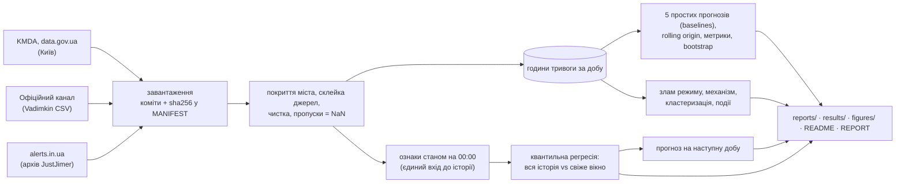
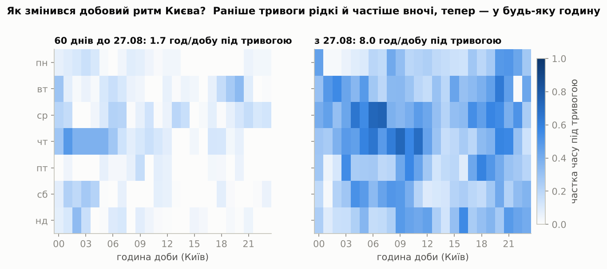
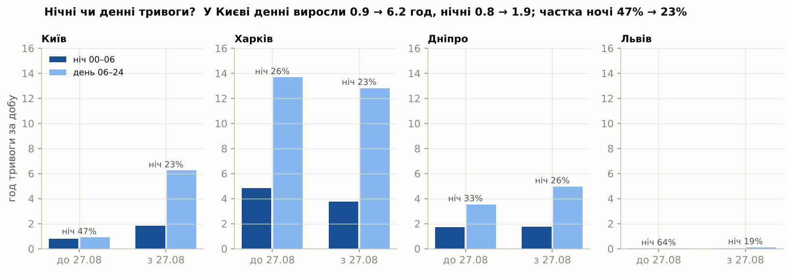
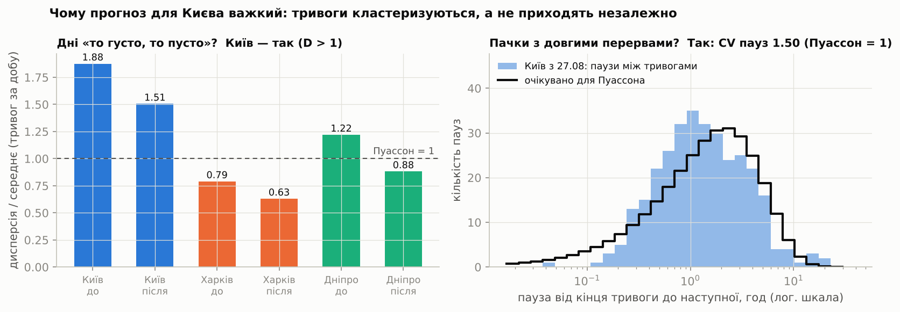
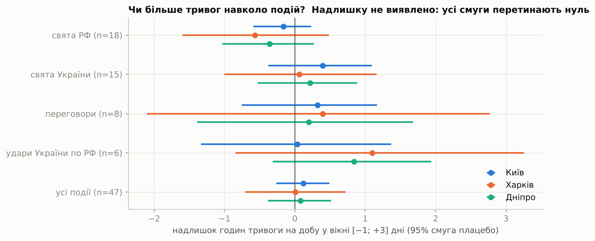
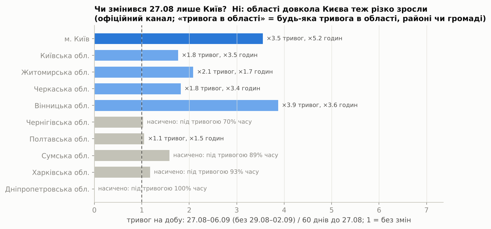

# Звіт: злам режиму повітряних тривог у Києві і чесний прогноз добових годин тривоги

Тут усе детально: дані та їх перевірка, метод, висновки з доказами, графіки, результати по
містах, факти й обмеження. Коротка версія — у [README](README.md). Терміни пояснено простими
словами в [глосарії](docs/GLOSSARY.md), а кожне рішення з обґрунтуванням записано в
[DECISIONS.md](DECISIONS.md).

Текст описує зафіксований знімок даних **12.10.2026** (остання повна доба — 11.10). Блоки
з позначкою «автоблок» перегенеровує `run_all.py`, тож після оновлення даних вони
показують нові числа.

## Зміст
1. [Питання і відповідь](#1-питання-і-відповідь)
2. [Дані та їх перевірка](#2-дані-та-їх-перевірка)
3. [Метод](#3-метод)
4. [Висновки з доказами](#4-висновки-з-доказами)
5. [Графіки](#5-графіки)
6. [Прогноз: від v1 до v2, результати по містах](#6-прогноз-від-v1-до-v2-результати-по-містах)
7. [Цікаві факти з даних](#7-цікаві-факти-з-даних)
8. [Обмеження](#8-обмеження)
9. [Що лишилося на потім](#9-що-лишилося-на-потім)
10. [Як відтворити](#10-як-відтворити)

## 1. Питання і відповідь
**Питання.** Чи змінився режим повітряних тривог у Києві восени 2026 року — і як чесно
прогнозувати добові години тривоги, коли режим змінюється? Прогнозуємо Київ, Харків і
Дніпро; Львів — лише описово.

**Відповідь.**
- **Злам був.** Режим у Києві змінився різко **27.08.2026**, за 10 днів до зміни правил
  оголошення тривог 06.09: годин тривоги на добу 1.70 → 8.09. Тож зростання дала не
  реформа.
- **Механізм.** Головне — **більше окремих тривог** (2.1 → 7.3 на добу), а не довші.
  - Тривоги часті в усі години доби, але це арифметичний наслідок того, що їх у 3.5 раза
    більше, а не окрема зміна добового ритму.
  - У межах доби тривоги йдуть пачками, а рівень змінюється хвилями на тиждень-два.
  - Це узгоджується з тактикою частих атак малими групами дронів, але дронів ми не бачимо —
    лише тривоги.
- **Злам регіональний.**
  - **Київ, Біла Церква (Київська обл.), Черкаси.** Найсильніший і стійкий злам: стрибок
    одразу після 27.08, ще до реформи, і він тримається.
  - **Дніпро, Полтава, Кропивницький, Миколаїв, Чернігів.** У перші дні теж стрибнули;
    Дніпро і Полтава потім повернулись ближче до попереднього рівня.
  - **Житомир, Вінниця і захід.** Зросли менше і переважно після 06.09; на заході — від
    дуже малої бази.
  - **Харків, Суми, Запоріжжя.** Без зростання або вже насичено.
  - Спершу ми писали «злам лише київський»; цей висновок спростував
    [адвокат диявола](agents/devils_advocate.md).
- **Жовтень.** Значуще більше тривог у жовтні, ніж у вересні, лише в Дніпрі й Рівному з 23
  міст. Ширшої хвилі не виявлено, але жовтень — лише 11 днів.
- **Прогноз.** Чесний прогноз у такому режимі — широкий інтервал.
  - **v1.** Окремі моделі для трьох міст для Києва не кращі за «як учора», і їхня медіана
    занижена.
  - **v2.** Одна спільна модель на 23 міста має 626 місто-днів нового режиму замість 32.
    Головне, що вона дала, — чесні інтервали: покриття 0.82 проти 0.71 в окремих моделей,
    при майже тій самій середній помилці (2.14 проти 2.10 год).
  - **Київ.** v2 трохи краща за найкращий простий прогноз (4.22 проти 4.29 год), але
    різниця в межах шуму.
  - **Разом на 23 містах:** 2.14 проти 2.31 год, але за interval score простий прогноз
    трохи кращий.
  - **Де модель краща.** За середньою помилкою — здебільшого в центрі й тилу; гірша — на
    фронті, де «як учора» майже ідеальний.

## 2. Дані та їх перевірка
<!-- DATA:START -->
| Джерело | Версія у `data/raw/MANIFEST.json` | Останній запис у даних |
|---|---|---|
| KMDA, data.gov.ua (Київ) | знімок 2026-10-12 | 2026-10-12 05:46 (за Києвом) |
| Офіційний канал @air_alert_ua (датасет Vadimkin) | коміт `7ccd436` | 2026-09-07 05:28 UTC (канал далі не публікує) |
| alerts.in.ua (архів JustJimer) | коміт `c5b3bd0` | 2026-10-12 10:46 UTC |

Остання повна доба в аналізі: **11.10.2026**.
<!-- DATA:END -->

**Джерела.**
- **[KMDA на data.gov.ua](https://data.gov.ua/dataset/83eda433-b4d9-47ac-89a0-5868dd4d5ce6)**
  — офіційна статистика тривог саме м. Київ, після 06.09 — з рівнем і причиною загрози.
  - Це єдиний ряд по обидва боки реформи.
  - Збігається з офіційним каналом: кореляція денних годин 0.996.
  - Збігається з alerts.in.ua: середня розбіжність 0.015 год/добу, жодного дня з
    різницею > 0.1 год.
- **[Vadimkin/ukrainian-air-raid-sirens-dataset](https://github.com/Vadimkin/ukrainian-air-raid-sirens-dataset)**
  — парсинг офіційного Telegram-каналу @air_alert_ua. Це історія Харкова, Дніпра і Львова
  до 06.09.2026.
- **[JustJimer/ukraine-air-alert-stats](https://github.com/JustJimer/ukraine-air-alert-stats)**
  — щоденний архів API alerts.in.ua з рівнями жовтий/червоний.
  - Харків, Дніпро і Львів — з 07.09.
  - Київ — з 12.10 (KMDA на знімку 12.10 є до 11.10 включно): останню, можливо неповну,
    добу KMDA беремо з alerts.in.ua.
- **Відкинуто: волонтерський датасет eTryvoga.** Порівняння з KMDA подія за подією
  показало, що з 2024 він губить довгі тривоги: тривог 2–4 год знаходить лише 17–28%. І
  навпаки, містить тривоги, яких немає в офіційних даних ([D-03](DECISIONS.md)).

**Ціль.** Години доби D (00:00–24:00 за Києвом), коли місто покрите хоча б однією
повітряною тривогою.
- Тривога рахується, якщо її оголошено на область, на район, що містить місто, або на
  саме місто. Тривоги в інших районах області не рахуються.
- Накладені записи об'єднуються, а не сумуються.
- Доби з переходом годинника мають 23 або 25 год.
- Розбивка за рівнями йде з пріоритетом червоний > жовтий > без рівня. У Харкові записи
  району й міста з різними рівнями накладались, тож рівні окремо давали б зайві години
  ([D-04](DECISIONS.md)).

**Що знайшли й виправили в даних.** Повний перелік — у [звіті якості](reports/data_quality.md)
і [DECISIONS](DECISIONS.md).
- **Дублі.** 38% рядків офіційного CSV — повні дублі. Об'єднання інтервалів робить їх
  нешкідливими; тест це перевіряє.
- **Домальовані кінці.** Парсер закривав тривогу без «відбою» як «початок + 1 год». Такі
  записи викинули; перевірка чутливості показала ≤ 9 змінених днів з 1 671.
- **Збій офіційного каналу 29.08 04:55 – 02.09 13:48 UTC.** Канал написав «З технічних
  причин тимчасово не працює публікація» і 73 год мовчав для всієї країни. Для Харкова,
  Дніпра і Львова ці 5 днів — пропуск: NaN, нічого не заповнювали. «Тривога» в Харкові
  на 109.7 год виявилась артефактом цього збою ([D-06a](DECISIONS.md)).
- **«Пропуск» у Києві 6–7.09 виявився справжньою тишею.** Це підтвердили три незалежні
  джерела.
- **Склейка джерел перевірена на перекриттях:**
  - Київ: KMDA і alerts.in.ua — 35 спільних днів без розбіжностей понад 0.1 год;
  - Харків: 15.10 проти 15.11 год у вікні 06.09 12:00 – 07.09 05:09 UTC;
  - Дніпро: 1.5 год розбіжності в тому самому вікні через рідкісний пропущений запис
    громади ([D-05](DECISIONS.md)).
  - Для всіх 23 міст перевірка йде на трохи ширшому вікні — до 07.09 06:09 UTC, коли
    закінчується стрічка каналу ([`results/national_data_checks.csv`](results/national_data_checks.csv)).
    Тому числа там інші: Харків 15.6 проти 16.0 год, Дніпро 6.8 проти 8.7.
    Розбіжність понад 0.5 год позначено для Запоріжжя, Дніпра і Херсона.

## 3. Метод


**Без leakage** ([глосарій](docs/GLOSSARY.md#leakage)).
- Прогноз на добу D робиться о 00:00 за Києвом.
- Ознаки бачать історію лише через одну функцію. Вона відкидає все, що почалось о 00:00
  або пізніше, а тривогу, що йде о півночі, обрізає на 00:00. Тобто відомо лише, що вона
  йде і скільки вже триває.
- Тести:
  - майбутнє змінюється чотирма способами, а ознаки лишаються бітово однаковими;
  - навмисно зсунуту на 03:00 відсічку тест ловить;
  - на реальній тривозі через північ видно лише її частину до 00:00.
- **Перевірка окремим агентом.** [«Мисливець за витоками»](agents/leak_hunter.md) шукав
  витоки в усьому коді незалежно від нас. Він перебудовував увесь конвеєр із сирих даних,
  обрізаних на момент прогнозу.
  - **Знайшов один справжній, але малий витік.** Точка склейки KMDA → alerts.in.ua
    бралась з останнього запису KMDA, тобто з майбутнього. Ознаки київських днів
    08.09–04.10 через це зсувались до 0.09 год. Тепер день склейки закріплюється разом зі
    знімком ([D-14a](DECISIONS.md)); опубліковані числа не змінились.
  - **Решта шляхів чиста:** вибір моделі, CQR, baselines, прогноз на завтра, збій каналу.
    Його тести — у `tests/test_leak_hunt.py`.

**Оцінка.**
- **Rolling origin:** кожен день прогнозується тільки з минулого, без перемішування.
- **Періоди:** валідація з 08.09 до початку тесту; тест — останні 14 повних діб (на
  знімку 12.10: валідація 08.09–27.09, тест 28.09–11.10).
- **Метрики оголошено заздалегідь:** MAE, покриття 80% інтервалу з інтервалом Вілсона,
  ширина інтервалу, interval score, pinball loss.
- **Простих прогнозів (baselines) п'ять:** «як учора», середнє за 7 днів, медіана за
  7 днів, «як тиждень тому», квантилі останніх 28 днів.
- **Їхні інтервали** будуються з власних помилок за 28 днів, за конформними рангами.
  Звичайні вибіркові квантилі з 28 точок покривали б у середньому лише 74.5%
  ([D-17a](DECISIONS.md)).
- **Критерій «модель корисна»:** її MAE і interval score нижчі, ніж у найкращого з п'яти
  простих прогнозів, а покриття близьке до 80%.
- **Невизначеність різниці** оцінюємо блоковим bootstrap.

**Модель.**
- Лінійна квантильна регресія — окремо для 10-го, 50-го і 90-го процентилів.
- Ознаки: години попередньої доби, середні за 7 і 28 днів, кількість тривог, години за
  останні 6 год до півночі, вихідний, тривога о 00:00 і скільки вона вже триває.
- Порівнювались два варіанти: «на всій історії» і «на свіжому вікні». Вікно (84 дні) і
  головну модель обрано на валідації. Конформну калібровку (CQR) додано лише там, де
  покриття погане ([D-18](DECISIONS.md)).
- **Застереження щодо чистоти вибору:**
  - 84 дні — край сітки кандидатів;
  - поріг для CQR зафіксовано після перегляду валідації, а тест рахувався в тому самому
    прогоні;
  - спосіб будувати інтервали простих прогнозів змінено, коли їхню тестову таблицю вже
    було видно (хоча рішення ухвалено за валідацією).

**Режими.**
- Байєсівська модель з однією точкою зламу. Вона дає розподіл імовірності дати зламу і
  фактор Байєса «злам проти без зламу».
- Порівняння «до/після»: 60 днів до 27.08 проти всіх днів після.
- Пуассон чи кластеризація: індекс дисперсії і коефіцієнт варіації пауз між тривогами.
- Тривоги навколо подій: перестановковий тест із локальними плацебо. Список подій
  закомічено до аналізу.

## 4. Висновки з доказами
| Твердження | Доказ |
|---|---|
| У Києві є злам режиму, і стався він **27.08.2026** — до зміни правил 06.09 | Найімовірніший день 27.08 (P = 0.73 за годинами, 0.90 за кількістю тривог); 95% HPD-набір — 18.08 і 25–27.08 (години), 26–27.08 (кількість); P(злам до 06.09) = 1.000; log10 BF 14.6 / 14.2. Дата та сама: за інших стартів вікна; з вирізаними 29.08–02.09; у вікні, що закінчується 05.09, тобто до реформи (P = 0.96); у незалежному ряді офіційного каналу (кореляція з KMDA 0.997). Сходинка, а не поступовий перехід. Окремі важкі дні-«передвісники» були вже 18.08 і 20.08: на сирій шкалі годин найімовірніший день — 18.08 |
| Зросла насамперед **кількість** тривог | 60 днів до 27.08 проти 27.08–11.10: 2.08 → 7.28 тривоги на добу (×3.5), години 1.70 → 8.09 (×4.8). ~80% зростання дала кількість (74–88% у перевірках на стійкість), решту — тривалість (медіана 27 → 38 хв). Якщо тривоги з паузою < 1 год рахувати однією хвилею, частка кількості — 57%. Хвіст тривалості виріс сильніше за медіану: 75-й процентиль 0.73 → 1.30 год |
| Тривоги часті **в усі години доби** — як наслідок кількості | Днів із тривогами у ≥ 3 з 4 шестигодинних блоків: 17% → 85%. Але якщо взяти справжню кількість тривог після зламу і старий добовий профіль, очікуємо 82% (74–89%), тож це арифметика кількості. Розподіл стартів по блоках доби значуще не змінився (χ², p = 0.12): і до зламу 64% стартів були вдень. Частка нічних годин 47% → 23% |
| Після реформи переважають **дронові** тривоги | 06.09–11.10: 7.7 год тривоги на добу, з них 7.1 год жовтих (91.8%, KMDA). На спільному відрізку 06.09–03.10 два джерела дають 87% (alerts.in.ua) і 92% (KMDA). У KMDA жовтий рівень має рівно одну причину — «Дронова небезпека» (224 з 224 записів). Червоні: ракети (13), масовані дрони (2), балістика (1). Червоні години бувають у 39% днів |
| Злам **регіональний: найсильніший і стійкий у Києві й довкола** | Години тривоги на добу в обласних центрах: 60 днів до 27.08 → 27.08–05.09 (одне джерело, до реформи; для всіх, крім Києва, лише 5 днів через збій каналу) → 06.09–11.10 ([`results/national_centre_change.csv`](results/national_centre_change.csv)). **Стрибок одразу і стійкий:** Київ 1.7 → 9.4 → 7.7, Біла Церква 1.1 → 6.7 → 8.3, Черкаси 2.4 → 10.0 → 8.4. **Стрибок одразу, потім спад:** Дніпро 5.3 → 9.6 → 6.3, Полтава 8.1 → 14.0 → 10.6; також Кропивницький 3.5 → 6.7 → 8.0, Миколаїв 6.0 → 9.7 → 9.5. **Чернігів** 7.8 → 14.8 → 17.8 — найбільший приріст, але поступово, з тривогами > 24 год. **Переважно після 06.09:** Житомир 1.1 → 1.9 → 5.0, Вінниця 0.7 → 2.0 → 3.0, захід від дуже малої бази (Рівне 0.2 → 0.6 → 2.5, Луцьк 0.04 → 0.3 → 1.1). **Без зростання або насичено:** Харків 18.5 → 17.6 → 16.4, Суми 19.9 → 18.5 → 17.1, Запоріжжя ~22. Після 07.09 для всіх, крім Києва, інше джерело, тож частина змін 06.09–11.10 може бути різницею джерел. Місто Харків: чіткого зламу немає (log10 BF 1.0 / −1.2); тривог +24% (p = 0.001), але годин 18.5 → 16.6 (p = 0.001). Дніпро: log10 BF −1.6 / −1.4 |
| Прогноз важкий: рівень іде **хвилями**, а в межах доби тривоги йдуть **пачками** | Між днями: дисперсія/середнє денної кількості 1.44 (p = 0.03), але в межах тижня — 0.97 (p = 0.53). Тож розкид дають хвилі на тиждень-два, а не «густо-пусто» щодня. У межах доби: CV пауз між тривогами 1.49, а модель без пачок (та сама кількість на добу і добовий ритм) дає 1.13 (95%: 1.02–1.29). Пауз < 1 год 40% проти 27% |
| Надлишку тривог навколо свят, переговорів і ударів по РФ **не виявлено** | Перестановковий тест: жодне p < 0.05 з 15 (найменше 0.08); Київ +0.12 год/добу (95% смуга плацебо −0.26…+0.49). Смуги широкі: менших ефектів тест не побачив би |
| **Жовтень:** ширшої хвилі не виявлено (11 днів) | Жовтень (01–11.10) проти 07.09–30.09, одне джерело. Значуще більше тривог (p < 0.05 і ≥ +25%) лише в Дніпрі (7.4 → 9.3 на добу, p = 0.04) і Рівному (2.7 → 4.5, p = 0.05) з 23 міст; Київ 6.3 → 8.0 (p = 0.07). Годин у жовтні в більшості міст менше: тихий тиждень 01–06.10 ([`results/national_recent.csv`](results/national_recent.csv)) |
| **Львів:** формальний злам зник | На знімку 10.10 log10 BF = 5.0 (злам 18.09, падіння 0.10 → 0 год/добу). Після тривоги 10.10 — 0.3 / 1.3, тобто зламу немає |

Новини описують ту саму тактику.
- [Texty, 24.09](https://texty.org.ua/articles/118339/shaxed-za-shaxedom-yak-reaktyvni-drony-zupynyayut-kyyiv/):
  з середини серпня атакують реактивні «шахеди», «поодинокі дрони і невеликі групи,
  розтягнуті в часі».
- [Телеграф](https://news.telegraf.com.ua/ukr/ukraina/5948850-chetvertye-sutki-vzryvov-kak-shakhedy-letyat-na-kiev-i-skolko-uzhe-bylo-trevog-infografika):
  13, 12, 10 і 11 тривог 27–30.08 — рівно стільки ж епізодів і в наших даних.
- [РБК-Україна](https://newsukraine.rbc.ua/news/new-threat-to-kyiv-russia-sharply-increases-1788174451.html):
  за 4 дні по Україні понад 1 500 БпЛА, ~800 з них реактивні. Отже, загальний обсяг теж
  був великим; «малі групи» описують те, як дрони заходять на Київ.

**Уся область, будь-яка тривога** — друга, грубіша міра того самого
([fig9](figures/README.md#9-чи-змінився-2708-лише-київ),
[`results/neighbour_oblasts.csv`](results/neighbour_oblasts.csv),
[`results/national_oblast_change.csv`](results/national_oblast_change.csv)).
- **Що рахували.** «Тривога в області» — будь-яка тривога в області, районі чи громаді
  (з офіційного каналу, без склейки джерел).
- **Порівняння.** 60 днів до 27.08 проти 27.08–06.09; дні збою 29.08–02.09 пропущено,
  тож «після» — лише 6 днів.
- **Що побачили.** Київська, Черкаська і Вінницька області зросли того ж 27.08. Їхні
  тривоги й раніше рухались разом із київськими: кореляція денної кількості 0.5–0.7.
- **Пояснення.** Це узгоджується з тим, що дрони на Київ летять через ці області. Але
  маршрутів ми не бачимо, тож це гіпотеза.
- **Де ця міра не працює.** Для прифронтових Харківської, Сумської і Дніпропетровської
  областей вона «насичена»: там хоч десь тривога 89–100% часу.

> **Чому Харків і Дніпро — слабкий контроль.**
> - **Стеля.** Місто Харків до зламу було під тривогою 77% часу, тож київське ×4.8 там
>   неможливе фізично.
> - **Чутливість.** У Дніпрі метод не помічає штучної сходинки ×1.25 від 27.08 (log10
>   BF 0.5) і помічає лише від ×1.5. Тож помірного зростання в Дніпрі (годин +28%,
>   p = 0.06) ми не можемо виключити.
> - **Пропуск.** За 29.08–02.09 немає даних — це перший тиждень після зламу. Стрибка
>   київського масштабу пропуск не сховав би: якщо вирізати ті самі 5 днів із київського
>   ряду, метод однаково знаходить 27.08 (log10 BF = 13.1 за годинами, 11.8 за кількістю на
>   знімку 12.10; [D-19a](DECISIONS.md)). Але короткого сплеску саме в
>   ці дні виключити не можна.

**Як читати байєсівські числа.** Детальніше — у [глосарії](docs/GLOSSARY.md#фактор-байєса-bf).
- **log10 BF** показує, у скільки разів (10^x) дані ймовірніші за моделі «є один злам»,
  ніж за моделі «зламу немає». Понад 2 — рішучий доказ; близько 0 — дані не розрізняють;
  менше 0 — за «без зламу».
- Київське значення 14.6 буквально не читаємо. Модель вважає дні незалежними, а вони
  кластеризуються, тож впевненість роздута. Правильне прочитання — «доказ величезний і
  стійкий».

**Перевірка агентом «адвокат диявола».** Для кожного висновку агент придумав 3–6
альтернативних пояснень і перевірив їх кодом. Його скрипт перезапущено на знімку 12.10; числа
в таблиці вище — з цього перезапуску.
- Висновок «злам лише київський» він спростував.
- «Усі години доби» звів до наслідку кількості.
- «Кластеризацію між днями» звів до хвиль.
- Решта тримається з уточненнями, які вже внесено в таблицю вище.

Подробиці — у [agents/devils_advocate.md](agents/devils_advocate.md), скрипт — у
[agents/devils_advocate_checks.py](agents/devils_advocate_checks.py).

## 5. Графіки
Кожен графік відповідає на одне питання. Пояснення осей, висновок і обмеження кожного —
у [figures/README.md](figures/README.md).

| | |
|---|---|
|  **Коли змінився режим у Києві?** Різко 27.08; внизу — розподіл імовірності дати зламу |  **Чи змінились контрольні міста?** У Харкові й Дніпрі різкого стрибка немає, але контроль слабкий; сірим позначено пропуск даних |
|  **Більше тривог чи довші?** Насамперед більше: 2.1 → 7.3 на добу; медіана тривалості 27 → 38 хв |  **Добовий ритм Києва.** Після зламу тривоги часті в будь-яку годину — бо їх у 3.5 раза більше |
|  **Ніч і день по містах.** У Києві денні тривоги 0.9 → 6.2 год/добу, частка ночі 47% → 23% |  **Чи потрапляє факт в інтервал?** Модель v1, тест 28.09–11.10: Київ 11/14, Харків 12/14, Дніпро 11/14 |
|  **Пуассон чи пачки?** Між днями — хвилі на тиждень-два; у межах доби — пачки |  **Тривоги навколо подій?** Надлишку не виявлено |
|  **Чи змінився 27.08 лише Київ?** Ні: Київська, Черкаська, Вінницька області теж різко зросли | [](https://torosyasia.github.io/air-alerts-forecast/) **Карта всієї України** — прогноз, зміна після 27.08, години за 30 днів |

## 6. Прогноз: від v1 до v2, результати по містах
Модель покращувалась у два кроки. Обидва варіанти перевірені однаково:
- rolling origin;
- валідація 08.09–27.09;
- тест — останні 14 повних діб, 28.09–11.10;
- ознаки — лише те, що відомо о 00:00.

### v1 — окремі моделі для трьох міст (CP4, попередній етап)
Окрема квантильна регресія для Києва, Харкова і Дніпра; варіант обирався на валідації
([D-18](DECISIONS.md)). Автоблок:

<!-- RESULTS:START -->
Тест **28.09–11.10.2026** (останні 14 повних діб), прогноз о 00:00 на добу, 3 міста разом:

| Метод | MAE, год | Покриття 80% (95% CI) | Ширина, год | Interval score |
|---|---|---|---|---|
| найкращий baseline за MAE (`climatology28`) | 3.30 | 0.90 (0.78–0.96) | 12.54 | 16.31 |
| найкращий baseline за IS (`climatology28`) | 3.30 | 0.90 (0.78–0.96) | 12.54 | 16.31 |
| **модель, обрана на валідації** (`qr_full__with_midnight`) | 3.01 | 0.81 (0.67–0.90) | 10.43 | 15.54 |
| свіже вікно + CQR (`qr_fresh84__with_midnight+cqr`) | 3.55 | 0.88 (0.75–0.95) | 13.10 | 18.32 |

| Місто | Модель: MAE / IS / покриття | Найкращий baseline: MAE / IS | Модель краща за |
|---|---|---|---|
| Київ | 4.30 / 18.36 / 0.79 | 4.29 (`yesterday`) / 18.46 (`median7`) | interval score |
| Харків | 2.38 / 13.30 / 0.86 | 2.20 (`climatology28`) / 12.48 (`climatology28`) | жодною метрикою |
| Дніпро | 2.35 / 14.97 / 0.79 | 2.92 (`median7`) / 16.53 (`climatology28`) | MAE, interval score |

Різниця «модель − найкращий baseline» (блоковий bootstrap, 95% CI): MAE -0.29 [-0.46, +0.17] (CI містить 0), interval score -0.77 [-2.76, +0.89] (CI містить 0).
<!-- RESULTS:END -->

- **Київ.** Модель v1 не краща за «як учора» за середньою помилкою (4.30 проти 4.29 год),
  лише трохи краща за interval score (18.36 проти 18.46).
- **Медіана занижена.** У середньому факт вищий на 2.5 год (у 9 з 14 днів).
- **Причина — мало даних нового режиму.** На початку тесту в Києві було лише 32 дні після
  27.08. Модель на всій історії навчена здебільшого на старому, спокійнішому режимі. Там
  після великого дня зазвичай ішов тихий: автокореляція сусідніх днів −0.20 проти +0.41
  після зламу. Тому модель майже ігнорувала «учора». Приклад зі знімка 10.10: на 10.10
  вона дала 4.4 год, хоча 9.10 було 11.9 год.
- **Свіже вікно не рятувало.** Модель лише на нових днях нестабільна, а на валідації гірша.
- **Харків і Дніпро.** У Харкові v1 не краща за квантилі останніх 28 днів, у Дніпрі — краща
  за обома метриками. Разом на трьох містах різниця з простим прогнозом у межах шуму:
  bootstrap-інтервали містять 0.
- **Ознака «тривога о 00:00 і скільки триває»** не покращує середню помилку, лише трохи
  звужує інтервали.
- **Повні таблиці:** [reports/baselines.md](reports/baselines.md),
  [reports/models.md](reports/models.md),
  [`results/metrics_validation_test.csv`](results/metrics_validation_test.csv).

### v2 — одна спільна модель на 23 міста (головна з 12.10)
- **Що це.** Квантильна регресія з тими самими ознаками і окремим базовим рівнем для
  кожного міста.
  - 23 міста: усі обласні центри на підконтрольній території плюс Біла Церква за Київську
    область.
  - Залежності від ознак спільні, тож на початку тесту модель мала 626 місто-днів нового
    режиму замість 32 у Києва.
  - Глобальна модель тут логічна, бо рядів багато, а історії нового режиму в кожному мало.
- **Вибір на валідації** ([D-22](DECISIONS.md)): серед варіантів із правдоподібним
  покриттям (95% інтервал містить 0.80) — найменший interval score.
  - Окремі моделі для кожного з 23 міст і спільна модель на останніх 84 днях мали трохи
    менший interval score, але покриття лише 0.68 і 0.65: інтервали занадто вузькі.
  - Спільна модель на всій історії дала 0.82.
- **Тест, 23 міста разом:**

  | Метод | Середня помилка, год | Interval score | Покриття |
  |---|---|---|---|
  | v2: спільна модель | 2.14 | 10.75 | **0.82** |
  | окремі моделі для 23 міст | **2.10** | 10.22 | 0.71 |
  | спільна на останніх 84 днях | 2.15 | **10.09** | 0.74 |
  | найкращий простий прогноз (квантилі за 28 днів) | 2.31 | 10.50 | 0.89 |

  - На тесті окремі моделі трохи точніші і мають менший interval score. Але їхні інтервали
    накривають факт лише в 71% днів замість 80%.
  - Тобто головне покращення v2 — у чесності інтервалів, а не в точності медіани.
- **По містах** v2 краща за найкращий простий прогноз за середньою помилкою в 11 з 23
  міст, за interval score — теж в 11, за обома метриками — у 8
  ([reports/national.md](reports/national.md)).

| Тест 28.09–11.10 | v1 | v2 | Найкращий простий прогноз |
|---|---|---|---|
| Київ: середня помилка, год | 4.30 | **4.22** | 4.29 («як учора») |
| Київ: interval score | 18.36 | **18.15** | 18.46 (медіана 7 днів) |
| Київ: покриття 80% інтервалу | 0.79 | 0.71 | — |
| Київ: факт мінус медіана, у середньому | +2.5 год (вище в 9 з 14 днів) | +1.1 год (вище в 7 з 14) | — |
| Харків: середня помилка, год | 2.38 | 2.44 | **2.20** |
| Дніпро: середня помилка, год | 2.35 | **2.29** | 2.92 |

**Де v2 працює добре, а де ні.**
- **Краща за середньою помилкою** — здебільшого центр і тил:
  - Дніпро 2.29 проти 2.92;
  - Житомир 3.25 проти 3.84;
  - Полтава 2.75 проти 3.20;
  - Черкаси 3.73 проти 4.15;
  - Одеса, Рівне, Тернопіль, Хмельницький, Кропивницький, Біла Церква, Київ.

  У Житомира, Кропивницького і Білої Церкви interval score при цьому гірший. Ймовірне
  пояснення: тут рівень змінюється з дня на день, і ознаки «учора», «середні», «тривога о
  00:00» це ловлять. Окремо ми це не перевіряли.
- **Гірша:**
  - на фронті: Чернігів 3.28 проти 2.07, Суми 3.09 проти 2.23, Харків, Запоріжжя;
  - на півдні: Херсон, Миколаїв;
  - а також Вінниця (2.80 проти 2.54, покриття 0.57).

  На фронті тривога стоїть майже постійно, тож «як учора» чи «як зазвичай за 28 днів»
  майже ідеальні. Спільна модель тягне ці міста до загального шаблону, бо від міста
  залежить лише базовий рівень. Інтервали там зайво широкі: покриття 0.79–1.00.
- **Тихі міста** (Ужгород, Львів, Чернівці, Івано-Франківськ): обидва прогнози ≈ 0, тож
  метрики там нічого не кажуть.
- **Київ.** v2 вперше трохи краща за найкращий простий прогноз за обома метриками, але
  різниця 0.07 год на 14 днях — у межах шуму (bootstrap не рахували).
  - Факт у середньому вищий за медіану на 1.1 год, але вищий лише в 7 з 14 днів: середнє
    тягнуть угору кілька дуже важких днів.
  - Покриття 0.71 нижче за 80%.

**Leakage.** Тести `tests/test_national.py` і `tests/test_leak_hunt.py`: прогноз на D не
змінюється, якщо замінити всі цілі від D і всі ознаки після D або змінити майбутні записи.
Вибір моделі не залежить від тесту.

## 7. Цікаві факти з даних
Автоблок, пораховано після всіх чисток. «Тривога» тут — це епізод: накладені записи
області, району й міста рахуються один раз.

<!-- FACTS:START -->
| | Київ | Харків | Дніпро | Львів |
|---|---|---|---|---|
| Тривог (епізодів) з 16.03.2022 | 2 537 | 9 581 | 7 592 | 843 |
| Годин під тривогою | 2 912 | 14 788 | 7 782 | 902 |
| Частка часу під тривогою, усього | 7% | 37% | 19% | 2% |
| … у 2022 (з 16.03) | 7% | 19% | 13% | 4% |
| … у 2023 | 5% | 15% | 14% | 3% |
| … у 2024 | 6% | 45% | 22% | 2% |
| … у 2025 | 8% | 44% | 25% | 2% |
| … у 2026 (до останньої доби) | 11% | 65% | 24% | 1% |
| Днів без жодної тривоги | 29% | <1% | 1% | 64% |
| Медіанна тривалість тривоги | 37 хв | 45 хв | 34 хв | 43 хв |
| Найдовша тривога | 12.7 год (29.09.2026) | 50.5 год (23.07.2024) | 15.1 год (31.05.2025) | 6.1 год (07.02.2026) |
| Найдовша тиша | 15.5 доби (з 02.10.2023) | 2.3 доби (з 20.11.2022) | 3.2 доби (з 08.05.2026) | 28.6 доби (з 29.09.2023) |
| Рекордна доба за годинами | 20.8 год (30.09.2026) | 24.0 год (08.07.2024) | 19.2 год (26.01.2026) | 6.8 год (10.02.2023) |
| Рекордна доба за кількістю тривог | 13 (27.08.2026) | 18 (08.05.2026) | 15 (10.08.2026) | 6 (24.08.2022) |
| Найнапруженіший місяць | 2026-09 (8.1 год/добу) | 2024-07 (20.6 год/добу) | 2025-03 (10.1 год/добу) | 2022-03 (2.0 год/добу) |
<!-- FACTS:END -->

Застереження до порівняння років:
- **Перехід на районний рівень.** У другій половині 2025 року тривоги в Харківській,
  Дніпропетровській і Львівській областях перейшли з обласного на районний рівень:
  - Харківська — із серпня;
  - Дніпропетровська — поступово з травня по грудень;
  - Львівська — у вересні–листопаді.

  Це видно з офіційного CSV і описано в
  [README датасету](https://github.com/Vadimkin/ukrainian-air-raid-sirens-dataset/tree/main/datasets).
  Тому частина «годин під тривогою» до 2026 року — це тривоги, оголошені через загрозу в
  іншій частині області.
- **Найдовша тиша** не враховує періоди, що зачіпають пропуск даних 29.08–02.09.2026.
  Через це Львів, де тиша у серпні–вересні 2026 тривала до ~36 днів, показує іншу дату.

## 8. Обмеження
- **Тривоги ≠ дрони.** «Малі групи дронів» — висновок із патерну (багато коротких тривог
  по всій добі) і з новин, а не з даних про кількість дронів.
- **Малий тест.** 14 днів на місто дають 95% інтервал для покриття ±~21 п.п. Довгий
  бектест 2025–2026 — інший режим (~1–2 год/добу в Києві), тож його калібровка на осінь
  не переноситься. Він лише в додатку.
- **Пропуск 29.08–02.09** у Харкові, Дніпрі й Львові — збій джерела. Не заповнювали.
- **Дніпро до 06.09.** В офіційному CSV могли бути пропущені тривоги, оголошені лише для
  громади міста. Після 06.09 вони не додавали годин понад районні.
- **«м. Київ» після реформи** тлумачимо як тривогу на все місто. Це спирається на джерела,
  але прямого офіційного документа немає.
- **Статистичні тести.** Манн–Вітні і байєсівська модель вважають дні незалежними, тож
  p-значення і фактори Байєса оптимістичні. Київські ефекти настільки великі, що висновок
  не змінюється.
- **Хвилі чи пачки.** Індекс дисперсії > 1 між днями в Києві після зламу пояснюють хвилі
  на тиждень-два: у межах тижня D ≈ 1. Пачки в межах доби — справжні. Ці два ефекти
  розділив агент [«адвокат диявола»](agents/devils_advocate.md).
- **«Тривога в області»** для сусідніх областей ширша, ніж «місто під тривогою», а «після»
  там лише 6 днів (до 06.09, без пропуску 29.08–02.09).
- **Тривоги навколо подій.** Подій мало (6–18 у групі), а список ударів 2026 року — з
  пошуку новин, а не повний перелік.
- **Зміна після 27.08 по обласних центрах.** До 07.09 дані з офіційного каналу, після —
  з alerts.in.ua. Там, де джерела на перекритті розходяться (Запоріжжя, Дніпро, Херсон;
  [`results/national_data_checks.csv`](results/national_data_checks.csv)), частина зміни
  може бути різницею джерел. Київ — один ряд KMDA. У Чернігові, Харкові, Сумах і Запоріжжі
  є тривоги, довші за 24 год.
- **Тест v2 — 14 днів.** Перевагу разом на 23 містах bootstrap не перевіряли. Для
  Києва різниця з «як учора» мала (0.07 год).
- **Ручний текст не оновлюється сам.** Цей звіт і [figures/README.md](figures/README.md)
  описують знімок 12.10.2026. Після `run_all.py --latest` оновлюються автоблоки, а також
  `results/`, `reports/` і `figures/`.

## 9. Що лишилося на потім
### Що далі
Відкладені ідеї: робити чи ні, вирішуємо окремо.
- **Поширення тривог між областями.** Чи передує тривога в сусідніх областях київській і
  на скільки хвилин. Це прямо перевірило б висновок про регіональний злам.
- **Швидке виявлення зміни режиму** і модель, що більше важить свіжі дні, а не обирає між
  «усією історією» і «свіжим вікном». Це відповідь на занижену київську медіану.
- **Звірка зі щоденними звітами Повітряних сил** про кількість дронів: перевірка «малих
  груп» на даних про дрони, а не про тривоги.
- **Горизонт прогнозу 2–7 днів:** як падає якість зі збільшенням горизонту.

### Розглядали, але не робили
- **Процес Хокса** — модель, де кожна тривога підвищує ймовірність наступної. Він
  природно описує пачки в межах доби. Чому ні:
  - прогноз потрібен у годинах за добу о 00:00;
  - розкид між днями ми пояснили хвилями на тиждень-два, а не самозбудженням між днями;
  - 46 днів нового режиму замало, щоб стабільно оцінити параметри.

  Кандидат для прогнозу всередині доби.
- **Прихована марковська модель (HMM)** — режими «тихо / напружено» як приховані стани.
  Чому ні:
  - у даних по суті один різкий злам, і байєсівська модель з однією точкою зламу
    простіша й легше пояснюється;
  - HMM з кількома станами на 46 днях нового режиму нестабільна.

  Кандидат для онлайн-виявлення зміни режиму.
- **Глибокі моделі** (LSTM, трансформери). Чому ні:
  - ~1 700 днів на місто, з них лише ~44 у новому режимі, тож така модель ще сильніше
    вивчила б старий режим;
  - її важче перевірити на leakage і пояснити;
  - навіть спільна модель лише трохи краща за «як учора», тож складніша навряд чи допоможе.

## 10. Як відтворити
Потрібен Python 3.13 (перевірено на 3.13.16) і git. Усі залежності, включно з
транзитивними, мають фіксовані версії у [`requirements.txt`](requirements.txt).

**1. Клонувати і встановити** (один раз):
```bash
git clone https://github.com/torosyasia/air-alerts-forecast.git
cd air-alerts-forecast
python -m venv .venv
.venv/bin/pip install -r requirements.txt      # Windows: .venv\Scripts\pip install -r requirements.txt
```

**2. Відтворити зафіксований знімок** (~12 хв):
```bash
.venv/bin/python run_all.py
```
- Скрипт бере версії джерел із [`data/raw/MANIFEST.json`](data/raw/MANIFEST.json): точні
  коміти й sha256, плюс закомічений знімок KMDA. Великі CSV (~45 МБ) завантажує сам, коли
  їх ще немає.
- Далі він будує ціль, ознаки, прості прогнози й моделі, шукає злам, рахує прогноз на
  наступну добу і малює графіки.
- Перезаписуються `results/`, `reports/`, `figures/` і автоблоки README, README.en.md та
  REPORT.
- Перевірено з чистого клону: результати, включно з PNG, відтворюються бітово, тож
  `git status` після запуску порожній ([агент-відтворювач](agents/reproducer.md)).

**3. Прогноз на свіжих даних:**
```bash
.venv/bin/python run_all.py --latest
```
- Визначає поточні коміти джерел (`git ls-remote`) і завантажує KMDA з data.gov.ua як
  новий датований знімок. Якщо файл KMDA не змінився, лишається старий.
- Переписує MANIFEST і перебудовує все.
- Прогноз робить на першу добу після останньої повної доби в даних. Архів alerts.in.ua
  оновлюється раз на добу (~03:07 UTC, буває із затримкою), тож удень це зазвичай
  сьогоднішня доба.
- Якщо котресь джерело недоступне, лишається попередня закріплена версія, а в лог
  пишеться попередження.
- **Щоб оновлений стан став відтворюваним**, закомітьте:
  ```bash
  git add data/raw/MANIFEST.json data/raw/kmda_airalerts_*.json results reports figures README.md README.en.md REPORT.md
  ```
  Новий знімок KMDA комітити обов'язково, бо інакше закріплений запуск на іншій машині
  зупиниться.

**4. Тести** (~3 хв):
```bash
.venv/bin/python -m pytest
```
Тести працюють на реальних даних будь-якого знімка: вони перевіряють властивості, а не
конкретні числа.

**Окремі кроки** можна запускати й поодинці, наприклад `.venv/bin/python -m
airalerts.regimes`. Список кроків — у [`run_all.py`](run_all.py).
