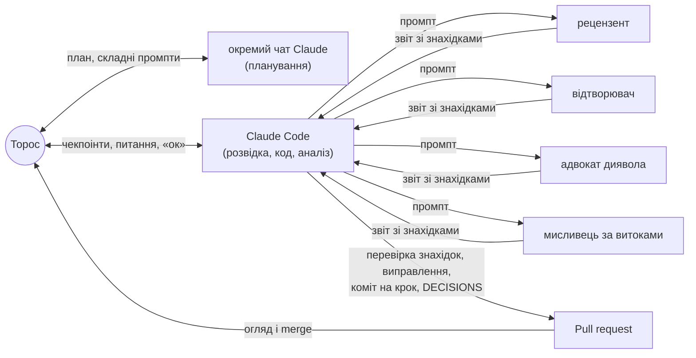

# Як це зроблено: людина + AI-агенти

Тут описано, як працювала система, без прикрас. Коротка версія — у
[README](../README.md#як-це-зроблено-людина--ai-агенти).

## Хто що робив
- **Торос (автор).**
  - Поставив питання і правила, придумав гіпотезу.
  - Перевіряв кожен чекпоінт, ставив незручні питання, мерджив PR.
  - План проєкту і найважчі промпти (постановку, критерії, означення leakage) готував в
    окремому чаті Claude.
- **Claude Code.** Розвідував джерела, писав код і тести, рахував, писав звіти й
  DECISIONS, комітив по кроку і відкривав PR. Цей файл теж написав він.
- **Чотири агенти-перевіряльники.** Окремі екземпляри Claude, запущені Claude Code. Жоден
  не бачив процесу, лише репозиторій. Агенти нічого не виправляли самі: їхні знахідки
  перевіряв і вносив Claude Code, а Торос бачив усе в PR.

## Правила, задані наперед
- **Жодних згенерованих, синтетичних чи домальованих даних** — ні для тестів, ні «щоб
  показати, як працює код». Якщо щось не вантажиться — стоп і питання. Пропуски не
  заповнюються мовчки.
- **Точне означення leakage.** Прогноз на D робиться о 00:00 за Києвом. Заборонено:
  - ознаки з D і пізніше;
  - масштабування чи підбір параметрів на всьому ряді;
  - перемішування днів;
  - новини після моменту прогнозу;
  - кінець тривоги, що йде о півночі.
- **Чекпоінти з «ок» від Тороса.** PR — у погоджених точках; merge робить лише Торос; у
  `main` напряму не пушимо; історію не переписуємо.
- **[DECISIONS.md](../DECISIONS.md)** з кожним рішенням і журналом виправлень; окремий
  коміт на кожен крок.
- **Модель «рахується»**, лише якщо вона краща за найкращий baseline і має покриття близько
  80%. Якщо ні — так і пишемо.
- **Факти про війну — лише з посиланнями.** «Якщо не впевнений — кажи прямо, не вигадуй.»

## Хронологія
| Етап | Що зроблено | PR |
|---|---|---|
| Розвідка | джерела, їхні останні дати, пастки, план на 2 дні; коду ще немає | — |
| CP1–CP3 | дані й ціль, ознаки о 00:00 і тести на leakage, baselines і протокол оцінки | [#1](https://github.com/torosyasia/air-alerts-forecast/pull/1) |
| CP4–CP5 | квантильна регресія, злам режиму, H1–H3, тривоги навколо подій | [#2](https://github.com/torosyasia/air-alerts-forecast/pull/2) |
| CP6–CP7 | Пуассон чи кластеризація, графіки, прогноз на завтра; рецензент і відтворювач | [#3](https://github.com/torosyasia/air-alerts-forecast/pull/3) |
| Після merge | адвокат диявола і мисливець за витоками; README → README + REPORT + глосарій | цей PR |

## Агенти-перевіряльники
| Агент | Коли | Що знайшов | Що змінилось |
|---|---|---|---|
| [Рецензент](reviewer.md) | 11.10, перед фінальним PR | ~170 чисел звірено. Знайдено: подвійне округлення в коді, неточну дату переходу на районні тривоги, 10 висновків сильніших за докази | виправлено все: [`c80c79f`](https://github.com/torosyasia/air-alerts-forecast/commit/c80c79f) |
| [Відтворювач](reproducer.md) | 11.10, паралельно | Закріплений запуск з чистого клону відтворюється бітово. Але `--latest` ламав тест, плодив дублі знімка, лишав модель захардкодженою, а ручні таблиці застарівали | виправлено все: [`bdf54f7`](https://github.com/torosyasia/air-alerts-forecast/commit/bdf54f7) |
| [Адвокат диявола](devils_advocate.md) | 12.10, після merge #3 | **Спростував** «злам лише київський»: Київська, Черкаська, Вінницька області теж зросли 27.08. «Усі години доби» — наслідок кількості. Розкид між днями — хвилі, а не пачки. Решта тримається | висновки переписано; додано модуль областей і fig9 ([`6818d15`](https://github.com/torosyasia/air-alerts-forecast/commit/6818d15)) |
| [Мисливець за витоками](leak_hunter.md) | 12.10, паралельно | **Справжній, але малий витік:** точка склейки KMDA → alerts.in.ua залежала від майбутніх записів. Знайдено ще баг на стику джерел (не витік). Решта шляхів чиста | тест, що падав ([`6381f59`](https://github.com/torosyasia/air-alerts-forecast/commit/6381f59)), потім виправлення ([`48d7f80`](https://github.com/torosyasia/air-alerts-forecast/commit/48d7f80)); баг — задокументований xfail |

Точні промпти — у файлі кожного агента. Промпти писав Claude Code англійською, бо агенти
працюють із кодом. Кожен промпт описує роль, задачу, обмеження («нічого не пуш», «працюй у
своєму клоні») і формат звіту.

## Де втручання людини змінило результат
| Що сказав Торос | Що змінилось |
|---|---|
| Перевірити склейку джерел за даними KMDA з data.gov.ua | KMDA стало основним джерелом для Києва — єдиним рядом по обидва боки реформи ([D-02, D-05](../DECISIONS.md)) |
| «Перевірено чи здогадка?» — про твердження, що волонтерські дані губують тривоги | Порівняння подія за подією показало, що з 2024 вони губують довгі тривоги (знаходять лише 17–28% тривог тривалістю 2–4 год). Джерело відкинуто, а моє твердження виправлено: про жовті тривоги воно було неточне ([D-03](../DECISIONS.md)) |
| Перевірити дату реформи: 06.09 чи 10.09 | За новинами й даними перехід на рівні — 06.09; 10.09 — це міські обмеження, а не оповіщення |
| Перевірити, чи не накладаються жовті й червоні тривоги | Накладання знайшлось, у Харкові. Правило «накладання = червоний» і тест «сума рівнів = загальні години» ([`9383fa8`](https://github.com/torosyasia/air-alerts-forecast/commit/9383fa8)) |
| Уточнив гіпотезу: механізм — часті атаки малими групами дронів | З'явились перевірки H1–H3: кількість чи тривалість, жовті чи червоні, контрольні міста ([D-15, D-19](../DECISIONS.md)) |
| «Чому покриття для Києва 0.43?» | Виявилось, що вибіркові квантилі з 28 точок за побудовою покривають лише 74.5%. Інтервали baselines перейшли на конформні ранги ([`cc6806f`](https://github.com/torosyasia/air-alerts-forecast/commit/cc6806f), [D-17a](../DECISIONS.md)) |
| Список подій — з новин і **закомічений до аналізу** | Події зафіксовано окремим комітом до тесту ([`99e6913`](https://github.com/torosyasia/air-alerts-forecast/commit/99e6913) → [`1afb0f9`](https://github.com/torosyasia/air-alerts-forecast/commit/1afb0f9)) |
| «Дірка після 27.08 — чи тримається висновок про Харків і Дніпро?» | Тест на маскування: вирізаємо ті самі 5 днів із київського ряду, злам видно. Висновок пом'якшено ([`32aaa47`](https://github.com/torosyasia/air-alerts-forecast/commit/32aaa47), [D-19a](../DECISIONS.md)) |

## Де Claude Code виправив сам себе
- **CV пауз між тривогами.** Перша версія рахувала інтервали «від старту до старту». Вони
  містять саму тривогу і виглядають регулярнішими, ніж є: для Харкова виходило CV < 1.
  Тепер рахуються паузи від кінця тривоги до початку наступної ([D-21](../DECISIONS.md)).
- **Збій офіційного каналу.** «Тривога» в Харкові на 109.7 год виявилась артефактом.
  29.08–02.09 канал написав «З технічних причин тимчасово не працює публікація» і 73 год
  мовчав для всієї країни. Ці дні тепер пропущені (NaN), а не заповнені
  ([`7e7145f`](https://github.com/torosyasia/air-alerts-forecast/commit/7e7145f), [D-06a](../DECISIONS.md)).
- **«Пропуск» у Києві 6–7.09** виявився справжньою тишею: це підтвердили три незалежні
  джерела. Запис про пропуск знято ([D-06](../DECISIONS.md)).

## Що з цього вийшло
- **Агенти знайшли те, чого не помітили ні Claude Code, ні Торос.** Найважливіше —
  спростування «злам лише київський»: висновок, який пройшов і чекпоінт, і рецензента.
  Витік через склейку джерел малий, але показав, що наші тести на leakage не бачили
  всередини `build.py`.
- **Рецензент і відтворювач** знайшли переважно помилки подачі: числа, сильні формулювання,
  відтворюваність. **Адвокат диявола і мисливець за витоками** — помилки суті. Тож їх
  варто запускати разом і раніше, ніж на останньому чекпоінті.
- **Кожну знахідку агента Claude Code перевіряв сам**, перш ніж вносити: скрипт адвоката
  перезапущено, головне число перераховано незалежно, тести мисливця відтворено.

## Коміти
- Рецензент → [`c80c79f`](https://github.com/torosyasia/air-alerts-forecast/commit/c80c79f).
- Відтворювач → [`bdf54f7`](https://github.com/torosyasia/air-alerts-forecast/commit/bdf54f7).
- Мисливець за витоками → [`6381f59`](https://github.com/torosyasia/air-alerts-forecast/commit/6381f59)
  (тести, що падали) → [`48d7f80`](https://github.com/torosyasia/air-alerts-forecast/commit/48d7f80) (виправлення).
- Адвокат диявола → [`6818d15`](https://github.com/torosyasia/air-alerts-forecast/commit/6818d15) (висновки, модуль областей, fig9, D у межах
  тижня).
- Короткий README, REPORT.md і глосарій → [`1c8e87f`](https://github.com/torosyasia/air-alerts-forecast/commit/1c8e87f); ця тека → [`e80991e`](https://github.com/torosyasia/air-alerts-forecast/commit/e80991e).

Повну історію див. у [PR #4](https://github.com/torosyasia/air-alerts-forecast/pull/4).

## Повний журнал
Повний журнал розмов людини з AI буде в `ai_log/` (додамо в понеділок).
