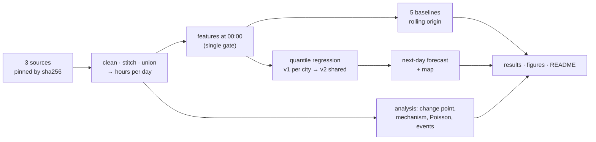

# Interview cheat sheet — Air-raid alerts, autumn 2026

**Toros-Manuk Petrychenko · KSE Agentic AI School 2026.** Data snapshot 12 Oct 2026, last full day 11 Oct.
Full Ukrainian guide: [GUIDE_UK.md](GUIDE_UK.md).

---

## 1. Pitch (60 s)
> *"I built a daily series of air-raid alert hours from three official sources and cross-checked them.*
> *A Bayesian change-point model shows an abrupt regime change in Kyiv on **27 Aug**, ten days before the 6 Sep alert-rules reform: **1.7 → 8.1 h/day**, mainly **more separate alerts**, mostly drones.*
> *The break is regional, around Kyiv. Then I built a probabilistic next-day forecast — **quantile regression**, median + 80% interval — evaluated with **rolling origin**, no leakage, against five baselines.*
> *A shared model across 23 oblast centres reaches **0.82 coverage** overall and lower error than the best baseline (**2.14 vs 2.31 h**), but loses to 'same as yesterday' on the front line.*
> *One-command reproducible, 64 tests, four independent AI checker agents."*

## 2. The task in one table
| | |
|---|---|
| **Question** | What changed in the alert regime in autumn 2026, where, and can daily alert hours be forecast honestly when the regime changes? |
| **Target** | Hours under alert per Kyiv-local day in each city — continuous, 0–24 (23/25 on DST days). **Not** yes/no: almost every day has an alert (days without any alert since 2022: Kharkiv < 1%, Kyiv 29%) |
| **Output** | Three numbers per city per day: **q10, q50, q90** → median + 80% interval. Kyiv, 12 Oct: **6.2 [2.2–11.0]** |
| **Issued at** | **00:00** of day D, from data strictly before then |
| **Covering rule** | Alert declared for the oblast, the city's raion, or the city hromada; overlaps merged (union, not sum) |
| **Baselines** | yesterday · 7-day mean · 7-day median · same weekday · climatology28 (median and 2nd/27th of the last 28 days) |
| **Metrics** | MAE · coverage of the 80% interval (Wilson CI) · interval score · (width, pinball) |
| **Validation** | Chronological + rolling origin; validation 08–27 Sep (20 d), test 28 Sep – 11 Oct (14 d) |
| **"Useful model"** | MAE **and** interval score below the best of the 5 baselines, coverage ≈ 0.80 |

**Which method answers which question**
| Question | Method |
|---|---|
| Did the regime change, when? | Bayesian single change point (Normal-Inverse-Gamma, posterior over dates, Bayes factor) |
| More alerts or longer ones? | Before/after, Mann–Whitney, log decomposition |
| Independent or clustered? | Index of dispersion (χ²), CV of quiet gaps, null simulation |
| More alerts around events? | Local-placebo permutation test (+ Holm) |
| Next-day forecast | Linear quantile regression; v2 = shared across 23 cities |

## 3. Pipeline

**Rolling origin:** for every day D in validation/test, refit on all days < D, forecast D, move on. Validation is for choices, test only for reporting.
```
2022 ─────────── history (train) ──────────── 07.09 │ 08.09–27.09 valid │ 28.09–11.10 test
                                    for each D: train = all days < D → forecast D
```

## 4. Key numbers
| Finding | Number |
|---|---|
| Kyiv break (MAP) | **27 Aug 2026**, P = 0.73 (hours) / 0.90 (count); P(before 6 Sep) = 1.000; log₁₀ BF 14.6 (inflated: days not independent) |
| Kyiv hours/day (60 d before → after) | **1.70 → 8.09** (×4.8) |
| Alerts/day | **2.08 → 7.28** (×3.5); median duration 27 → 38 min → **~80%** of the increase from count |
| After 6 Sep | 7.7 h/day, of which **7.1 yellow (91.8%)** = "drone danger" |
| Regional (h/day: before → 27.08–05.09 → from 06.09) | Kyiv 1.7 → 9.4 → 7.7 · Bila Tserkva 1.1 → 6.7 → 8.3 · Cherkasy 2.4 → 10.0 → 8.4 · Kharkiv 18.5 → 17.6 → 16.4 |
| Poisson? | Kyiv **no**: dispersion 1.44 between days but 0.97 within a week (weekly waves); gap CV 1.49 vs 1.13 without bursts (bursts within a day) |
| Events | No excess detected (min p = 0.077 of 15 tests; Kyiv +0.12 h/day) |
| Data | Official CSV: 38% exact duplicates; channel outage 29 Aug – 2 Sep (73 h) → NaN; KMDA vs official r = 0.996 |
| v2 test, 23 cities | MAE **2.14** vs 2.31 · IS 10.75 vs **10.50** · coverage **0.82** vs 0.89 |
| v2 Kyiv | MAE 4.22 vs 4.29 (yesterday) — within noise; coverage 0.71 |
| v2 by city | better MAE in **11/23** (centre, rear); worse on the front (Chernihiv 3.28 vs 2.07) |
| v1 Kyiv | 4.30 vs 4.29; median too low by +2.5 h (only 32 new-regime days) |
| New-regime training rows | **626 city-days** (v2) vs **32** (v1 Kyiv) |
| Tests | 64 = 63 passed + 1 documented xfail |

## 5. Visuals
| When did Kyiv change? | More alerts or longer? |
|---|---|
|  |  |
| **Does the fact fall in the interval? (v1 test)** | **Poisson or bursts?** |
|  |  |
| **Only Kyiv on 27 Aug?** | **Map: next-day forecast** |
|  |  |

*fig6 title says "26.09–09.10" (hard-coded old text); the actual test is 28.09–11.10.*

## 6. Core formulas
**Pinball (quantile) loss** — asymmetric: for τ = 0.9 under-forecasting costs 9× more.

$$L_\tau(y,q)=\max\big(\tau(y-q),\ (\tau-1)(y-q)\big)$$

**Quantile regression** — same linear form as OLS, different loss; one model per τ. Fit by IRLS / linear programming, not gradient descent.

$$\hat\beta_\tau=\arg\min_\beta\sum_i L_\tau(y_i,\ x_i^\top\beta)$$

**v2 shared model** — city-specific intercept $\alpha_c$, shared slopes $\beta$.

$$q_\tau(y_{c,D})=\alpha_{c,\tau}+x_{c,D}^\top\beta_\tau$$

**Interval score** ($\alpha = 0.2$) — width plus a 10× penalty for misses.

$$\text{IS}=(u-l)+\tfrac{2}{\alpha}(l-y)^+ +\tfrac{2}{\alpha}(y-u)^+$$

**Coverage and its uncertainty** — 14 test days give roughly ±21 pp.

$$\hat c=\tfrac1n\sum\mathbf 1[l\le y\le u],\qquad \text{SE}=\sqrt{0.8\cdot0.2/14}\approx0.107$$

**Conformal ranks** — under exchangeability, a new value falls between the r-th and s-th of n sorted values with probability (s − r)/(n + 1):
- pandas 10%/90% quantiles → (25.3 − 3.7)/29 = **0.745**;
- ranks 2 and 27 → 25/29 = **0.862**.

**CQR** — widen the interval by the model's own recent misses.

$$s_i=\max(q_{10}-y,\ y-q_{90}),\quad Q=s_{(\lceil 29\cdot 0.8\rceil=24)},\quad [q_{10}-Q,\ q_{90}+Q]$$

**Bayesian change point** — uniform prior over dates; segments are Normal with a NIG prior, integrated out.

$$P(\tau=d\mid y)\propto p(y_{<d})\,p(y_{\ge d}),\qquad \text{BF}=\frac{p(y\mid\text{one change})}{p(y\mid\text{no change})}$$

**Dispersion and gap CV** — Poisson gives D = 1 and CV = 1.

$$D=\frac{s^2}{\bar N},\quad (n-1)D\sim\chi^2_{n-1};\qquad \text{CV}=\frac{s_g}{\bar g}$$

**Count vs duration** — 80% of the increase from count.

$$\ln\tfrac{h_1}{h_0}=\ln\tfrac{n_1}{n_0}+\ln\tfrac{\bar d_1}{\bar d_0},\qquad \tfrac{\ln3.50}{\ln3.50+\ln1.36}\approx0.80$$

**General math (likely questions)**
| | |
|---|---|
| Bayes | $P(A\mid B)=\frac{P(B\mid A)P(A)}{P(B)}$ — rare disease, 99% sensitive, 5% FP → P ≈ 0.17 |
| Brier / log loss | $\frac1n\sum(\hat p-o)^2$ · $-\frac1n\sum[o\ln\hat p+(1-o)\ln(1-\hat p)]$ — proper scores for probabilities; ours are pinball/IS (continuous target) |
| Gradient descent | $\beta\leftarrow\beta-\eta\nabla L$; Newton uses the Hessian $H^{-1}\nabla L$; pinball is non-differentiable at 0 → QR via LP/IRLS |
| MAE vs RMSE | MAE ↔ median, robust; RMSE ↔ mean, punishes big errors |
| Bias–variance | $\text{MSE}=\text{Bias}^2+\text{Var}+\sigma^2$; L2 $\lambda\sum\beta^2$, L1 $\lambda\sum\lvert\beta\rvert$ |
| Time-series CV | no shuffled k-fold; walk-forward (expanding / sliding window) |
| ROC-AUC / PR-AUC | AUC = P(score⁺ > score⁻); PR-AUC for rare classes (baseline = prevalence); not used — no classification |
| p-value | P(this or more extreme \| H₀), not P(H₀); 15 tests → 1 − 0.95¹⁵ ≈ 0.54; Holm: $p_{(i)}\le\alpha/(m-i+1)$ |
| Confidence vs credible | frequentist procedure (Wilson, bootstrap) vs posterior probability (HPD) |
| MLE | Gaussian noise → OLS; Laplace → median regression; asymmetric Laplace → quantile regression |
| Poisson / NB | Var = mean; overdispersion → negative binomial $\text{Var}=\mu+\mu^2/r$ |
| Boosting | $F_m=F_{m-1}+\eta h_m$, trees fit on negative gradients; strong on tabular data, needs data |

## 7. Ready answers
**Why does the model barely beat "same as yesterday"?**
> *"Alert hours are persistent — the level moves in one-to-two-week waves — and on the front line alerts run almost non-stop, so yesterday is nearly perfect. Days are also very different (Kyiv SD 5.1 h), and the driver is the enemy's decisions, which aren't in our history. With 14 test days the gap is within noise, and I say that openly. The real gain is honest intervals."*

**How do you know there's no leakage?**
> *"Three layers. By construction, a single gate cuts all history at 00:00, and an alert running at midnight is known only up to midnight. Perturbation tests change the future in four ways and require bit-identical features; they have proven power — they catch a deliberately broken cutoff. And an independent agent rebuilt the whole pipeline from raw data as of each forecast time and found one small real leak in source stitching, which we fixed test-first."*

**What did you do, and what did the AI do?**
> *"Claude Code wrote the code. I owned the framing: the question, the hypothesis, the target and leakage definitions, the success criterion, the rules — no synthetic data, checkpoints, a decision log. I verified every checkpoint, and several of my questions changed the result: 'why is Kyiv's coverage 0.43?' led to conformal ranks; 'one model for all cities' led to v2. I also set up four independent checker agents, and they found things neither of us had seen."*

**Why quantile regression?**
> *"It predicts the interval bounds directly, with no distributional assumption — our hours are skewed and bounded 0–24 — and the width can depend on the features. It's linear, so it's stable with ~44 days of the new regime and interpretable. OLS ± σ gives symmetric, constant intervals that can go negative; boosting would overfit or learn the old regime."*

**Why not use the break date as a feature?**
> *"It was found on the whole series, including the test — that would be leakage. The model adapts through lags. Online change detection using only past data is the honest next step."*

**Why 80% and not 100% coverage?**
> *"A 0–24 h interval always covers. An 80% interval should miss about 2 days in 10; above 0.80 means too wide, below means overconfident."*

**Why is the median "too low" in Kyiv?**
> *"Skew: a few very heavy days pull the mean up. The fact exceeds the median in only 7 of 14 days."*

## 8. Weak spots — say them first
- Test is **14 days** (±21 pp on coverage); Kyiv's edge over yesterday (4.22 vs 4.29) is noise; no bootstrap for v2.
- By the pre-stated criterion v2 **doesn't** beat the best baseline on interval score overall (10.75 vs 10.50). It was chosen by a "plausible coverage first, then IS" rule written after the first validation run.
- "0.82 vs 0.71" compares v2 with **per-city models on the same 23 cities**, not with v1. Kyiv's v2 coverage is 0.71.
- Outside Kyiv the data source changes on 7 Sep, right after the reform.
- We observe **alerts, not attacks**.
- Day-independence makes p-values and BF optimistic; the Kyiv effect is large enough not to matter.
- Researcher degrees of freedom are documented: 84-day window at the grid edge, CQR threshold set after seeing validation.

**Next steps:** online change detection · groups of cities / hierarchical (partial pooling) model · leave-one-city-out · quantile boosting · red-alert classifier (Brier, AUC) once there's enough data.

## 9. About me
- **2nd-year BSc Applied Mathematics, KSE**; before that, the Ukrainian Physics and Mathematics Lyceum (УФМЛ). Interests: graph and hypergraph theory, dynamical systems, AI-agent workflows.
- **Achievements:**
  - silver prize, All-Ukrainian Mathematical Battles Tournament (2022);
  - All-Ukrainian Math Olympiad, district/city stages (2023–2025) [results — уточнити];
  - Yuliia Zdanovska Memorial Scholarship (2026);
  - KSE student math tournament (2025);
  - this project reached the interview stage.
- **Experience:**
  - KSE Institutional Development Lab: squad #4 lead (Scholarship Committee and Senate) and head of the Project Office (10 squads); designed scholarship/Senate processes and a workload model; built the lab tracker with Apps Script;
  - lecturer at the summer olympiad school «Математичний Олімп» (2025, 2026);
  - math-battles judge (2026);
  - tutor.
- **Other builds with Claude:** graph_agent (graph/hypergraph verification) · NMT-2027 prep portal.
- **Skills:**
  - Python — pandas, statsmodels, pytest (code via Claude Code);
  - Git/GitHub, Apps Script, LaTeX;
  - Claude, Claude Code, Cowork, multi-agent verification.

**Tell me about yourself (~35 s).**
> *"I'm Toros, a second-year Applied Math student at KSE, from a math-olympiad background — silver at the All-Ukrainian Math Battles, and now I teach at a summer olympiad school. This year I lead a squad and run the project office in KSE's Institutional Development Lab. For the selection task I built an air-alert forecasting project with Claude Code. I set the question and the rules, checked every result, and used independent AI agents to catch mistakes."*

**Why Agentic AI School? (~30 s)**
> *"In the lab I want to bring AI into how we work — communication, Claude in Slack, CRM and Sheets automations. The alerts project showed me that agents are powerful but need structure: checkpoints, tests, independent reviewers. I want to learn to build agentic systems properly and apply them at KSE right away."*

**Biggest achievement? (~40 s)**
> *"The air-alerts project. In three days, working with AI agents, we found that the public alerts dataset had silently stopped updating. We cross-checked three sources and dated Kyiv's regime change to 27 August. Then we built an all-Ukraine forecast — interval coverage 0.82 overall against a nominal 0.80 — and an interactive map. I'm proudest that it's honest: a checker agent found a real data leak, we fixed it test-first, and the README says plainly where the model doesn't beat a simple baseline."*

*Fill in the [уточнити] items before the interview (olympiad results, English level).*
