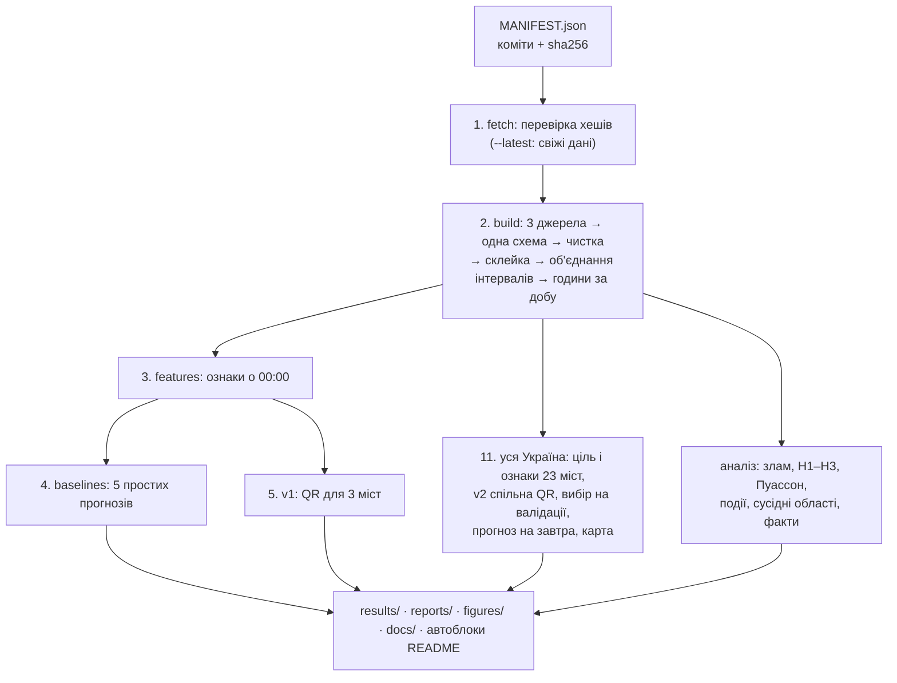

# Підготовка до співбесіди — детальний гайд

Проєкт: **«Повітряні тривоги восени 2026: що змінилось, де, і чи можна це прогнозувати»**.
Знімок даних 12.10.2026, остання повна доба 11.10.2026. Усі числа взято з файлів репозиторію;
приклади з «умовними» числами позначено окремо.

Коротка англійська шпаргалка для друку — [CHEATSHEET_EN.md](CHEATSHEET_EN.md).

**Позначки:** 🔴 найімовірніше спитають · 🟡 можуть спитати · ⚪ рідко.

## Зміст
1. [Проєкт за 60 секунд](#1-проєкт-за-60-секунд-)
2. [Рамка задачі: що прогнозували і чому](#2-рамка-задачі-що-прогнозували-і-чому-)
3. [Архітектура](#3-архітектура-)
4. [Дані і ціль](#4-дані-і-ціль-)
5. [Leakage](#5-leakage-)
6. [Оцінка: train / validation / test і метрики](#6-оцінка-train--validation--test-і-метрики-)
7. [Baselines і конформні ранги](#7-baselines-і-конформні-ранги-)
8. [Квантилі і квантильна регресія](#8-квантилі-і-квантильна-регресія-)
9. [Моделі: v1 → v2, «як учора», абляція, CQR](#9-моделі-v1--v2-як-учора-абляція-cqr-)
10. [Де тут часові ряди](#10-де-тут-часові-ряди-)
11. [Злам режиму: байєсівська модель](#11-злам-режиму-байєсівська-модель-)
12. [Механізм: кількість, рівні, регіональність](#12-механізм-кількість-рівні-регіональність-)
13. [Процес тривог: Пуассон чи пачки](#13-процес-тривог-пуассон-чи-пачки-)
14. [Події: перестановковий тест і Голм](#14-події-перестановковий-тест-і-голм-)
15. [Агенти: хто що робив](#15-агенти-хто-що-робив-)
16. [Слабкі місця і чесні відповіді](#16-слабкі-місця-і-чесні-відповіді-)
17. [Що можна було б зробити: ідеї](#17-що-можна-було-б-зробити-ідеї-)
18. [Загальна математика](#18-загальна-математика)
19. [Банк питань](#19-банк-питань)
20. [Словник UA–EN](#20-словник-uaen)

---

## 1. Проєкт за 60 секунд 🔴

**Українською.**
> «Я дивився, як змінились повітряні тривоги восени 2026. Зібрав щоденний ряд годин тривоги з трьох офіційних джерел і звірив їх між собою. Байєсівська модель зламу показала: у Києві режим змінився різко 27.08, за 10 днів до нових правил оголошення. Годин стало 1.7 → 8.1 на добу, насамперед через кількість окремих тривог, і переважно це дрони. Злам регіональний: Київ і області довкола. Потім я зробив ймовірнісний прогноз на добу — квантильну регресію з медіаною і 80% інтервалом — і перевірив його без leakage проти п'яти простих прогнозів. Спільна модель на 23 обласні центри дає інтервали з покриттям 0.82 і трохи меншу помилку, ніж найкращий простий прогноз; на фронті вона гірша за "як учора". Усе відтворюється однією командою, 64 тести, і чотири незалежні AI-агенти перевіряли числа, відтворюваність, висновки й витоки.»

**English.**
> *"I studied how air-raid alerts changed in autumn 2026. I built a daily series of alert hours from three official sources and cross-checked them. A Bayesian change-point model shows an abrupt regime change in Kyiv on 27 August — ten days before the alert rules changed — from 1.7 to 8.1 hours a day, driven mainly by more separate alerts, mostly drones. The break is regional, around Kyiv. Then I built a probabilistic next-day forecast — quantile regression with a median and an 80% interval — evaluated with rolling origin, without leakage, against five baselines. A shared model across 23 oblast centres reaches 0.82 interval coverage overall and slightly lower error than the best baseline, but loses to 'same as yesterday' on the front line. Everything reproduces with one command, 64 tests, and four independent AI agents audited the numbers, reproducibility, conclusions and leakage."*

---

## 2. Рамка задачі: що прогнозували і чому 🔴

| Питання | Відповідь |
|---|---|
| **Головне питання** | Що змінилось у режимі тривог восени 2026, де саме, і чи можна чесно прогнозувати добові години тривоги, коли режим змінюється? |
| **Що прогнозуємо** | **Години тривоги за добу** (00:00–24:00 за Києвом) у кожному з 23 обласних центрів. Неперервна ціль від 0 до 24 (23 або 25 у дні переходу годинника) |
| **Що на виході** | Три числа: **q10, q50, q90**. q50 — точковий прогноз (медіана), [q10, q90] — 80% інтервал |
| **Коли робимо прогноз** | О **00:00** дня D, лише з того, що відомо до цього моменту |
| **Чому не «буде тривога чи ні»** | Для більшості міст бінарна ціль тривіальна: днів без жодної тривоги з 2022 — Харків < 1%, Дніпро 1%, Київ 29% |
| **Чому не «коли наступна тривога»** | Точний момент залежить від рішень, яких у даних не видно, його не передбачити |
| **Baselines** | 5 простих прогнозів: «як учора», середнє за 7 днів, медіана за 7, «як тиждень тому», квантилі останніх 28 днів |
| **Метрики** | MAE, покриття 80% інтервалу (з інтервалом Вілсона), ширина, interval score, pinball loss |
| **Валідація** | Хронологічна, rolling origin: щодня перенавчання на минулому. Валідація 08.09–27.09 (20 днів), тест 28.09–11.10 (14 днів) |
| **Критерій «модель корисна»** | MAE **і** interval score нижчі, ніж у найкращого з 5 baselines, а покриття близьке до 80% |

**Яка модель для якої задачі**

| Задача | Метод |
|---|---|
| Чи і коли змінився режим | Байєсівська модель з однією точкою зламу |
| Більше тривог чи довші | Порівняння до/після, тест Манна–Вітні, розклад у логарифмах |
| Тривоги в усі години доби? | χ² для блоків доби + null-симуляція |
| Незалежні тривоги чи пачки | Індекс дисперсії, χ²-тест, CV пауз, null-симуляція |
| Тривоги навколо подій | Перестановковий тест із локальними плацебо |
| Прогноз на добу | Лінійна квантильна регресія (v2: спільна на 23 міста) |
| Чи чесна оцінка | Rolling origin, блоковий bootstrap, тести на leakage, агенти |

---

## 3. Архітектура 🔴

### 3.1. Три шари
| Шар | Питання | Модулі |
|---|---|---|
| **Дані** | Скільки годин місто реально було під тривогою щодня? | `fetch`, `sources`, `build`, `intervals` |
| **Аналіз** | Чи змінився режим, коли, де і чому? | `regimes`, `process`, `events`, `neighbours`, `stats` |
| **Прогноз** | Скільки годин буде завтра, з інтервалом? Чи чесно ми це міряємо? | `features`, `evaluate`, `models`, `national_models`, `forecast` |

Плюс шари довіри: **тести** (64: 63 passed + 1 xfailed) і **4 агенти-перевіряльники**.

> ⚠️ **Пастка.** Дата зламу (27.08) **не подається в модель прогнозу**. Її знайдено на всьому ряді, включно з тестом, тож це був би leakage. Модель «бачить» новий рівень лише через лаги (учора, середнє за 7 днів). *EN: "The change point is an analysis result, not a model input."*

### 3.2. Конвеєр `run_all.py` (одна команда, ~12 хв)


Що робить кожен крок:
1. **fetch.** Бере точні версії джерел і перевіряє sha256. Якщо хеш не збігся, запуск зупиняється.
2. **build.**
   - Кожне джерело перекладає записи в одну схему: місто, рівень, початок, кінець (UTC).
   - Чистка: дублі, домальовані кінці, збій каналу → NaN.
   - Склейка джерел у фіксовану північ.
   - Об'єднання інтервалів і розрізання по добах за Києвом.
   - Результат — таблиця «місто × день → години».
3. **features.** Ознаки станом на 00:00, лише через одну функцію-«ворота» `history_at`.
4. **baselines.** Прості прогнози з інтервалами з власних минулих помилок.
5. **v1.** Квантильна регресія для Києва, Харкова, Дніпра; підбір вікна; CQR; абляції.
6. **Аналіз.** Байєсівський злам, механізм, Пуассон, події, сусідні області, факти.
7. **Уся Україна.** Ціль і ознаки для 23 міст тими самими функціями → три варіанти моделі + 5 baselines → головна модель обирається лише на валідації → прогноз на завтра → карта.
8. **figures** (9 графіків) і **автоблоки** README/REPORT. Переписується лише текст між мітками `<!-- NAME:START -->` і `<!-- NAME:END -->`.

**Чому так:**
- **Закріплені версії** → бітова відтворюваність з чистого клону, включно з PNG. Це перевірив агент-відтворювач.
- **Модулі за питаннями** → кожен крок можна протестувати окремо.
- **Автоблоки** → прогноз у README не застаріває після оновлення даних.

### 3.3. Схема даних
- **Запис тривоги:** `source, city, unit_type, unit, level (none/yellow/red), cause, started_at, finished_at (UTC), record_id`.
- **Денна таблиця:** `city, date, hours, hours_yellow, hours_red, hours_none, n_episodes, day_len_h, source, long_alert, missing`. Ціль $y_{c,D}$ = `hours`.

### 3.4. Тести
| Файл | Що гарантує |
|---|---|
| `test_target.py` | ціль правильна: секундна сітка, DST, дублі, рівні, правило покриття |
| `test_leakage.py`, `test_leak_hunt.py` | майбутнє не впливає на ознаки і прогноз |
| `test_evaluate.py`, `test_models.py` | baselines і моделі бачать лише минуле; квантилі впорядковані |
| `test_regimes.py`, `test_national.py`, `test_outputs.py` | аналіз, 23 міста, вихідні файли й автоблоки |

Усі тести на **реальних** даних; синтетичних немає за правилом. **Xfail** — задокументований відомий баг на стику джерел (≤ 0.02 год MAE), а не збій.

---

## 4. Дані і ціль 🔴

### 4.1. Три джерела
| Джерело | Що дає | Деталі |
|---|---|---|
| **KMDA** (data.gov.ua) | Київ: єдиний ряд по обидва боки реформи 06.09, з рівнем і причиною | 2 641 запис; знімок закомічено, бо upstream перезаписує файл |
| **Офіційний канал @air_alert_ua** (датасет Vadimkin) | інші міста до 07.09 | 299 275 рядків, **38% — повні дублі**; стрічка мовчки закінчилась 07.09 |
| **alerts.in.ua** (архів JustJimer) | усі міста після 07.09 | API зберігає історію лише на місяць, тому архів повний приблизно з 06.09 |
| ~~eTryvoga~~ (волонтери) | **відкинуто** | з 2024 губить довгі тривоги: з тривог 2–4 год знаходить лише 17–28%; має тривоги, яких немає в офіційних даних |

**Звірка (cross-check):**
- KMDA vs офіційний канал: кореляція **0.996**, MAE 0.017 год на добу (1 630 днів).
- KMDA vs alerts.in.ua: MAE 0.015 год, 35 днів, жодного дня з різницею > 0.1 год.
- Телеграф: 13, 12, 10, 11 тривог 27–30.08. У нас рівно стільки ж.

**Склейка:** до 07.09 — офіційний канал, після — alerts.in.ua; для Києва KMDA. Перекриття: Харків 15.10 проти 15.11 год; Дніпро 6.32 проти 7.81 (в офіційному CSV бракує запису громади; позначено).

### 4.2. Ціль
$$y_{c,D}=\frac{1}{3600}\,\Big|\ \bigcup_i [s_i, e_i)\ \cap\ [D_{00:00},\ D_{24:00})\ \Big|$$
- $c$ — місто, $D$ — доба за Києвом
- $[s_i, e_i)$ — $i$-та тривога, що покриває місто
- $\bigcup$ — **об'єднання** (накладене рахується один раз)
- $|\cdot|$ — довжина в секундах; ділимо на 3600 → години

**Правило покриття.** Місто під тривогою, якщо її оголошено на **область**, на **район, що містить місто**, або на **громаду міста**. Тривоги в інших районах області — ні.
- Чому три рівні: з 2025 частина областей перейшла з обласних тривог на районні. Без районів і громад ми б пропустили більшість тривог.
- Чому об'єднання: о 10:00–11:00 тривога для області, району і громади. Сума дала б 3 год, об'єднання — 1 год.

**Деталі:**
- **Рівні.** Пріоритет червоний > жовтий > без рівня. У Харкові знайшлось 66 відрізків накладання (151 год).
- **DST.** Доба має 23 або 25 год.
- **Епізод (тривога).** Записи з паузою ≤ 60 с склеюються, бо зміна рівня йде без «відбою».

**Чому місто, а не «будь-де в області».** Обласна міра насичується: Дніпро 22% часу в місті проти **100%** будь-де в області; Харків 77% проти 93%.

### 4.3. Чистка: «не заповнюємо, а позначаємо»
| Проблема | Рішення |
|---|---|
| Збій каналу 29.08–02.09 (73 год тиші на всю країну) | 5 днів = **NaN** для міст на офіційному каналі. Нуль збрехав би «тихо», інтерполяція — синтетичні дані |
| Харків: «тривога» 109.7 год | артефакт збою: «відбій» прийшов, щойно канал ожив |
| Записи з домальованим кінцем (рівно 1 год) | викинуто; без них змінюються ≤ 9 днів |
| Київ 6–7.09 | не пропуск: три джерела показують справжню тишу |
| Записи довші за 24 год | лишили, позначили прапорцем |

**Q&A:**
- **«Звідки знаєш, що ціль правильна?»** → «Тест перераховує години по секундній сітці; три джерела збігаються (0.996); кількість тривог збігається з новинами.»
- **«Чому NaN, а не нуль?»** → «Missing is not zero: ми не знаємо, чи була тривога. NaN-день не прогнозується і не оцінюється.»

---

## 5. Leakage 🔴

**Що це.** Інформація, якої в момент прогнозу ще не було, потрапляє в навчання чи оцінку. Модель «підглядає у відповіді», тест показує кращу якість, ніж буде в житті.

**Головне:** витік **не видно з метрик**. Він робить їх кращими, тобто приємнішими. Захист — лише конструкція і тести.

**Означення в проєкті.** Прогноз на $D$ — о $t_0 = D$ 00:00 за Києвом:
$$x_D = f\big(\mathcal H_{t_0}\big),\qquad \mathcal H_{t_0}=\{\text{записи з } s_i < t_0,\ \text{обрізані на } t_0\}$$
- $x_D$ — ознаки для дня $D$
- $\mathcal H_{t_0}$ — історія, відома на момент $t_0$

**Заборонено:**
- ознаки з $D$ і пізніше;
- кінець тривоги, що йде о півночі. Відомо лише, що вона йде і скільки вже триває. Приклад: запис 07.09 19:39 → 08.09 05:40, о $t_0$ відомо лише 4 год 20 хв 33 с;
- підбір параметрів чи вибір моделі на тесті;
- перемішування днів;
- новини після моменту прогнозу.

**Як перевіряли:**
| Тест | Ідея |
|---|---|
| Збурення майбутнього | Майбутнє змінюємо 4 способами (викинути; тривога о $t_0$ закінчується через 1 с; ніколи; зсув на 5 год) → ознаки мають лишитись **бітово** тими самими |
| Потужність тесту | Навмисно зламана відсічка (03:00 замість 00:00) → тест падає. Тест, що ніколи не падає, нічого не доводить |
| Лаг = минула ціль | `h_lag1(D)` точно дорівнює $y(D-1)$ |
| **As-of rebuild** | Увесь конвеєр перебудовується з **сирих** даних, обрізаних на $t_0$ → ознаки ті самі |
| Вибір моделі | Усі тестові $y$ замінюємо випадковими → обрана модель і валідаційні метрики ті самі |

**Справжній витік L1.**
- **Що.** День склейки Києва KMDA → alerts.in.ua брався з **останнього** запису KMDA, тобто з майбутнього.
- **Хто знайшов.** Агент-мисливець. Наші тести збурювали вже оброблені записи, а витік був раніше, у підготовці даних.
- **Масштаб.** Ознаки Києва зсувались до 0.09 год; метрики змінились би на ±0.1 год MAE у різні боки, тобто це не систематичний оптимізм.
- **Як виправили.** Спершу тест, що падає, потім фікс: дата склейки закріплюється разом зі знімком. Опубліковані числа не змінились.

**Свобода дослідника** (не витік коду, але чесно розкрито):
- поріг CQR обрано після перегляду валідації;
- спосіб інтервалів baselines змінено, коли тестова таблиця вже була видна (рішення — за валідацією);
- вікно 84 дні — край сітки;
- правило вибору v2 сформульоване після першого прогону.

**Q: «Звідки знаєш, що leakage немає?»**
> «Гарантувати на 100% не можна, але відомі шляхи закрито. Перше — конструкція: уся історія йде через одну функцію, що обрізає на 00:00. Друге — тести, які змінюють майбутнє, і вони мають потужність: ловлять навмисно зламану відсічку. Третє — незалежний агент перебудував увесь конвеєр із сирих даних на момент прогнозу і знайшов один малий витік у склейці джерел; ми його виправили test-first.»

**Пастка.** Leakage ≠ overfitting. Overfitting — модель запам'ятала шум. Leakage — модель бачила майбутнє.

---

## 6. Оцінка: train / validation / test і метрики 🔴

### 6.1. Чим наш поділ відрізняється від класичного
- **Класика.** Один раз розрізати → навчити на train → підібрати на validation → один раз перевірити на test.
- **Для часових рядів не можна:**
  - випадковий поділ кладе майбутнє в train;
  - один фіксований поділ заморожує модель на старому режимі.
- **У нас — хронологічний поділ + rolling origin (expanding window):**
```
16.03.2022 ─────────────────────────── 07.09 │ 08.09 ─── 27.09 │ 28.09 ─── 11.10
              історія (train)                │ валідація 20 дн │ тест 14 дн
 для кожного дня D: train = усі дні < D → прогноз D → D додається в історію → D+1
```
- **Валідація** — для всіх виборів: вікно W, правило CQR, головна модель.
- **Тест** — лише звіт. Разом 23 × 14 = **322** прогнози.
- **Sliding window.** Варіант, де train — лише останні 84 дні.

### 6.2. Метрики
$y$ — факт, $q_{10}, q_{50}, q_{90}$ — прогноз, $n$ — днів, $\alpha = 0.2$.

| Метрика | Формула | Сенс |
|---|---|---|
| **MAE** | $\frac1n\sum \lvert y-q_{50}\rvert$ | середня помилка медіани, год |
| **relMAE** | $\text{MAE}/\text{MAE}_{\text{yesterday}}$ | < 1 — краще за «як учора»; замість MASE |
| **Coverage** | $\frac1n\sum \mathbf 1[q_{10}\le y\le q_{90}]$ | ціль 0.80 |
| **Width** | $\frac1n\sum(q_{90}-q_{10})$ | вужче — корисніше |
| **Interval score** | $(q_{90}-q_{10})+\tfrac{2}{\alpha}(q_{10}-y)^+ +\tfrac{2}{\alpha}(y-q_{90})^+$ | ширина + 10 × промах; менше — краще |
| **Pinball** | середнє $L_\tau$ по τ = 0.1, 0.5, 0.9 | якість кожного квантиля |

$(z)^+ = \max(z, 0)$.

**Чому покриття ≈ 0.80, а не 100%.** 100% дає і безглуздий інтервал «0–24 год». 80% інтервал має промахнутись приблизно у 2 днях з 10.
- **< 0.80** → самовпевнений, надто вузький (*overconfident*);
- **> 0.80** → перестраховується, надто широкий (*underconfident*).
- Приклад: у Запоріжжі покриття v2 **1.00**, але interval score 14.29 проти 5.74 у простого прогнозу.

**Інтервал Вілсона** — довірчий інтервал для частки, коректний на малих $n$. Наскільки грубий тест з 14 днів:
$$\text{SE}=\sqrt{\frac{p(1-p)}{n}}=\sqrt{\frac{0.8\cdot0.2}{14}}\approx0.107\ \Rightarrow\ \pm1.96\cdot0.107\approx\pm21\text{ п.п.}$$

**Блоковий bootstrap різниці «модель − baseline».** Тягнемо дні з поверненням **блоками по 3 підряд** (зберігає залежність сусідніх днів), 5 000 разів, і беремо 2.5% і 97.5%. Якщо інтервал містить 0, перевага не доведена.
- v1, тест: MAE −0.29 [−0.46, +0.17], IS −0.77 [−2.76, +0.89] — обидва містять 0.
- Для v2 не рахували.
- Чому не тест Дібольда–Маріано: свідомо обрали bootstrap (D-11).

**Критерій «модель корисна».** MAE і IS нижчі за найкращий baseline, обраний **окремо за кожною метрикою** (на користь baselines), і покриття ≈ 0.80.

---

## 7. Baselines і конформні ранги 🔴

**П'ять простих прогнозів:**
- «як учора»: $\hat y_D = y_{D-1}$ (naive / persistence);
- середнє за 7 днів;
- медіана за 7 днів;
- «як тиждень тому»: $y_{D-7}$;
- **climatology28** — назва з метеорології: прогноз «як зазвичай буває», без поточних змін. Медіана останніх 28 днів, інтервал — 2-ге і 27-ме значення з 28.

**Інтервали перших чотирьох:** прогноз + межі **власних помилок** за останні 28 днів.

**Чому не звичайні квантилі 10% / 90%.** Якщо значення обмінювані (exchangeable: режим стабільний, порядок не важливий), нове значення потрапляє між $r$-м і $s$-м з $n$ упорядкованих значень з імовірністю
$$P=\frac{s-r}{n+1}$$
- **pandas** (інтерполяція): ранги 3.7 і 25.3 → $\frac{25.3-3.7}{29}=\mathbf{0.745}$, менше 0.80 навіть без зміни режиму.
- **Конформні ранги:** $k_{lo}=\lfloor 29\cdot0.1\rfloor=2$, $k_{hi}=\lceil 29\cdot0.9\rceil=27$ → $\frac{27-2}{29}=\mathbf{0.862}\ge0.80$.

**Історія.** Ти спитав: «Чому покриття для Києва 0.43?» → розібрались → конформні ранги, обрано на валідації (N = 28). Покриття медіани за 7 днів у Києві на тесті стало 0.79.

**Найкращий простий прогноз разом на тесті — climatology28:** MAE 2.31, IS 10.50, покриття 0.89. На фронті найкращий — «як учора».

---

## 8. Квантилі і квантильна регресія 🔴

### 8.1. Квантиль
$\tau$-квантиль — значення, нижче якого лежить частка $\tau$ випадків.
- 0.5 = **медіана**;
- 0.9 — лише 10% днів вищі;
- 0.1 — лише 10% нижчі.
- Між 0.1 і 0.9 лежить **80%** днів — це наш інтервал.

**Київ на 12.10: 2.2 / 6.2 / 11.0.** «Найімовірніше ~6 год; з імовірністю 80% — від 2 до 11; приблизно 1 шанс із 10, що більше 11.»

### 8.2. Pinball loss — асиметрична помилка
Штраф залежить від того, **в який бік** помилився:
$$L_\tau(y, q) = \begin{cases} \tau\,(y - q), & y \ge q \quad\text{(недопрогноз)}\\ (1-\tau)\,(q - y), & y < q \quad\text{(перепрогноз)}\end{cases}$$
- $y$ — факт, $q$ — прогноз квантиля, $\tau$ — який квантиль.

**Аналогія: дорога в аеропорт.** Запізнитись дорожче, ніж приїхати раніше, тому плануєш песимістичний час дороги, тобто 90-й квантиль.

**Київ, $q_{90} = 11$:**
- факт 14 → штраф $0.9\cdot3=2.7$;
- факт 5 → $0.1\cdot6=0.6$.

Занизити в 9 разів болючіше, тож модель піднімає $q_{90}$, доки вище лишається лише ~10% днів. Для τ = 0.5 штраф симетричний, і мінімум дає **медіана** (MAE).

### 8.3. Лінійна і квантильна регресія
**Лінійна:** $\hat y=\beta_0+\beta_1x_1+\dots+\beta_kx_k=x^\top\beta$.
- $x_j$ — ознаки;
- $\beta_j$ — на скільки зростає прогноз, коли ознака зростає на 1.

**OLS** мінімізує суму квадратів і має готову формулу. Вона прогнозує **середнє**:
$$\hat\beta=\arg\min_\beta\sum_i (y_i-x_i^\top\beta)^2=(X^\top X)^{-1}X^\top y$$

**Квантильна регресія** — та сама лінійна формула, але мінімізує pinball. Тому прогнозує **квантиль**:
$$\hat\beta_\tau = \arg\min_\beta \sum_{i} L_\tau\big(y_i,\ x_i^\top \beta\big)$$
- Готової формули немає: лінійне програмування або **IRLS** (iteratively reweighted least squares). Statsmodels рахує IRLS: багато разів повторена **зважена** регресія, ваги рядків перераховуються із залишків. Це лише спосіб обчислення, а не OLS-модель.
- **Кожен квантиль — окрема модель:** три оптимізації з тими самими ознаками, але своїми вагами $\beta_{0.1}, \beta_{0.5}, \beta_{0.9}$. Квантилі можуть «перетнутись», тому їх сортуємо.

### 8.4. Чому квантильна регресія, а не інше
| Альтернатива | Чому гірше для нас |
|---|---|
| **OLS + «±1.28σ»** | Інтервал однакової ширини щодня і симетричний (може піти нижче 0: середнє 2, σ = 3 → [−1.8; 5.8]); припускає нормальність, а години скошені й обмежені 0–24 |
| **Пуассон / негативний біноміальний** | Моделі для **кількості**, а ціль — **години**. Довелось би окремо модель кількості (NB, бо D > 1) і модель тривалості |
| **Бустинг, нейромережі** | Нового режиму ~44 дні на місто: перенавчання або вивчення старого режиму; важче пояснити й перевірити на leakage |
| **Квантильна регресія ✅** | Межі інтервалу напряму, без припущень про розподіл; ширина може залежати від ознак; лінійна → стабільна на малих даних і пояснювана |

**Чому 0.1 / 0.5 / 0.9.** Медіана оптимальна для MAE і стійка до кількох дуже важких днів (skew). 80% зафіксовано заздалегідь. Наша аргументація: на 14 днях 95% інтервал має промахнутись у середньому лише 0.7 дня, тож калібрування не перевірити; 80% → ~2.8 промаху.

### 8.5. Ознаки (8 штук)
| Ознака | Сенс |
|---|---|
| `h_lag1` | години вчора |
| `h_mean7`, `h_mean28` | середні за 7 і 28 днів |
| `ep_mean7` | середня кількість тривог за 7 днів |
| `h_last6h` | години тривоги за останні 6 год до півночі |
| `weekend` | вихідний |
| `active_t0` | чи йде тривога о 00:00 |
| `active_elapsed_h` | скільки вона вже триває |

У v2 додаються прапорці міста (one-hot). Ще 13 ознак рахуються, але модель їх не використовує (`post_reform`, `dow`, лаги рівнів тощо).

**«Модель бачить рівень через лаги».** Коли режим стрибає з 1.7 до 8 год, «учора» і «середнє за 7 днів» самі стають ~8, і прогноз піднімається, хоча дати зламу модель не знає.

### 8.6. Як робимо прогноз (крок за кроком)
1. **Таблиця:** рядок = (місто, день), 8 ознак + ціль. У v2 ≈ 1 643 рядки на місто × 23.
2. **Для кожного дня $D$:** навчаємо 3 QuantReg на рядках з датою $< D$.
3. **Підставляємо ознаки дня $D$ у формулу.** Умовний приклад: ваги 0.5 + 0.3·учора + 0.5·середнє_7; учора 5.4, середнє 8.0 → $0.5+1.62+4.0\approx6.1$.
4. **Сортуємо** q10 ≤ q50 ≤ q90 і **обрізаємо** до [0, довжина доби].
5. **Прогноз на завтра** — та сама модель v2 на день «остання повна доба + 1»: історія до 00:00, навчання на всіх днях до неї, 23 міста одразу. Додаємо MAE і покриття на тесті для кожного міста, щоб було видно, наскільки цьому вірити.

---

## 9. Моделі: v1 → v2, «як учора», абляція, CQR 🔴

### 9.1. v1 і v2 — та сама квантильна регресія, різні дані
- **v1** — окрема модель на кожне з 3 міст (Київ, Харків, Дніпро). Варіанти: вся історія або свіже вікно; три набори ознак; CQR для вузьких інтервалів.
- **v2** — одна спільна модель на 23 міста, свій базовий рівень у кожного міста:
$$q_\tau(y_{c,D})=\alpha_{c,\tau}+x_{c,D}^\top\beta_\tau$$
- $\alpha_{c,\tau}$ — свій рівень міста
- $\beta_\tau$ — спільні ваги ознак

Ідея: залежність «учора → сьогодні» схожа в різних містах. Тож на початку тесту v2 бачить **626 місто-днів** нового режиму замість **32** у Києва. Англійською — **global model / pooling across series**.

### 9.2. Результати на тесті 28.09–11.10
| | v1 | v2 | Найкращий простий прогноз |
|---|---|---|---|
| Київ, MAE, год | 4.30 | **4.22** | 4.29 («як учора») |
| Київ, interval score | 18.36 | **18.15** | 18.46 (медіана за 7 днів) |
| Київ, покриття | **0.79** | 0.71 | — |
| Київ: факт мінус медіана, у середньому | +2.5 (вище в 9 з 14) | +1.1 (вище в 7 з 14) | — |

| 23 міста разом | MAE | IS | Покриття |
|---|---|---|---|
| **v2, спільна** | 2.14 | 10.75 | **0.82** |
| окремі моделі на 23 міста | **2.10** | 10.22 | 0.71 |
| спільна на останніх 84 днях | 2.15 | **10.09** | 0.74 |
| climatology28 | 2.31 | 10.50 | 0.89 |

- v2 краща за MAE в 11 з 23 міст, за IS теж в 11, за обома — у 8.
- **Краща:** центр і тил. Дніпро 2.29 проти 2.92, Полтава, Черкаси, Житомир, Київ.
- **Гірша:** фронт і південь. Чернігів 3.28 проти 2.07, Суми 3.09 проти 2.23, Харків, Запоріжжя, Херсон, Миколаїв, Вінниця.

**Чому обрали v2 (лише за валідацією).** Серед варіантів, у яких 95% CI покриття містить 0.80, — найменший IS. Окремі моделі (0.68) і свіже вікно (0.65) мали вужчі інтервали, але самовпевнені.

**Чому v1 занижувала.** Ваги навчено на старому режимі: після важкого дня там ішов тихий (автокореляція −0.20). Після зламу +0.41. Модель «не довіряла» вчорашньому дню. Приклад: на 10.10 v1 дала 4.4 год, хоча 9.10 було 11.9.

**Skew і «медіана занижена».** Години скошені праворуч: більшість днів помірні, кілька дуже важких. Факт у середньому вищий за медіану на 1.1 год, але вищий лише в 7 з 14 днів. Це наслідок скошеності, а не систематичного заниження:
$$\text{skewness}=\frac{\mathbb E[(Y-\mu)^3]}{\sigma^3}>0$$

### 9.3. Чому модель майже не б'є «як учора» 🔴
1. **Ряд «пам'ятає».** Рівень іде хвилями на тиждень-два, тож учора — вже добрий прогноз.
2. **Фронт насичений.** Тривога майже постійна, і «як учора» майже ідеальний.
3. **Дні дуже різні.** У Києві після зламу стандартне відхилення 5.1 год; 18% днів < 3 год і 18% > 12 год. У межах доби — пачки.
4. **Мало даних нового режиму.**
5. **На вході лише минулі тривоги.** Рішення ворога в них не видно.

> *EN: "Alert hours are persistent and driven by decisions we can't observe, so 'same as yesterday' is strong. Our real gain is honest intervals, not a sharper point forecast."*

### 9.4. Свіже вікно і абляція
- **Свіже вікно W ∈ {28, 42, 56, 84}** (лише v1, лише валідація). IS падав монотонно: 27.66 → 24.33 → 20.84 → 18.96. Обрано 84 — край сітки. Коротке вікно погане: хвостові квантилі визначаються кількома точками.
- **Абляція** — не модель, а експеримент: прибираємо ознаку і дивимось, чи погіршилось.
  - Без «тривога о 00:00» — ефекту немає (тест IS −0.05 [−1.02, +0.76]).
  - Без `h_last6h` — MAE на тесті гірший на **0.30** год [0.07, 0.54].

### 9.5. CQR (conformalized quantile regression)
**Навіщо.** QR на свіжому вікні мала на валідації покриття 0.55–0.64. CQR — «латка», що розширює (або звужує) інтервал за власними минулими промахами моделі.
1. Для кожного з останніх 28 днів:
$$s_i=\max\big(q_{10,i}-y_i,\ y_i-q_{90,i}\big)$$
   $s_i > 0$ — факт вийшов за межу на $s_i$ год; $s_i < 0$ — факт усередині.
2. Беремо $Q = s_{(k)}$ з $k=\lceil (n+1)(1-\alpha)\rceil=\lceil 29\cdot0.8\rceil=24$ (24-те найменше з 28).
3. Новий інтервал: $[q_{10}-Q,\ q_{90}+Q]$. Приклад: [2, 9], $Q = 2$ → [0, 11].

**Гарантія:** покриття ≥ 80%, якщо помилки обмінювані.

**Результат:**
- Київ, валідація, свіже вікно: покриття 0.55 → 0.80, IS 22.85 → 17.30.
- На тесті разом свіже вікно + CQR (IS 18.32) гірше, ніж вся історія без CQR (15.54).
- **У v2 CQR немає**: покриття і так 0.82.

---

## 10. Де тут часові ряди 🔴
Увесь проєкт — аналіз часових рядів: для кожного міста щоденний ряд $y_{c,1}, y_{c,2}, \dots$ з 16.03.2022.

| Ідея часових рядів | Де в нас |
|---|---|
| **Структурний злам / нестаціонарність** (structural break, non-stationarity) | Байєсівський пошук точки зламу 27.08 |
| **Автокореляція** (autocorrelation) | Лаг 1 у Києві: −0.20 до зламу, +0.41 після |
| **Авторегресійні ознаки** (lags) | `h_lag1`, середні за 7 і 28 днів. Наша QR — по суті квантильна авторегресія |
| **Persistence / seasonal naive baseline** | «Як учора», «як тиждень тому» |
| **Сезонність** | Вихідний; добовий профіль тривог; дні тижня |
| **Крос-валідація для часових рядів** | Rolling origin, expanding і sliding window |
| **Точковий процес** (point process) | Моменти тривог як пуассонівський процес: індекс дисперсії, паузи |
| **Залежність при оцінці невизначеності** | Блоковий bootstrap замість звичайного |
| **Адаптація до зміни режиму** | Свіже вікно vs вся історія; спільна модель |

---

## 11. Злам режиму: байєсівська модель 🔴

**Ідея.** Перебрати всі можливі дати зламу і зважити, яка найкраще пояснює дані.

**Іграшковий приклад.** Ряд `1, 2, 1, 2, 8, 9, 8`.
- Злам перед 5-м днем → дві щільні групи → дані пояснюються **добре**.
- Злам перед 3-м → друга група змішана → **погано**.

**Кроки:**
1. **Модель шматка.** Кожен шматок «до» і «після» — нормальний розподіл (на √годин) зі своїми $\mu$, $\sigma^2$. Корінь стабілізує дисперсію.
2. **Маргінальна правдоподібність шматка.** $\mu$ і $\sigma^2$ не підбираємо, а **інтегруємо** по апріорному розподілу:
$$p(y_{\text{шматка}})=\int p(y\mid\mu,\sigma^2)\,p(\mu,\sigma^2)\,d\mu\,d\sigma^2$$
   - Prior — **Normal-Inverse-Gamma**. Він спряжений (conjugate), тож інтеграл має точну формулу.
   - Інтегрування автоматично карає надто дрібні шматки (бритва Оккама).
3. **Формула Баєса для дати:**
$$P(\tau=d\mid y)=\frac{P(\tau=d)\ p(y_{<d})\ p(y_{\ge d})}{\sum_{d'}P(\tau=d')\ p(y_{<d'})\ p(y_{\ge d'})}$$
   - $P(\tau=d)$ рівномірний: даті ми не підказуємо;
   - знаменник нормує суму до 1;
   - мінімальний шматок — 7 днів; вікно з 01.06.
4. **Чи злам є.** Фактор Байєса:
$$\text{BF}=\frac{p(y\mid\text{один злам})}{p(y\mid\text{без зламу})}$$
   log₁₀ BF > 2 — рішучий доказ, ≈ 0 — не розрізнити, < 0 — за «без зламу».

**Результат для Києва:**
| | Години | Кількість тривог |
|---|---|---|
| MAP (найімовірніша дата) | **27.08**, P = 0.73 | **27.08**, P = 0.90 |
| HPD95 (найменший **набір** днів з 95% ймовірності) | 18.08 і 25–27.08 | 26–27.08 |
| P(злам до реформи 06.09) | 1.000 | 1.000 |
| log₁₀ BF | 14.6 | 14.2 |

**Як читати BF.** 14.6 буквально не читаємо: модель вважає дні незалежними, а вони корелюють, тож впевненість роздута. Читаємо як «доказ величезний і стійкий»; дата стійка.

**Стійкість:**
- інший старт вікна (01.05, 01.07) — та сама дата;
- вирізані 29.08–02.09 — та сама;
- вікно лише до 05.09 — P = 0.96;
- незалежний ряд офіційного каналу — та сама (кореляція з KMDA 0.997);
- сходинка краща за поступовий перехід.
- На сирій шкалі годин найімовірніший день — 18.08: окремі важкі дні-«передвісники» (18.08 і 20.08).

**Чому байєс, а не «порівняти до/після».** Для порівняння треба знати дату. Модель **сама знаходить дату** і дає її невизначеність.

**Слабкі місця:** незалежність днів (BF завищений); одна точка зламу; гаусівська модель на √годин.

---

## 12. Механізм: кількість, рівні, регіональність 🔴

**Кількість чи тривалість (H1).** 60 днів до 27.08 проти 27.08–11.10:
- години на добу **1.70 → 8.09** (×4.8);
- тривог **2.08 → 7.28** (×3.5);
- медіана тривалості **27 → 38 хв**.

Розклад у логарифмах (години ≈ кількість × середня тривалість):
$$\ln\frac{h_1}{h_0}=\ln\frac{n_1}{n_0}+\ln\frac{\bar d_1}{\bar d_0},\qquad \frac{\ln 3.50}{\ln 3.50+\ln 1.36}\approx 0.80$$
- $h$ — години на добу, $n$ — кількість тривог, $\bar d$ — середня тривалість; 0 — «до», 1 — «після».

**~80% зростання дала кількість.** У перевірках стійкості 74–88%; 57%, якщо тривоги з паузою < 1 год рахувати однією.

**Тест Манна–Вітні.** Порівнює дві групи за рангами, без припущення нормальності: p ≈ 1e−12.

**«Тривоги в усі години доби».** Частка днів, коли тривоги стартували в ≥ 3 з 4 шестигодинних блоків, зросла з 17% до 85%. Але null-модель (та сама кількість, старий добовий профіль) дає 82%, тобто це **арифметика кількості**. χ² для розподілу стартів по блоках: p = 0.12.

**Жовті й червоні (H2), Київ після 06.09:**
- 7.7 год на добу, з них **7.1 жовтих (91.8%)**;
- жовтий має одну причину — «Дронова небезпека» (224 з 224);
- червоні: ракети 13, масовані дрони 2, балістика 1;
- червоні години бувають у 39% днів;
- рівні між містами не порівнюємо: Харків 30% жовтих, Дніпро 13% — місцева практика оголошення.

**Що не робили:** переходи «жовтий → червоний»; прогноз імовірності червоного рівня. Рівні існують лише з 06.09, тож даних замало.

**Регіональність.** Години на добу: 60 днів до 27.08 → 27.08–05.09 (до реформи) → 06.09–11.10.
| Область (центр) | до | 27.08–05.09 | 06.09–11.10 |
|---|---|---|---|
| м. Київ | 1.7 | **9.4** | **7.7** |
| Київська (Біла Церква) | 1.1 | **6.7** | **8.3** |
| Черкаська (Черкаси) | 2.4 | **10.0** | **8.4** |
| Дніпропетровська (Дніпро) | 5.3 | 9.6 | 6.3 |
| Харківська (Харків) | 18.5 | 17.6 | 16.4 |

- Перше формулювання «злам лише київський» **спростував адвокат диявола**: Київська, Черкаська, Вінницька області теж зросли 27.08.
- Харків і Дніпро — слабкий контроль: у Харкова стеля (77% часу під тривогою), у Дніпрі метод не бачить сходинки ×1.25.
- Поза Києвом з 07.09 інше джерело, тож частина змін після 06.09 може бути різницею джерел.

**Жовтень (11 днів).** Значуще зростання лише в Дніпрі (тривог 7.4 → 9.3) і Рівному з 23 міст. Київ 6.3 → 8.0, p = 0.07.

---

## 13. Процес тривог: Пуассон чи пачки 🟡

**Пуассонівський процес** — події приходять незалежно з постійною інтенсивністю $\lambda$. Тоді:
- кількість за добу ~ Пуассон: дисперсія = середньому;
- паузи між подіями експоненційні: CV = 1.

$$D=\frac{s^2}{\bar N},\quad (n-1)D\sim\chi^2_{n-1};\qquad \text{CV}=\frac{s_{\text{пауз}}}{\bar g}$$
- $s^2$, $\bar N$ — дисперсія і середнє денної кількості
- $\bar g$ — середня пауза «кінець тривоги → початок наступної»

**Результат:**
| Місто | Вердикт |
|---|---|
| **Київ** | **Не Пуассон.** D = 1.44 (p = 0.03), але **в межах тижня 0.97** → розкид між днями дають **хвилі** на тиждень-два. CV пауз 1.49 проти 1.13 у моделі без пачок → у межах доби **пачки** |
| Харків | Регулярніший за Пуассон (D ≈ 0.8): тривога майже постійна |
| Дніпро | Близько до Пуассона (D ≈ 1) |

- **Чому паузи, а не інтервали «старт → старт».** Інтервал між стартами містить саму тривогу і виглядає регулярнішим. Перша версія через це давала CV < 1 для Харкова.
- **Пастка.** D > 1 — не обов'язково пачки: його дає і рівень, що змінюється з тижня на тиждень. Тому рахуємо D у межах тижня.

---

## 14. Події: перестановковий тест і Голм 🟡
- **Питання.** Чи більше тривог навколо свят РФ і України, переговорів, ударів по РФ? 47 подій, список закомічено **до** аналізу.
- **Статистика.** Середні години у вікні [−1, +3] дні навколо подій.
- **Локальні плацебо.** Кожну дату зсуваємо на випадкові 5–30 днів і рахуємо те саме, 10 000 разів. «Локальні» — щоб плацебо були в тому самому сезоні й режимі, інакше події 2026 порівнювались би з тихим 2023.
$$p=\frac{1}{B}\sum_{b=1}^{B}\mathbf 1\big[T^{(b)}\ge T_{\text{obs}}\big]$$
- **Результат: ефекту не виявлено.** Жодне з 15 p не < 0.05 (найменше 0.077); Київ +0.12 год на добу.
- **Множинне тестування.** 15 тестів → $1-0.95^{15}\approx0.54$ шансу «знайти» щось випадково.
  - **Бонферроні:** $p < \alpha/m$.
  - **Голм:** сортуємо $p_{(1)}\le\dots\le p_{(m)}$, перевіряємо $p_{(i)}\le\alpha/(m-i+1)$ до першого провалу. Менш консервативний, той самий захист (FWER).
  - У нас: $15\cdot0.077>1$ → нічого.
- **Потужність.** Для Києва тест побачив би лише ефект понад ~+0.5 год на добу. «Не виявлено» ≠ «немає».

---

## 15. Агенти: хто що робив 🔴
| Хто | Що |
|---|---|
| **Ти** | Питання, гіпотеза, правила наперед (без синтетичних даних, точне означення leakage, чекпоінти, журнал рішень), критерій «модель корисна», вибір перевірок, перевірка кожного чекпоінту, merge |
| **Окремий чат Claude** | План і найважчі промпти |
| **Claude Code** | Розвідка джерел, код, тести, розрахунки, звіти, коміти |
| **Рецензент** | Звірив ~170, потім ~230 чисел; знайшов баг округлення і висновки, сильніші за докази |
| **Відтворювач** | Чистий клон → бітово ті самі файли; знайшов проблеми режиму `--latest` |
| **Адвокат диявола** | 3–6 альтернативних пояснень на кожен висновок, перевірені кодом; **спростував «злам лише київський»** |
| **Мисливець за витоками** | As-of rebuild; знайшов **справжній витік** у склейці |

Агенти бачили лише репозиторій, не процес, і нічого не виправляли самі.

**Де людина змінила результат:**
- «Чому покриття для Києва 0.43?» → конформні ранги.
- «Перевір склейку за даними KMDA» → KMDA стало основним джерелом для Києва.
- «Перевірено чи здогадка?» про волонтерські дані → порівняння подія за подією, джерело відкинуто.
- «Чи не накладаються жовті й червоні?» → правило «накладання = червоний».
- «Події — з новин і закомітити до аналізу» → список зафіксовано окремим комітом.
- «Одна модель на всі міста, щоб було більше даних нового режиму» → v2.
- «Київська область показує сам Київ» → Біла Церква.

**Q: «Що реально зробив ти, а що AI?»**
> «Код писав Claude Code — це і є суть Agentic AI. Моє — постановка: питання, гіпотеза, означення цілі й leakage, критерій успіху, правила роботи. І контроль: я погоджував кожен крок і ставив питання, які змінили результат, наприклад про покриття 0.43 і про одну модель на всі міста. Ще я організував незалежних агентів-перевіряльників, і вони знайшли те, чого не бачили ні я, ні Claude Code.»
> *EN: "The AI wrote the code; I owned the framing, the rules, the evaluation criteria and the verification — and several of my questions changed the results."*

---

## 16. Слабкі місця і чесні відповіді 🔴
1. **«v2 дала покриття 0.82 проти 0.71».** 0.71 — окремі моделі на тих самих 23 містах, а не v1 для 3 міст (у неї разом 0.81). У Києві покриття v2 — 0.71, нижче за v1 (0.79).
   > «Порівняння чесне в межах 23 міст: спільна проти окремих. Для Києва покриття нижче номінального.»
2. **За власним критерієм** (MAE **і** IS кращі за найкращий baseline) v2 разом **не проходить**: IS 10.75 проти 10.50. Обрали за правилом «спершу правдоподібне покриття, потім IS», сформульованим після першого прогону валідації.
   > «Так, і це розкрито. Вужчі інтервали з покриттям 0.65–0.68 — самовпевнені.»
3. **Опівнічні ознаки.** На ранніх даних трохи звужували інтервали, на фінальних — ефекту немає; у документації лишилось старе формулювання.
4. **CQR:** у тексті «27-ме з 28», у коді правильно 24-те.
5. **Заголовок графіка тесту** містить старі дати, бо написаний вручну.
6. **Тест лише 14 днів** (±21 п.п. для покриття); перевага над «як учора» в Києві (4.22 проти 4.29) — у межах шуму; bootstrap для v2 не рахували.
7. **Поза Києвом з 07.09 інше джерело**, що збігається з реформою 06.09.
8. **Ми бачимо тривоги, а не атаки.** «Малі групи дронів» — висновок з патерну і новин.
9. **Тести вважають дні незалежними** → p-значення і BF оптимістичні; київські ефекти настільки великі, що висновок не змінюється.
10. **Свобода дослідника:** вікно 84 — край сітки; поріг CQR після валідації.

> Загальна фраза: *"These choices were not made on the test set, but some were made after looking at validation — and all of them are documented."*

---

## 17. Що можна було б зробити: ідеї
| Ідея | Що це | Чому корисно |
|---|---|---|
| **Онлайн-виявлення зміни режиму** | Шукати злам щодня лише з даних до $D$ (наприклад, BOCPD — Bayesian online change-point detection) і більше важити свіжі дні | Чесна відповідь на занижену медіану v1 |
| **Групи міст** | Кластери фронт / центр / захід, окрема модель або взаємодії «учора × група» | Спільна модель тягне фронт до загального шаблону |
| **Leave-one-city-out** | Навчити на 22, перевірити на 23-му | Чи логіка справді спільна |
| **Ієрархічна модель (partial pooling)** | Свої ваги в кожного міста, але «підтягнуті» до спільних | Компроміс між окремими і спільною |
| **Квантильний бустинг** (LightGBM `objective="quantile"`) | Нелінійності й взаємодії | Тепер, коли даних 23 міст, можна спробувати; ризик перенавчання |
| **Класифікація «чи буде червоний рівень»** | Логістична регресія або бустинг → ймовірність; Brier, log loss, ROC-AUC, PR-AUC | Зараз лише ~36 днів з рівнями |
| **NB-модель кількості + модель тривалості** | Дві моделі, склеєні в години | Природно для overdispersion |
| **Процес Хокса** | Кожна тривога підвищує ймовірність наступної | Пачки всередині доби; для прогнозу в межах доби |
| **HMM** | Приховані стани «тихо / напружено» | Онлайн-виявлення режиму |
| **Горизонт 2–7 днів** | Як падає якість з горизонтом | Практичне планування |
| **Поширення між областями** | Чи передує тривога в сусідніх областях київській | Пряма перевірка регіонального зламу |
| **Звірка з даними про дрони** | Звіти Повітряних сил | «Малі групи» на даних про дрони, а не про тривоги |

---

## 18. Загальна математика

### 18.1. Формула Баєса 🔴
$$P(A\mid B)=\frac{P(B\mid A)\,P(A)}{P(B)},\qquad P(B)=\sum_k P(B\mid A_k)P(A_k)$$
- prior $P(A)$ — що думали до даних;
- likelihood $P(B\mid A)$ — наскільки дані ймовірні, якщо $A$;
- posterior $P(A\mid B)$ — що думаємо після;
- evidence $P(B)$ — нормування.

**Приклад.** Хвороба в 1%, чутливість тесту 99%, хибні спрацювання 5% → після позитивного тесту $P(\text{хворий})\approx\frac{0.0099}{0.0099+0.0495}\approx0.17$. Base rate має значення.

**У нас:** $A$ = «злам у день $d$», $B$ = ряд годин.

### 18.2. Brier score і log loss 🔴
$$\text{Brier}=\frac1n\sum(\hat p_i-o_i)^2,\qquad \text{LogLoss}=-\frac1n\sum\big[o_i\ln\hat p_i+(1-o_i)\ln(1-\hat p_i)\big]$$
- $\hat p_i$ — прогноз імовірності, $o_i\in\{0,1\}$ — що сталося.
- Brier: 0 — ідеально; завжди 0.5 → 0.25. Його можна розкласти на reliability (калібрування) − resolution (розрізнення) + uncertainty.
- Log loss жорстоко карає впевнену помилку.
- Обидві — **proper scoring rules**: найкращий бал лише за чесну ймовірність.
- **У нас немає** (ціль неперервна). Наші аналоги — pinball і interval score; узагальнення на весь розподіл — **CRPS**.

### 18.3. Gradient descent 🔴
$$\beta\leftarrow\beta-\eta\,\nabla_\beta L(\beta)$$
- $\eta$ — learning rate: завеликий → розбігається, замалий → повільно.
- **SGD / mini-batch** — градієнт на частині даних (нейромережі).
- **Momentum, Adam** — згладжують кроки.
- **Опукла функція** (convex) → один глобальний мінімум. Нейромережі неопуклі.
- **Метод Ньютона** використовує гессіан $H=\partial^2L/\partial\beta\,\partial\beta^\top$: $\beta\leftarrow\beta-H^{-1}\nabla L$. Швидше збігається, але дорожчий крок.
- **У нас:** pinball опуклий, але не диференційовний у нулі (гессіан майже скрізь 0). Тому QR розв'язують лінійним програмуванням або IRLS (statsmodels), а не градієнтним спуском.

### 18.4. MAE vs RMSE 🔴
$$\text{MAE}=\frac1n\sum|y-\hat y|,\qquad \text{RMSE}=\sqrt{\frac1n\sum(y-\hat y)^2}$$
- MAE мінімізує **медіана**, RMSE — **середнє**.
- RMSE сильніше карає великі помилки і чутливий до викидів; RMSE ≥ MAE.
- **У нас MAE**, бо прогноз — медіана, а ряд скошений.

### 18.5. Overfitting, bias–variance, регуляризація 🔴
$$\mathbb E[(y-\hat f(x))^2]=\text{Bias}^2+\text{Variance}+\sigma^2$$
- **Bias** — недонавчання; **variance** — перенавчання; $\sigma^2$ — шум, який не прибрати.
- **Ліки:** простіша модель, більше даних, регуляризація, рання зупинка, чесна валідація.
  - Ridge (L2): $+\lambda\sum\beta_j^2$, стискає ваги.
  - Lasso (L1): $+\lambda\sum|\beta_j|$, обнуляє частину ваг.
- **У нас:** 8 ознак, лінійна модель, спільна модель на 23 міста = більше даних.

### 18.6. Крос-валідація для часових рядів 🔴
- K-fold з перемішуванням → майбутнє в train.
- Правильно — rolling origin / walk-forward: expanding або sliding window.
- Іноді лишають «зазор» (gap) між train і test, якщо ознаки бачать вперед або цілі перекриваються.
- **Окремо валідація для виборів, тест — лише звіт.**

### 18.7. ROC-AUC і PR-AUC 🔴
- **ROC-крива:** TPR = $\frac{TP}{TP+FN}$ проти FPR = $\frac{FP}{FP+TN}$ за всіх порогів.
- **AUC** = $P(\hat p_{+}>\hat p_{-})$: 0.5 — монетка, 1 — ідеально. Не залежить від порогу і від калібрування (лише ранжування).
- **PR-крива:** precision = $\frac{TP}{TP+FP}$ проти recall. **PR-AUC** — для рідкісних класів; базовий рівень = частка позитивних.
- **Accuracy** погана на дисбалансі: 95% негативних → «завжди ні» має 0.95.
- **F1** = $\frac{2PR}{P+R}$.
- **У нас не використовували** (немає класифікації); з'явились би в задачі «чи буде червоний рівень».

### 18.8. p-value, помилки I/II роду, множинне тестування 🔴
- $p=P(\text{такий або сильніший результат}\mid H_0)$. **Не** ймовірність, що $H_0$ правдива.
- Помилка I роду — хибна знахідка (рівень $\alpha$). Помилка II роду — пропуск. Потужність = $1-\beta$.
- Багато тестів → Бонферроні / Голм (FWER) або Benjamini–Hochberg (FDR, контролює частку хибних серед знахідок).
- **«Не значуще» ≠ «ефекту немає»** — дивись на потужність і довірчий інтервал.

### 18.9. Довірчий vs credible інтервал 🟡
- **Confidence (частотницький):** процедура, яка в 95% повторень накриває справжнє значення. У нас — Вілсон, bootstrap.
- **Credible (байєсівський):** справжнє значення в інтервалі з імовірністю 95% за моделлю і prior. У нас — HPD дати зламу.
- **Prediction interval** (наш q10–q90) — для **майбутнього спостереження**, а не для параметра. Він завжди ширший.

### 18.10. MLE 🟡
$$\hat\theta=\arg\max_\theta\prod_i p(y_i\mid\theta)=\arg\max_\theta\sum_i\ln p(y_i\mid\theta)$$
- Гаусівський шум → MLE = OLS.
- Шум Лапласа → MLE = мінімізація MAE (медіанна регресія).
- Асиметричний Лаплас → квантильна регресія.
- Пуассон: $\hat\lambda=\bar N$.

### 18.11. Гаусіан 🟡
$$f(y)=\frac{1}{\sigma\sqrt{2\pi}}e^{-\frac{(y-\mu)^2}{2\sigma^2}}$$
- 68–95–99.7: частка значень у межах 1, 2, 3 σ.
- z = 1.28 залишає 10% з кожного боку (80% інтервал), z = 1.96 — 2.5% (95%).
- **У нас:** шматки в моделі зламу.

### 18.12. Калібрування 🟡
- Прогноз калібрований, якщо «з імовірністю 80%» справджується в ~80% випадків.
- Для ймовірностей — reliability diagram.
- Для розподілів — **PIT** (probability integral transform): значення $F(y)$ мають бути рівномірними.
- **У нас:** покриття 80% інтервалу.

### 18.13. Пуассонівський процес і negative binomial 🟡
- Пуассон: $P(N=k)=\frac{\lambda^ke^{-\lambda}}{k!}$, $\mathbb E N=\text{Var}N=\lambda$; паузи $\sim\text{Exp}(\lambda)$ — без пам'яті.
- **Overdispersion** (Var > mean) → **NB**: $\text{Var}=\mu+\mu^2/r$. Виникає як Пуассон зі змінною (гамма) інтенсивністю — наші «хвилі».

### 18.14. Градієнтний бустинг 🟡
$$F_m(x)=F_{m-1}(x)+\eta\,h_m(x)$$
- $h_m$ — маленьке дерево, навчене на мінус-градієнті втрат (для MSE — на залишках).
- Градієнтний спуск у просторі функцій.
- XGBoost / LightGBM / CatBoost.
- Сильний на табличних даних; потребує даних, легко перенавчити, гіперпараметри (глибина, $\eta$, кількість дерев).
- **Random forest** — інше: незалежні дерева на bootstrap-вибірках, усереднення → зменшує variance.

### 18.15. Bootstrap і ЦГТ 🟡
- Bootstrap: перевибірка з поверненням → розподіл статистики без формул.
- Для залежних даних — блоковий.
- ЦГТ: середнє багатьох незалежних величин ≈ нормальне, $\text{SE}=\sigma/\sqrt n$.

### 18.16. t-test, Манн–Вітні, χ² ⚪
- **t-test** — середні двох груп, припускає нормальність.
- **Манн–Вітні** — ранги, без нормальності; стійкий до викидів.
- **χ²** — частоти в таблиці (у нас: блоки доби до/після).

### 18.17. Стаціонарність і автокореляція ⚪
- Стаціонарний ряд — розподіл не змінюється в часі. Злам порушує це.
- ACF — кореляція ряду з самим собою зі зсувом $k$.
- **У нас:** лаг 1 −0.20 → +0.41.

### 18.18. Exchangeability і conformal prediction ⚪
- Обмінюваність — спільний розподіл не залежить від порядку.
- Тоді для $n$ значень нове потрапляє на будь-яке з $n+1$ місць рівноймовірно → ранги дають гарантоване покриття без припущень про розподіл.
- Зміна режиму порушує обмінюваність.

### 18.19. Хокс і HMM ⚪
- **Хокс:** інтенсивність $\lambda(t)=\mu+\sum_{t_i<t}\alpha e^{-\beta(t-t_i)}$ — кожна подія тимчасово підвищує ймовірність наступних (самозбудження).
- **HMM:** прихований стан $z_t$ (тихо / напружено) з матрицею переходів; спостереження залежать від стану. Фітиться EM (Baum–Welch).

### 18.20. Логістична регресія і сигмоїда ⚪
$$P(o=1\mid x)=\sigma(x^\top\beta)=\frac{1}{1+e^{-x^\top\beta}}$$
- Фітиться MLE (= мінімізація log loss), градієнтним спуском або Ньютоном.
- **У проєкті немає**, бо немає класифікації.

---

## 19. Банк питань
| Питання | Відповідь вголос |
|---|---|
| Що прогнозували? | Години тривоги за добу в кожному обласному центрі, медіану і 80% інтервал, о 00:00 |
| Чому не «буде чи ні»? | Для більшості міст це тривіально: тривога майже щодня |
| Які baselines? | Як учора, середнє і медіана за 7 днів, як тиждень тому, квантилі останніх 28 днів |
| Які метрики? | MAE для медіани; для інтервалу — покриття з інтервалом Вілсона і interval score |
| Як валідували? | Хронологічно, rolling origin: щодня перенавчання на минулому; валідація для виборів, 14 днів тесту лише для звіту |
| Чому квантильна регресія? | Інтервал напряму, без припущень про розподіл, стабільна на малих даних |
| Як фітиться? | Мінімізує pinball loss; statsmodels — IRLS, а не градієнтний спуск |
| Чому модель майже не б'є «як учора»? | Ряд персистентний, фронт насичений, дні різні, рішення ворога не видно; виграш — у чесних інтервалах |
| Звідки знаєш, що немає leakage? | Одна функція-ворота, тести на збурення з доведеною потужністю, as-of rebuild агентом, знайдений і виправлений витік |
| Як знайшли злам? | Байєсівська модель з однією точкою: перебір дат, маргінальна правдоподібність, апостеріорний розподіл; 27.08, P = 0.73 |
| Чому BF такий великий? | Модель вважає дні незалежними; читаємо як «дуже сильний доказ», не буквально |
| Це не реформа? | Злам на 10 днів раніший, P(до 06.09) = 1.000 |
| Більше чи довші? | ~80% зростання годин — кількість |
| Пуассон? | Київ — ні: хвилі між днями і пачки в межах доби |
| Що зробив ти, а що AI? | Див. розділ 15 |
| Найбільша слабкість? | 14 днів тесту і перевага в межах шуму; чесно пишемо |
| Що далі? | Онлайн-детекція режиму, групи міст / ієрархічна модель, квантильний бустинг |

---

## 20. Словник UA–EN
| Українською | English |
|---|---|
| ціль | target |
| ознака | feature |
| лаг | lag |
| точковий прогноз | point forecast |
| прогнозний інтервал | prediction interval |
| покриття | coverage |
| калібрування | calibration |
| квантиль | quantile |
| квантильна регресія | quantile regression |
| функція втрат | loss function |
| ковзний початок | rolling origin / walk-forward |
| розширюване вікно | expanding window |
| ковзне вікно | sliding window |
| наївний прогноз «як учора» | naive / persistence forecast |
| витік даних | data leakage |
| перенавчання | overfitting |
| точка зламу | change point / structural break |
| апріорний / апостеріорний | prior / posterior |
| маргінальна правдоподібність | marginal likelihood |
| фактор Байєса | Bayes factor |
| індекс дисперсії | index of dispersion |
| надмірна дисперсія | overdispersion |
| перестановковий тест | permutation test |
| множинне тестування | multiple testing |
| довірчий інтервал | confidence interval |
| обмінюваність | exchangeability |
| абляція | ablation |
| відтворюваність | reproducibility |
| скошеність | skewness |
